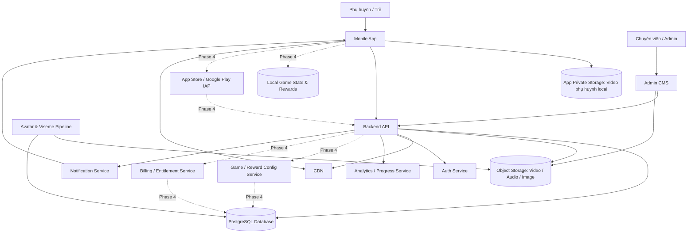
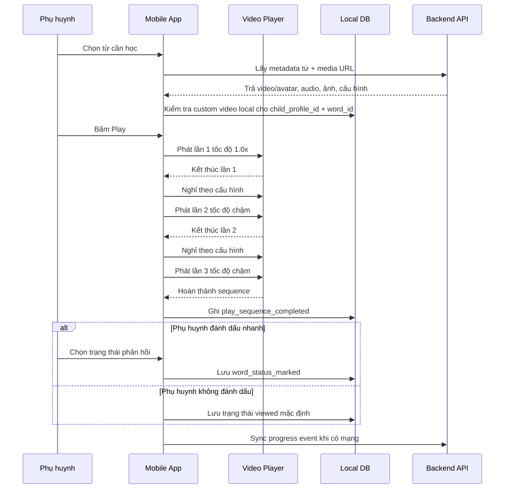
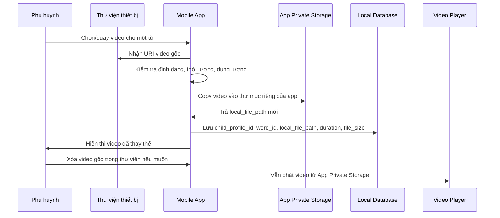
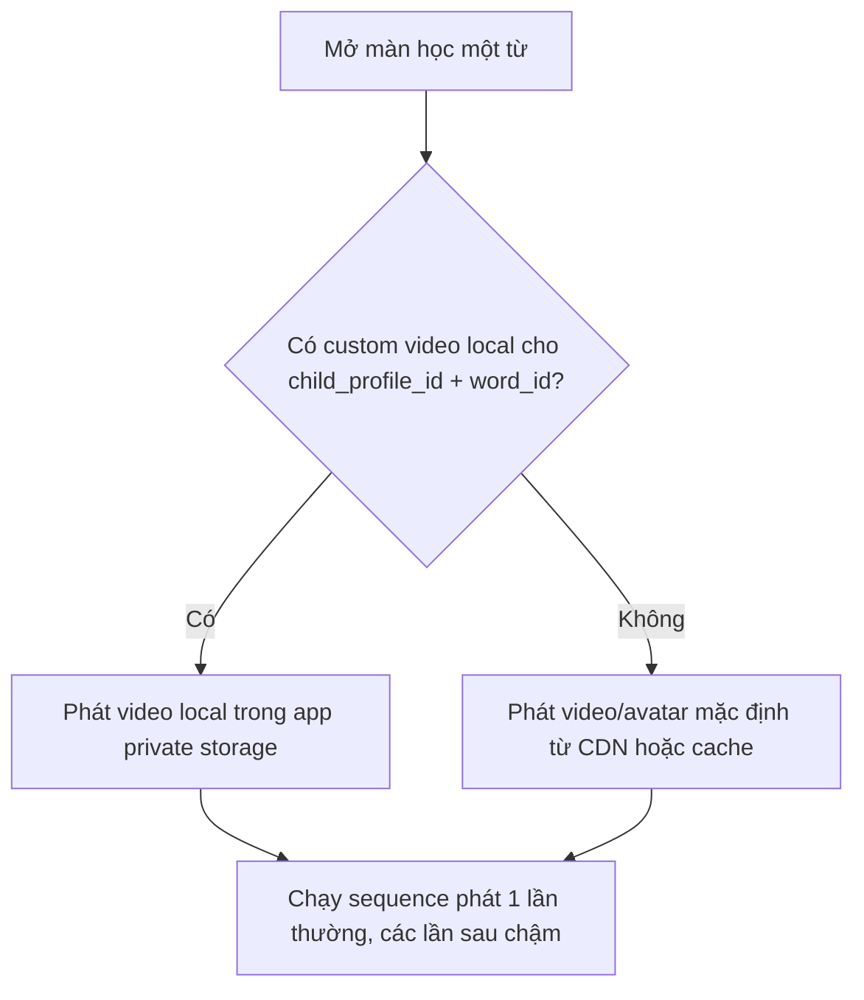
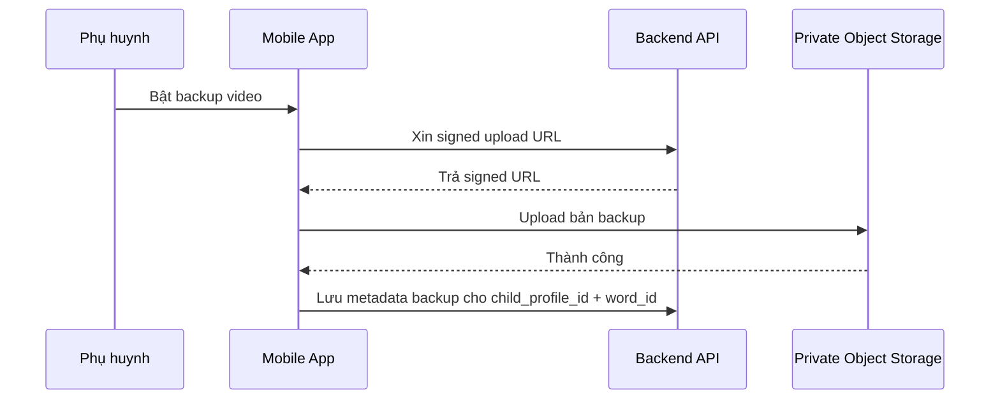
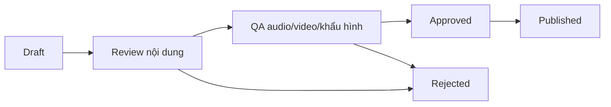
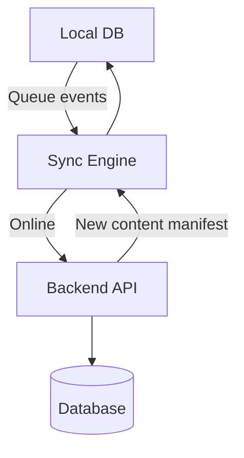

# KidEDU - Tài liệu Technical/System Design

> Tách từ tài liệu nguồn `Tong_quat_he_thong_Kidedu.md` phiên bản 1.7, ngày 2026-06-24.  
> Mục tiêu tách file: giảm độ dài tài liệu, giúp product/design review và dev implementation đọc đúng phần cần thiết.

## Phạm vi file này

File này tập trung vào thiết kế kỹ thuật và triển khai:

- Kiến trúc tổng quan mobile/backend/CMS/media pipeline.
- Công nghệ mobile, video player, local DB, media cache.
- Avatar/viseme pipeline và video phụ huynh local-only.
- Backend API, authorization matrix, data model, CMS.
- Offline/cache, privacy/security, event tracking.
- Non-functional requirements, mapping từ demo sang production.
- Backlog kỹ thuật, repository structure và mobile folder structure.

Các phần layout màn hình, UX copy, sensory-friendly, game/paywall UX và QA UI/UX được chuyển sang file UI/UX riêng.

## 1. Mục tiêu sản phẩm

KidEDU là ứng dụng mobile hỗ trợ trẻ chậm nói tiếng Việt luyện nghe, nhìn khẩu hình và bắt chước phát âm thông qua các bài học từ vựng ngắn, trực quan, có lặp lại theo tốc độ phù hợp.

Sản phẩm tập trung vào các giá trị chính theo giai đoạn: Phase 0/1/2 ưu tiên chứng minh lõi học khẩu hình và trải nghiệm sử dụng ổn định; Phase 3 nâng cấp avatar/viseme và cá nhân hóa; Phase 4 mới mở game và thương mại hóa khi app đã có dữ liệu sử dụng thật.

1. **Khẩu hình rõ ràng**: trẻ nhìn thấy avatar/người mẫu phát âm với khẩu hình miệng rõ, đồng bộ với âm thanh.
2. **Lặp lại có kiểm soát**: mỗi từ được phát nhiều lần, lần đầu tốc độ bình thường, các lần sau chậm hơn để trẻ quan sát và bắt chước.
3. **Nội dung tiếng Việt có cấu trúc**: từ đơn, từ kép, số đếm, từ theo chủ đề, có thể mở rộng theo âm đầu, vần, thanh điệu và mức độ khó.
4. **Cá nhân hóa bởi phụ huynh**: phụ huynh có thể thay video mặc định bằng video tự quay, giúp trẻ tương tác với khuôn mặt quen thuộc.
5. **Trò chơi kích thích tương tác ở Phase 4**: mini-game, sticker và phần thưởng chỉ nên thêm sau khi luồng học khẩu hình đã ổn định, tránh làm trẻ lệch khỏi mục tiêu học chính ở giai đoạn đầu.
6. **Thương mại hóa ở Phase 4**: freemium/trả phí chỉ nên triển khai sau khi app hoạt động ổn định, nội dung đủ tốt, có dữ liệu sử dụng thật và có lượng user nhất định.

> Lưu ý định vị: KidEDU là công cụ hỗ trợ luyện tập tại nhà, không thay thế chẩn đoán hoặc can thiệp chuyên môn của bác sĩ/chuyên viên âm ngữ trị liệu.

---

## 2. Phạm vi chức năng theo phase

Tài liệu dùng một mô hình roadmap thống nhất: **Phase 0 → Phase 5**. Không trộn lẫn nhiều cách gọi như MVP/V1/V2/V4 ở cùng một tầng quyết định. Khi cần nói về MVP, tài liệu phân biệt rõ **Prototype**, **Pilot MVP** và **Production MVP**.

| Phase | Tên giai đoạn | Mục tiêu chính | Không làm trong phase này |
|---:|---|---|---|
| Phase 0 | Prototype | Chứng minh concept học bằng khẩu hình với ít từ nhưng chất lượng cao | Backend/CMS đầy đủ, game, paywall, subscription |
| Phase 1 | Pilot MVP | App mobile dùng được với nhóm phụ huynh test nhỏ | Game, monetization, avatar real-time, therapist/B2B |
| Phase 2 | Production MVP | Bản đủ ổn để public beta/pilot rộng | Game/paywall nếu retention chưa đủ; AI chấm phát âm |
| Phase 3 | Avatar & Personalization | Nâng cấp pipeline avatar/viseme và cá nhân hóa ôn tập | Monetization nếu app chưa có user ổn định |
| Phase 4 | Game + Monetization | Phase 4A thêm game/reward; Phase 4B mới thêm freemium, paywall, IAP/subscription | Không để game/paywall chen vào màn trẻ |
| Phase 5 | Therapist/B2B | Tài khoản chuyên viên, trung tâm, trường học, license | Không triển khai nếu chưa có nhu cầu B2B thật |

### 3.1. Phase 0 - Prototype

Phase 0 dùng để chứng minh: trẻ có thể nhìn video/avatar khẩu hình, nghe phát âm và bắt chước theo một luồng học ngắn.

Trạng thái triển khai hiện tại: repo đã có prototype web tĩnh Phase 0 tại `index.html`, `src/styles.css`, `src/app.js`. Prototype dùng localStorage cho progress/settings/events và IndexedDB để lưu Blob video phụ huynh local-only. Đây là bước chứng minh luồng trước khi chuyển sang mobile app thật.

Playback prototype phát video học khẩu hình với audio bật khi phụ huynh bấm Play/Replay; không render video học ở trạng thái `muted` mặc định.

Parent Mode prototype dùng combo box để đánh dấu từ đã học và custom file picker cho video phụ huynh; Settings hiển thị thời gian nghỉ theo giây, còn giá trị nội bộ vẫn lưu bằng millisecond.

Lưu ý kỹ thuật: repo chưa có 5 asset video khẩu hình thật. Các đường dẫn media mặc định đang là slot local dự kiến; cần bổ sung file video thật để hoàn tất acceptance P00-02.

| Mã | Chức năng | Mô tả |
|---|---|---|
| P00-01 | Bộ từ mẫu nhỏ | 1 chủ đề, 7-10 từ đầu tiên, ưu tiên âm môi/nguyên âm dễ quan sát |
| P00-02 | Video khẩu hình thật | Ít nhất 5 video thật, không dùng video placeholder cho phần demo cốt lõi |
| P00-03 | Màn học chi tiết | Video/avatar lớn, ảnh minh họa, chữ lớn, Play/Replay/Next |
| P00-04 | Phát lặp | Thường → chậm → chậm, cho cấu hình số lần phát ở mức prototype |
| P00-05 | Video phụ huynh thử nghiệm | Thay video cho 1-2 từ mẫu, kiểm chứng luồng copy vào app storage |
| P00-06 | Đánh dấu kết quả đơn giản | Bé nhìn / bé bắt chước / cần ôn; có thể dùng local state/mock data |

### 3.2. Phase 1 - Pilot MVP

Phase 1 là bản mobile có thể test với phụ huynh thật. Trọng tâm là học khẩu hình, media ổn định, video phụ huynh local và tracking cơ bản.

| Mã | Chức năng | Mô tả |
|---|---|---|
| F01 | Danh sách chủ đề | 2-3 chủ đề đầu tiên, đủ test thói quen học |
| F02 | Danh sách từ | 20-30 từ mẫu, có ảnh, trạng thái học cơ bản |
| F03 | Màn học child-first | Child Mode là trang chính; chỉ có video, ảnh/từ, Play/Replay/Next |
| F04 | Hidden Navigation Bar | Thanh điều hướng ẩn, vuốt lên để hiện; vào Parent/Settings cần giữ 1 giây |
| F05 | Phát lặp video | Lần 1 tốc độ thường, lần 2+ tốc độ chậm, cấu hình số lần phát |
| F06 | Video phụ huynh lưu local | App copy video vào app private storage, không upload cloud mặc định |
| F07 | Local DB + progress | Lưu child profile, progress, settings, metadata video local |
| F08 | Backend API cơ bản | Content, progress event, hồ sơ trẻ |
| F09 | CMS đơn giản | Thêm/sửa từ, ảnh, audio, video/avatar; chưa cần workflow phức tạp |
| F10 | Consent cơ bản | Màn thông báo phụ huynh và ghi nhận đồng ý tối thiểu |

### 3.3. Phase 2 - Production MVP

Phase 2 là bản đủ ổn để public beta hoặc pilot rộng. Nội dung nhiều hơn, CMS/QA tốt hơn, privacy và authorization rõ hơn.

| Mã | Chức năng | Mô tả |
|---|---|---|
| F11 | Thư viện nội dung mở rộng | Tối thiểu 5 chủ đề, 50+ từ |
| F12 | Video/avatar QA | Ít nhất 20-30 video/avatar khẩu hình thật đã kiểm tra chất lượng |
| F13 | CMS workflow | Draft → Review → QA → Published |
| F14 | Cache/offline ổn định | Metadata/media/progress hoạt động được khi mất mạng với nội dung đã tải |
| F15 | Progress report | Báo cáo tuần, từ cần ôn, trạng thái học theo hồ sơ trẻ |
| F16 | Privacy baseline | Consent, retention, deletion/export request, audit log cho dữ liệu nhạy cảm |
| F17 | Authorization matrix | Per-endpoint ownership check, role check, therapist delegation nếu có |
| F18 | Monitoring | Crash report, lỗi video, API latency, sync failure |

### 3.4. Phase 3 - Avatar/viseme nâng cao và cá nhân hóa

Phase 3 tập trung vào nâng chất lượng khác biệt cốt lõi: avatar/viseme, cấu trúc tiếng Việt và gợi ý ôn tập cá nhân hóa.

| Mã | Chức năng | Mô tả |
|---|---|---|
| A01 | Avatar 3D pre-render pipeline | Tạo video/avatar đồng nhất theo từng từ |
| A02 | Viseme timeline | Lưu timeline khẩu hình, âm đầu/vần/thanh, QA audio-khẩu hình |
| A03 | Avatar real-time nghiên cứu | Chỉ triển khai nếu pipeline pre-render không đủ mở rộng |
| A04 | Cá nhân hóa ôn tập | Gợi ý từ cần ôn dựa trên tiến trình, tần suất, đánh dấu của phụ huynh |
| A05 | Tùy chọn giọng/vùng miền | Bắc/Nam hoặc giọng chuẩn được kiểm duyệt, không làm nếu chưa đủ nội dung |

### 3.5. Phase 4 - Game và Monetization khi app đã ổn định

Không đưa **trò chơi**, **freemium**, **paywall** hoặc **subscription** vào Phase 0/1/2/3. Giai đoạn đầu cần ưu tiên chứng minh giá trị cốt lõi: trẻ có xem khẩu hình không, phụ huynh có quay lại dùng không, nội dung có giúp luyện tập đều đặn không. Chỉ triển khai Phase 4 khi đã có lượng user nhất định và dữ liệu retention đủ tin cậy.

Phase 4 là umbrella phase, nhưng nên triển khai theo hai bước:

- **Phase 4A - Game & Reward**: thêm Game Hub, 3 mini-game đầu tiên, sticker/reward và game analytics.
- **Phase 4B - Monetization**: chỉ thêm freemium, paywall, IAP/subscription, entitlement và business analytics sau khi Phase 4A không làm giảm thời gian học chính hoặc retention.

Điều kiện khuyến nghị trước khi bật Phase 4:

- App đã chạy ổn định trên iOS/Android, ít lỗi video/playback.
- Luồng học chính đã được phụ huynh dùng lặp lại qua nhiều tuần.
- Có thư viện nội dung đủ tốt, ví dụ tối thiểu 5-10 chủ đề và 100+ từ có media chất lượng.
- Có nhóm user dùng thật, có dữ liệu retention, số phiên học/tuần và phản hồi phụ huynh.
- Phụ huynh hiểu rõ giá trị app trước khi gặp game hoặc paywall.
- Đã có chính sách riêng tư, điều khoản dịch vụ và luồng hỗ trợ người dùng.
- Trước Phase 4B, phải kiểm tra Phase 4A không làm trẻ bỏ qua luồng học khẩu hình hoặc làm giảm thời gian học chính.

| Mã | Chức năng Phase 4 | Mô tả |
|---|---|---|
| G01 | Phase 4A - Game Hub | Màn tập hợp trò chơi, dùng lại từ, ảnh, audio, video/avatar hiện có |
| G02 | Phase 4A - Mini-game kích thích tương tác | Chọn đúng hình, bắt chước khẩu hình, mở rương sticker; game ngắn, ít nhiễu |
| G03 | Phase 4A - Phần thưởng/sticker | Sao, sticker, bộ sưu tập, huy hiệu chủ đề; thưởng tích cực, không tạo cảm giác thua cuộc |
| G04 | Phase 4A - Game analytics | Đo game_started, game_completed, game_answered, reward_earned |
| B01 | Phase 4B - Giới hạn dùng thử freemium | Dùng thử 7-10 từ trong 1 chủ đề miễn phí; nội dung còn lại khóa nhẹ cho phụ huynh |
| B02 | Phase 4B - Subscription/IAP | Mở khóa thư viện hoặc gói nội dung thông qua trả phí; backend xác thực giao dịch và cấp entitlement |
| B03 | Phase 4B - Entitlement/cache quyền truy cập | Lưu trạng thái free/premium, hỗ trợ restore purchase và offline entitlement |
| B04 | Phase 4B - Business analytics | Đo trial, locked content tap, paywall view, purchase funnel và conversion |

### 3.6. Phase 5 - Therapist/B2B

Phase 5 chỉ làm khi có nhu cầu thật từ chuyên viên, phòng khám, trung tâm hoặc trường học.

| Mã | Chức năng | Mô tả |
|---|---|---|
| T01 | Tài khoản chuyên viên | Chuyên viên xem tiến trình khi phụ huynh cấp quyền |
| T02 | Giao bài tập | Chuyên viên chọn từ/chủ đề cho từng trẻ |
| T03 | Ghi chú chuyên viên | Ghi chú/báo cáo theo buổi học, có audit log |
| T04 | Gói trung tâm/trường học | License nhiều hồ sơ trẻ, mã kích hoạt, quản lý nhiều lớp/nhóm |

## 3. Kiến trúc tổng quan

### 4.1. Sơ đồ hệ thống



### 4.2. Các khối chính

| Khối | Vai trò |
|---|---|
| Mobile App | Ứng dụng cho phụ huynh/trẻ học từ, xem avatar khẩu hình, thêm video phụ huynh local, theo dõi tiến trình |
| Backend API | Xử lý dữ liệu người dùng, nội dung, tiến trình, cấu hình học |
| Admin CMS | Công cụ quản trị danh mục, từ vựng, ảnh, âm thanh, video/avatar |
| Object Storage | Lưu ảnh, audio, video/avatar mặc định của hệ thống; video phụ huynh chỉ đưa lên cloud nếu bật backup tùy chọn |
| App Private Storage | Lưu bản copy video phụ huynh ngay trong thiết bị/app để dùng offline, không phụ thuộc thư viện ảnh |
| CDN | Phân phối media nhanh, giảm tải backend |
| Database | Lưu metadata: user, child profile, word, category, lesson, progress, media |
| Avatar & Viseme Pipeline | Tạo hoặc quản lý video/avatar khẩu hình đồng bộ âm thanh |
| Analytics/Progress Service | Tổng hợp lượt học, tiến trình, từ cần ôn |
| Game/Reward Module | Module Phase 4: quản lý cấu hình trò chơi, luật thưởng, sticker/phần thưởng và sự kiện chơi; chưa cần trong Phase 0/1/2/3 |
| Billing/Entitlement Service | Module Phase 4: xác thực giao dịch trả phí, quản lý gói, quyền truy cập nội dung và trạng thái dùng thử; chưa cần trong Phase 0/1/2/3 |
| Notification Service | Nhắc lịch học, nhắc ôn tập |

---

## 4. Công nghệ Mobile App

| Hạng mục | Đề xuất | Lý do chọn |
|---|---|---|
| Framework | React Native + Expo hoặc Flutter | Cả hai đều phù hợp để làm app iOS/Android từ một codebase, giúp giảm thời gian và chi phí so với viết native riêng. Với KidEDU, ưu tiên tốc độ ra MVP, dễ test UI/UX và có hệ sinh thái xử lý video, file local, notification. |
| Framework khuyến nghị cho MVP | React Native + Expo | Demo hiện tại đang theo tư duy React/component nên chuyển sang React Native + Expo nhanh hơn. Expo có sẵn nhiều module cho video, file system, image picker, notification, build app và OTA update. Nếu team đã mạnh Flutter thì Flutter vẫn là lựa chọn tốt. |
| Video player | Expo Video hoặc React Native Video | App phụ thuộc rất nhiều vào phát video khẩu hình, chỉnh tốc độ phát, lắng nghe sự kiện kết thúc video, preload và phát file local. Nếu dùng Expo mới nên ưu tiên Expo Video; không nên bắt đầu mới bằng Expo AV vì đã bị deprecate. |
| Audio player | Expo Audio hoặc module audio tương đương | Cần phát âm thanh rõ, có thể tách audio khỏi video ở các bài nâng cao, kiểm soát tốc độ/âm lượng và tránh nhạc/nút UI lấn âm phát âm. |
| State management | React Query + Zustand/local store hoặc Redux Toolkit | React Query phù hợp cho dữ liệu server như danh mục, từ vựng, tiến trình đồng bộ; Zustand/local store phù hợp cho trạng thái UI nhẹ như từ đang học, lượt phát, setting hiện tại. Redux Toolkit chỉ nên dùng nếu logic app phức tạp hơn. |
| Local database | SQLite trước; WatermelonDB/Realm nếu cần sync/offline phức tạp | MVP cần lưu hồ sơ trẻ, tiến trình, setting và đường dẫn video phụ huynh local. SQLite đủ nhẹ, ổn định, dễ kiểm soát. WatermelonDB/Realm phù hợp hơn khi dữ liệu lớn, cần offline-first và đồng bộ nhiều thiết bị. |
| Cache media | FileSystem cache + metadata local DB | Video/avatar mặc định và video phụ huynh là file nặng, không nên lưu trực tiếp trong database. FileSystem lưu file, database chỉ lưu metadata/path để phát lại, kiểm soát dung lượng và hỗ trợ offline. |
| Auth | Email/OTP/social login hoặc tài khoản phụ huynh tối giản | Giai đoạn đầu nên giảm ma sát đăng ký. Có thể cho dùng thử local trước, sau đó đăng nhập để đồng bộ tiến trình. Không nên yêu cầu trẻ đăng nhập; tài khoản thuộc về phụ huynh. |
| Push notification | Firebase Cloud Messaging / Expo Push Notification | Dùng để nhắc lịch học ngắn, nhắc ôn từ và kéo phụ huynh quay lại app. Không phải lõi MVP tuyệt đối, có thể bật sau khi luồng học ổn định. |
| In-app purchase | Chưa cần trong Phase 0/1/2/3; chuẩn bị cho Phase 4 bằng StoreKit / Google Play Billing / RevenueCat hoặc service tương đương | Monetization đặt ở Phase 4. Từ đầu chỉ cần thiết kế dữ liệu đủ mở rộng để sau này thêm entitlement/paywall mà không phá kiến trúc nội dung. |

#### 5.1.1. Khuyến nghị lựa chọn cho đội phát triển

Nếu bắt đầu ngay từ demo hiện có, nên chọn stack MVP như sau:

```text
React Native + Expo
Expo Video
Expo Audio
Expo FileSystem
Expo ImagePicker
SQLite
React Query + Zustand
Backend API + PostgreSQL
Object Storage/CDN cho video mặc định
App Private Storage cho video phụ huynh
```

Lý do: stack này đi thẳng vào các yêu cầu quan trọng nhất của KidEDU: phát video khẩu hình mượt, phát lặp theo tốc độ thường/chậm, copy video phụ huynh vào bộ nhớ riêng của app, lưu metadata local, hỗ trợ offline và triển khai nhanh trên cả iOS/Android.

#### 5.1.2. Quy tắc chọn công nghệ theo giai đoạn

| Giai đoạn | Cách chọn công nghệ |
|---|---|
| MVP | Chọn công nghệ nhanh, ít custom native, dễ test trên thiết bị thật, ưu tiên video/local file/offline cơ bản |
| Phase 1 | Bổ sung đồng bộ tiến trình, báo cáo, lộ trình học, tối ưu cache và preload video |
| Phase 2 | Cân nhắc module native/engine riêng nếu làm avatar 3D real-time, ghi âm trẻ hoặc phân tích âm thanh |
| Phase 4 | Thêm game, reward, IAP/subscription, entitlement và business analytics khi app đã có user thật |

#### 5.1.3. Lưu ý kỹ thuật quan trọng

- Không lưu video phụ huynh trong database; chỉ lưu file trong app private storage và lưu đường dẫn/metadata trong local DB.
- Không phát video mặc định trực tiếp từ backend; backend chỉ trả metadata/link, media nên đi qua CDN/cache.
- Với Expo, nên dùng `expo-video` cho phát video mới; `expo-av` không nên là lựa chọn chính cho dự án mới.
- Với màn học, video player phải hỗ trợ: phát local file, phát remote URL, chỉnh tốc độ, nhận sự kiện kết thúc, xử lý lỗi tải, preload và cleanup khi rời màn.
- Auth nên tối giản ở MVP để phụ huynh vào học nhanh; các phần đăng nhập, đồng bộ nhiều thiết bị và trả phí có thể nâng sau.

## 5. Luồng học kỹ thuật



| Lần phát | Tốc độ | Mục đích |
|---|---:|---|
| Lần 1 | 1.0x | Trẻ nghe và nhìn cách phát âm tự nhiên |
| Lần 2 | 0.5x - 0.7x | Trẻ quan sát khẩu hình chậm |
| Lần 3 | 0.5x - 0.7x | Trẻ bắt chước theo |

Cấu hình nên cho phép:

- Số lần phát: 1-5.
- Tốc độ chậm: 0.5x, 0.6x, 0.75x.
- Thời gian nghỉ giữa các lần: 0.5s - 3s.
- Cho phép bật/tắt tự động chuyển sang từ tiếp theo.

## 6. Metadata nội dung tiếng Việt

Ví dụ với từ `Ba`:

```json
{
  "id": "ba",
  "text": "Ba",
  "normalized_text": "ba",
  "category_id": "gia-dinh",
  "difficulty_level": 1,
  "syllables": [
    {
      "text": "ba",
      "initial": "b",
      "rhyme": "a",
      "tone": "ngang",
      "phoneme_hint": "/b/ + /a/",
      "mouth_hint": "Môi khép rồi bật ra, sau đó miệng mở rộng."
    }
  ],
  "image_asset_id": "img_ba_001",
  "audio_asset_id": "aud_ba_001",
  "default_avatar_video_id": "vid_ba_avatar_001"
}
```

Khẩu hình chỉ hỗ trợ một phần. Tiếng Việt còn có thanh điệu, cần được thể hiện bằng âm thanh, nhịp, cao độ và hướng dẫn nghe.

| Thanh | Ví dụ | Cần hỗ trợ bằng gì? |
|---|---|---|
| Ngang | ba | Âm đều, tự nhiên |
| Huyền | bà | Âm đi xuống nhẹ |
| Sắc | bá | Âm đi lên, ngắn hơn |
| Hỏi | bả | Âm lượn xuống-lên |
| Ngã | bã | Âm lượn/ngắt tùy vùng miền |
| Nặng | bạ | Âm thấp, ngắn, dứt |

Vì vậy, avatar khẩu hình nên đi kèm audio tiếng Việt chuẩn, có thể tùy chọn giọng Bắc/Nam ở các phiên bản sau.

---

## 7. Thiết kế Avatar & Viseme

### 8.1. Khái niệm

- **Phoneme**: đơn vị âm thanh nghe được.
- **Viseme**: hình dạng miệng nhìn thấy khi phát âm.
- **Visual cue**: mọi gợi ý bằng hình ảnh giúp trẻ hiểu và bắt chước, bao gồm khẩu hình, mũi tên, hình minh họa, chữ lớn.

### 8.2. Chiến lược triển khai theo giai đoạn

| Giai đoạn | Cách làm | Ưu điểm | Hạn chế |
|---|---|---|---|
| Phase 0/1 | Video dựng sẵn cho từng từ | Chất lượng kiểm soát tốt, dễ demo/pilot | Tốn công tạo video cho nhiều từ |
| Phase 2 | Avatar 3D pre-render theo từng từ | Đồng nhất hình ảnh, dễ cache/CDN | Cần pipeline dựng avatar |
| Phase 3 | Avatar real-time theo phoneme/viseme nếu cần | Linh hoạt, sinh từ mới nhanh | Kỹ thuật khó, cần đồng bộ chính xác |
| Phase 3+ | Cá nhân hóa giọng/avatar | Trải nghiệm cao | Chi phí và độ phức tạp lớn |

### 8.3. Pipeline đề xuất cho Phase 0/1/2

```mermaid
flowchart LR
    WORD[Từ tiếng Việt] --> SCRIPT[Chuẩn hóa text + syllable]
    SCRIPT --> AUDIO[Thu âm / TTS kiểm duyệt]
    AUDIO --> ALIGN[Phân đoạn thời gian âm tiết]
    ALIGN --> VISEME[Mapping phoneme/viseme]
    VISEME --> RENDER[Render avatar/video]
    RENDER --> QA[Kiểm tra bởi người phụ trách nội dung]
    QA --> STORAGE[Lưu video/audio/image]
    STORAGE --> APP[Mobile App sử dụng]
```



### 8.4. Dữ liệu viseme mẫu

```json
{
  "word_id": "ba",
  "duration_ms": 900,
  "viseme_timeline": [
    {
      "start_ms": 0,
      "end_ms": 180,
      "viseme": "closed_lips",
      "description": "Môi khép cho âm /b/."
    },
    {
      "start_ms": 180,
      "end_ms": 300,
      "viseme": "lip_release",
      "description": "Bật môi ra."
    },
    {
      "start_ms": 300,
      "end_ms": 900,
      "viseme": "open_mouth_a",
      "description": "Miệng mở rộng cho âm /a/."
    }
  ]
}
```

### 8.5. Yêu cầu chất lượng avatar/video

| Tiêu chí | Yêu cầu |
|---|---|
| Khung hình | Cận mặt, ưu tiên rõ miệng, không nhiều chi tiết gây nhiễu |
| Ánh sáng | Sáng đều, không bóng mạnh vùng miệng |
| Tốc độ | Có bản phát tự nhiên và bản chậm không méo âm quá mức |
| Đồng bộ | Âm thanh và khẩu hình lệch không quá mức chấp nhận được |
| Biểu cảm | Thân thiện, không quá hoạt hình gây mất tập trung |
| Thời lượng | Mỗi từ ngắn, thường 1-3 giây/lần phát |
| Kiểm duyệt | Nội dung phải được kiểm tra trước khi public |

---

## 8. Video phụ huynh lưu local trong app

### 9.1. Nguyên tắc thiết kế

Với MVP, video phụ huynh tự chọn/quay **không upload lên cloud mặc định**. App phải copy video vào vùng lưu trữ riêng của ứng dụng, sau đó lưu metadata và đường dẫn file local vào local database.

Nguyên tắc bắt buộc:

- Không chỉ lưu URI/path của video trong thư viện ảnh.
- Phải copy file vào **app private storage** hoặc thư mục document/internal storage do app quản lý.
- Khi phụ huynh xóa video gốc trong thư viện điện thoại, video đã copy trong app vẫn còn và vẫn phát được.
- Khi gỡ app, clear app data hoặc đổi máy, video local có thể mất nếu chưa có tính năng backup/export.
- Không lưu file video trực tiếp vào database; database chỉ lưu metadata và local file path.

### 9.2. Luồng thêm video phụ huynh



### 9.3. Luồng chọn nguồn video khi học



Pseudo-logic:

```ts
const videoSource = customVideo?.localFilePath ?? word.defaultAvatarVideoUrl;
```

### 9.4. Vị trí lưu file đề xuất

Không lưu vào cache tạm. Nên lưu trong vùng dữ liệu lâu dài của app.

Ví dụ cấu trúc thư mục:

```text
app-private-storage/
  custom-videos/
    {childProfileId}/
      {wordId}/
        parent-video.mp4
        thumbnail.jpg
```

Ví dụ metadata local:

```json
{
  "id": "local-custom-video-001",
  "child_profile_id": "child_123",
  "word_id": "me",
  "local_file_path": "file:///app-private-storage/custom-videos/child_123/me/parent-video.mp4",
  "thumbnail_path": "file:///app-private-storage/custom-videos/child_123/me/thumbnail.jpg",
  "duration_ms": 5200,
  "file_size_bytes": 8430000,
  "mime_type": "video/mp4",
  "created_at": "2026-06-24T09:00:00+07:00",
  "is_active": true,
  "sync_status": "local_only"
}
```

### 9.5. Ràng buộc video đề xuất

| Hạng mục | Giá trị đề xuất |
|---|---|
| Định dạng | MP4 ưu tiên; MOV có thể hỗ trợ rồi convert nếu cần |
| Thời lượng | 1-10 giây/từ |
| Dung lượng tối đa | 20-50 MB/video trong MVP |
| Độ phân giải | 480p hoặc 720p là đủ cho khẩu hình |
| Vị trí lưu | App private storage, không phải gallery, không phải cache |
| Database | Chỉ lưu metadata + local_file_path |
| Xóa video | Phụ huynh có thể xóa video thay thế trong app |
| Mạng | Không cần mạng để phát video local |

### 9.6. Hành vi khi xóa file gốc hoặc xóa app

| Tình huống | Video trong app còn không? | Ghi chú |
|---|---:|---|
| Phụ huynh xóa video gốc trong thư viện ảnh | Có | Vì app đã copy sang vùng lưu trữ riêng |
| Tắt/mở lại app | Có | Metadata và file local vẫn tồn tại |
| Mất mạng | Có | Phát từ local file |
| Xóa cache app | Có thể còn | Phụ thuộc nền tảng; không được lưu video trong cache |
| Clear app data | Mất | Dữ liệu riêng của app bị xóa |
| Gỡ app | Thường mất | Cần cảnh báo người dùng trước khi gỡ app |
| Đổi điện thoại | Không tự có | Cần export/import hoặc cloud backup tùy chọn |

### 9.7. Backup cloud tùy chọn ở giai đoạn sau

Sau MVP có thể bổ sung tùy chọn:

```text
Bật sao lưu video phụ huynh lên cloud
```

Khi chưa bật backup, video không rời thiết bị. Khi bật backup, hệ thống mới cần object storage private, signed URL, mã hóa và chính sách xóa dữ liệu rõ ràng.

Luồng backup tùy chọn:



### 9.8. Lưu ý bảo mật trẻ em

- Video phụ huynh có thể chứa mặt trẻ/người thân, cần xem là dữ liệu nhạy cảm.
- Mặc định local-only, không public, không upload server.
- Không dùng video phụ huynh để huấn luyện mô hình nếu chưa có đồng ý rõ ràng.
- Nếu có cloud backup, cần quyền xóa dữ liệu và chính sách xuất dữ liệu.
- Tối thiểu hóa dữ liệu cá nhân của trẻ.

---

## 9. Backend API

### 12.1. Công nghệ đề xuất

| Thành phần | Đề xuất |
|---|---|
| API framework | NestJS, FastAPI hoặc Django REST Framework |
| Database | PostgreSQL |
| Cache | Redis |
| Object storage | AWS S3, Cloudflare R2, Google Cloud Storage hoặc Supabase Storage |
| CDN | CloudFront, Cloudflare CDN hoặc tương đương |
| Auth | Firebase Auth, Auth0, Supabase Auth hoặc custom JWT |
| Queue | BullMQ, Celery, Sidekiq hoặc managed queue |
| Monitoring | Sentry, OpenTelemetry, Grafana/Prometheus |

### 12.2. API nhóm nội dung

| Method | Endpoint | Mô tả |
|---|---|---|
| GET | `/v1/categories` | Lấy danh sách chủ đề |
| GET | `/v1/categories/{category_id}/words` | Lấy danh sách từ theo chủ đề |
| GET | `/v1/words/{word_id}` | Lấy chi tiết một từ |
| GET | `/v1/lessons/recommended` | Lấy bài học gợi ý cho trẻ |
| GET | `/v1/media/{media_id}` | Lấy metadata media |

### 12.3. API nhóm học tập

| Method | Endpoint | Mô tả |
|---|---|---|
| POST | `/v1/progress/events` | Ghi nhận sự kiện học |
| GET | `/v1/children/{child_profile_id}/progress` | Lấy tiến trình của trẻ |
| POST | `/v1/children/{child_profile_id}/word-status` | Đánh dấu mức độ học của một từ |
| GET | `/v1/children/{child_profile_id}/review-queue` | Lấy danh sách từ cần ôn |

### 12.4. API nhóm video phụ huynh

Trong MVP local-only, video phụ huynh **không bắt buộc cần API upload** vì file được lưu ngay trong app private storage. Backend chỉ cần biết tiến trình học; metadata video thay thế có thể nằm hoàn toàn ở local database.

API dưới đây chỉ cần khi bật tính năng backup/sync video lên cloud ở giai đoạn sau:

| Method | Endpoint | Mô tả |
|---|---|---|
| POST | `/v1/uploads/presign` | Tạo signed URL để upload backup video lên private object storage |
| POST | `/v1/custom-videos/backups` | Lưu metadata bản backup video phụ huynh |
| GET | `/v1/custom-videos/backups?child_profile_id=&word_id=` | Lấy metadata backup video cho một từ |
| DELETE | `/v1/custom-videos/backups/{custom_video_backup_id}` | Xóa bản backup video phụ huynh |


### 12.5. API nhóm trò chơi và phần thưởng (Phase 4)

| Method | Endpoint | Mục đích |
|---|---|---|
| GET | `/v1/games` | Phase 4: lấy danh sách game đang bật |
| GET | `/v1/games/{game_id}` | Phase 4: lấy cấu hình chi tiết một game |
| POST | `/v1/game-sessions` | Phase 4: ghi nhận một phiên chơi |
| POST | `/v1/game-events` | Phase 4: ghi event trong quá trình chơi |
| GET | `/v1/rewards` | Lấy danh sách sticker/phần thưởng |
| GET | `/v1/children/{child_profile_id}/rewards` | Lấy bộ sưu tập phần thưởng của trẻ |
| POST | `/v1/children/{child_profile_id}/rewards` | Ghi nhận phần thưởng mới |

Lưu ý: nhóm API này không cần triển khai trong Phase 0/1/2/3. Ở Phase 4 đầu tiên, game có thể chạy chủ yếu ở client và chỉ đồng bộ event/progress lên backend khi có mạng.

### 12.6. API nhóm billing và quyền truy cập (Phase 4)

Nhóm API này **không cần triển khai trong Phase 0/1/2/3**. Chỉ thêm ở Phase 4 khi bắt đầu freemium/trả phí.

| Method | Endpoint | Mô tả |
|---|---|---|
| GET | `/v1/entitlements/me` | Lấy trạng thái quyền truy cập hiện tại của user |
| GET | `/v1/plans` | Lấy danh sách gói trả phí đang bật |
| POST | `/v1/purchases/verify` | Xác thực receipt/giao dịch từ App Store hoặc Google Play |
| POST | `/v1/purchases/restore` | Khôi phục giao dịch đã mua |
| GET | `/v1/content-access?child_profile_id=` | Lấy manifest nội dung kèm trạng thái khóa/mở |
| POST | `/v1/business-events` | Ghi nhận event paywall, locked content, purchase funnel |

### 12.7. API nhóm tài khoản

| Method | Endpoint | Mô tả |
|---|---|---|
| POST | `/v1/auth/login` | Đăng nhập |
| POST | `/v1/auth/logout` | Đăng xuất |
| GET | `/v1/me` | Thông tin phụ huynh |
| POST | `/v1/children` | Tạo hồ sơ trẻ |
| GET | `/v1/children` | Danh sách hồ sơ trẻ |
| PATCH | `/v1/children/{child_profile_id}` | Cập nhật hồ sơ trẻ |
| DELETE | `/v1/children/{child_profile_id}` | Xóa hồ sơ trẻ theo quy trình deletion |


### 12.8. API Authorization Matrix

Hệ thống dùng **RBAC + ownership check**:

- **RBAC**: kiểm tra role của user, ví dụ `parent`, `therapist`, `content_editor`, `admin`, `business_admin`.
- **Ownership check**: kiểm tra user hiện tại có quyền với `child_profile_id` hay không.
- Không endpoint nào được dựa vào UI để bảo vệ dữ liệu. Mọi kiểm tra quyền phải nằm ở backend.

| Endpoint | Role được phép | Rule bắt buộc |
|---|---|---|
| `GET /v1/categories` | Anonymous/Auth user | Chỉ trả nội dung `published` |
| `GET /v1/categories/{category_id}/words` | Anonymous/Auth user | Chỉ trả nội dung `published`; Phase 4 mới thêm access control free/premium |
| `GET /v1/words/{word_id}` | Anonymous/Auth user | Chỉ trả media public/default; không trả private backup nếu không có quyền |
| `POST /v1/progress/events` | Parent | `child_profiles.user_id = auth.user_id` với mọi `child_profile_id` trong payload |
| `GET /v1/children/{child_profile_id}/progress` | Parent, Therapist được cấp quyền | Parent sở hữu hồ sơ; therapist có active grant với scope `read_progress` |
| `POST /v1/children/{child_profile_id}/word-status` | Parent, Therapist được cấp quyền nếu cho phép | Parent sở hữu hồ sơ; therapist có scope `write_progress` |
| `GET /v1/children/{child_profile_id}/review-queue` | Parent, Therapist được cấp quyền | Parent sở hữu hồ sơ; therapist có scope `read_progress` |
| `POST /v1/uploads/presign` | Parent | Chỉ tạo signed URL cho child profile thuộc parent; chỉ dùng khi bật cloud backup |
| `DELETE /v1/custom-videos/backups/{custom_video_backup_id}` | Parent | Chỉ xóa backup thuộc child profile của parent |
| CMS content endpoints | Content Editor/Admin | Không được xem dữ liệu trẻ |
| User/role management | Admin | Ghi audit log bắt buộc |
| Billing endpoints Phase 4 | Parent | Chỉ thao tác entitlement của chính user |

Quy tắc therapist delegation:

```sql
CREATE TABLE therapist_access_grants (
  id UUID PRIMARY KEY,
  therapist_user_id UUID REFERENCES users(id),
  parent_user_id UUID REFERENCES users(id),
  child_profile_id UUID REFERENCES child_profiles(id),
  scopes TEXT[], -- read_progress, write_notes, assign_lessons, write_progress
  status VARCHAR(50), -- active, revoked, expired
  granted_at TIMESTAMP,
  revoked_at TIMESTAMP,
  expires_at TIMESTAMP,
  created_at TIMESTAMP,
  updated_at TIMESTAMP
);
```

Therapist không tự thấy dữ liệu trẻ. Therapist chỉ thấy `child_profile` khi phụ huynh cấp quyền rõ ràng. Mọi lượt xem/cập nhật của therapist phải ghi vào `audit_logs`.

---

## 10. Thiết kế dữ liệu

### 13.1. Quy ước đặt tên dữ liệu

Để tránh nhầm lẫn khi triển khai, tài liệu dùng quy ước thống nhất:

| Loại | Chuẩn | Ví dụ |
|---|---|---|
| Database table | plural snake_case | `users`, `child_profiles`, `learning_events` |
| Database column | snake_case | `child_profile_id`, `created_at` |
| API path | resource REST rõ nghĩa | `/v1/children/{child_profile_id}/progress` |
| TypeScript type/model | PascalCase | `ChildProfile`, `LearningEvent` |
| Event field | snake_case | `event_name`, `event_version` |

Quyết định quan trọng: dùng **`child_profile_id` ở mọi nơi**, không dùng `child_id`. Lý do: entity thực tế trong app là hồ sơ trẻ, một phụ huynh có thể có nhiều hồ sơ trẻ và sau này chuyên viên/trường học cũng làm việc theo hồ sơ.

### 13.2. ERD tổng quan

> Ghi chú: các bảng `games`, `game_sessions`, `rewards`, `child_rewards`, `content_packages`, `subscription_plans`, `purchase_transactions`, `user_entitlements` là nhóm Phase 4. Phase 0/1/2/3 có thể chưa cần tạo, hoặc tạo ở trạng thái dự phòng nhưng chưa dùng trong app.

```mermaid
erDiagram
    users ||--o{ child_profiles : owns
    users ||--o{ purchase_transactions : makes
    users ||--o{ user_entitlements : has
    users ||--o{ parental_consents : grants
    child_profiles ||--o{ learning_progress : has
    child_profiles ||--o{ learning_events : records
    child_profiles ||--o{ custom_video_backups : optionally_syncs
    child_profiles ||--o{ parental_consents : requires
    categories ||--o{ words : contains
    content_packages ||--o{ categories : unlocks
    content_packages ||--o{ words : unlocks
    words ||--o{ word_media : has
    words ||--o{ learning_progress : tracked_by
    words ||--o{ learning_events : appears_in
    words ||--o{ custom_video_backups : optionally_replaced_by
    media_assets ||--o{ word_media : linked_to
    lessons ||--o{ lesson_words : contains
    subscription_plans ||--o{ user_entitlements : grants
    purchase_transactions ||--o{ user_entitlements : results_in
    words ||--o{ lesson_words : included_in

    users {
        uuid id
        string email
        string phone
        string display_name
        datetime created_at
    }

    child_profiles {
        uuid id
        uuid user_id
        string nickname
        int birth_year
        json settings
        datetime created_at
    }

    categories {
        uuid id
        string name
        string slug
        string icon
        string access_level
        int trial_word_limit
        int sort_order
        bool is_active
    }

    words {
        uuid id
        uuid category_id
        uuid content_package_id
        string text
        string normalized_text
        string access_level
        int trial_order
        int difficulty_level
        json linguistic_metadata
        bool is_active
    }

    media_assets {
        uuid id
        string type
        string url
        string storage_key
        string mime_type
        int duration_ms
        json metadata
    }

    word_media {
        uuid id
        uuid word_id
        uuid media_asset_id
        string role
        bool is_default
    }

    custom_video_backups {
        uuid id
        uuid child_profile_id
        uuid word_id
        uuid media_asset_id
        string sync_status
        datetime created_at
    }

    learning_progress {
        uuid id
        uuid child_profile_id
        uuid word_id
        int view_count
        int practice_count
        string latest_status
        datetime last_practiced_at
    }

    learning_events {
        uuid id
        uuid child_profile_id
        uuid word_id
        string event_name
        int event_version
        json payload
        datetime created_at
    }

    lessons {
        uuid id
        string title
        string description
        int difficulty_level
        bool is_active
    }

    lesson_words {
        uuid lesson_id
        uuid word_id
        int sort_order
    }

    parental_consents {
        uuid id
        uuid parent_user_id
        uuid child_profile_id
        string consent_type
        string status
        string consent_version
        datetime granted_at
        datetime revoked_at
    }

    content_packages {
        uuid id
        string code
        string name
        string access_level
        json unlock_scope
        bool is_active
    }

    subscription_plans {
        uuid id
        string code
        string name
        string billing_period
        string store_product_id
        json benefits
        bool is_active
    }

    purchase_transactions {
        uuid id
        uuid user_id
        string store
        string product_id
        string transaction_id
        string status
        datetime purchased_at
        datetime expires_at
    }

    user_entitlements {
        uuid id
        uuid user_id
        uuid subscription_plan_id
        uuid purchase_transaction_id
        string access_scope
        string status
        datetime starts_at
        datetime expires_at
    }

    games ||--o{ game_sessions : played_as
    games ||--o{ game_levels : has
    child_profiles ||--o{ game_sessions : plays
    child_profiles ||--o{ child_rewards : earns
    rewards ||--o{ child_rewards : granted_as

    games {
        uuid id
        string code
        string name
        string game_type
        json default_config
        bool is_active
    }

    game_levels {
        uuid id
        uuid game_id
        int level_order
        json config
    }

    game_sessions {
        uuid id
        uuid child_profile_id
        uuid game_id
        uuid category_id
        int correct_count
        int retry_count
        bool reward_earned
    }

    rewards {
        uuid id
        string code
        string name
        string reward_type
        string image_url
    }

    child_rewards {
        uuid id
        uuid child_profile_id
        uuid reward_id
        uuid game_session_id
        datetime earned_at
    }
```



### 13.3. Bảng `words`

| Field | Type | Mô tả |
|---|---|---|
| id | UUID | ID từ |
| category_id | UUID | Chủ đề |
| text | string | Từ hiển thị, ví dụ “Mẹ” |
| normalized_text | string | Dạng chuẩn hóa, ví dụ “me” |
| content_package_id | UUID nullable | Gói nội dung nếu từ thuộc package Phase 4; MVP có thể để trống |
| access_level | enum | public/free/premium; premium chỉ dùng từ Phase 4 |
| trial_order | int nullable | Thứ tự trong bộ 7-10 từ dùng thử khi bật Phase 4 |
| difficulty_level | int | Độ khó 1-5 |
| linguistic_metadata | JSONB | Âm đầu, vần, thanh, hướng dẫn khẩu hình |
| is_active | boolean | Có hiển thị hay không |
| created_at | datetime | Ngày tạo |
| updated_at | datetime | Ngày cập nhật |

### 13.4. Bảng `media_assets`

| Field | Type | Mô tả |
|---|---|---|
| id | UUID | ID media |
| type | enum | image, audio, video, avatar_video |
| url | string | CDN URL |
| storage_key | string | Object storage key |
| mime_type | string | image/png, video/mp4... |
| duration_ms | int | Thời lượng nếu là audio/video |
| width | int | Chiều rộng nếu là ảnh/video |
| height | int | Chiều cao nếu là ảnh/video |
| metadata | JSONB | Viseme timeline, voice, version... |


### 13.5. Bảng `learning_progress`

| Field | Type | Mô tả |
|---|---|---|
| id | UUID | ID tiến trình |
| child_profile_id | UUID | Hồ sơ trẻ |
| word_id | UUID | Từ được học |
| view_count | int | Số lần mở màn học |
| practice_count | int | Số lần bấm phát |
| latest_status | enum | viewed, imitated, partial, clear, review_needed |
| last_practiced_at | datetime | Lần học gần nhất |
| parent_note | text | Ghi chú phụ huynh nếu có |
| created_at | datetime | Ngày tạo |
| updated_at | datetime | Ngày cập nhật |


### 13.6. Bảng `learning_events`

Nên lưu event dạng append-only để phân tích sau. Tên event dùng canonical vocabulary ở mục 17.

| Field | Type | Mô tả |
|---|---|---|
| id | UUID | ID event |
| event_id | string nullable | ID event từ client để chống gửi trùng |
| child_profile_id | UUID | Hồ sơ trẻ |
| word_id | UUID nullable | Từ liên quan nếu có |
| lesson_id | UUID nullable | Lesson liên quan nếu có |
| event_name | enum | Phải thuộc canonical vocabulary ở mục 17.1. Nhóm Phase 0/1/2/3 gồm `word_opened`, `play_sequence_started`, `play_sequence_completed`, `custom_video_saved_local`, `custom_video_deleted_local`, `word_status_marked`, `lesson_started`, `lesson_completed`, `review_queue_opened`; nhóm Phase 4A/4B gồm game/reward/paywall/purchase/entitlement events như `game_answered`, `reward_earned`, `purchase_succeeded`, `entitlement_restored` |
| event_version | int | Version schema event, bắt đầu từ 1 |
| session_id | string | ID phiên học trên client |
| source | enum | mobile, cms, backend |
| payload | JSONB | repeat_count, speeds, used_custom_video, status... |
| client_timestamp | datetime | Thời điểm ở thiết bị |
| server_timestamp | datetime | Thời điểm backend nhận |
| created_at | datetime | Thời điểm ghi DB |

### 13.7. Local DB bảng `custom_videos`

Bảng này nằm trong local database của mobile app. Đây là bảng chính để quản lý video phụ huynh trong MVP local-only.

| Field | Type | Mô tả |
|---|---|---|
| id | string/UUID | ID local của video thay thế |
| child_profile_id | string/UUID | Hồ sơ trẻ trên thiết bị |
| word_id | string/UUID | Từ được thay video |
| local_file_path | string | Đường dẫn file trong app private storage |
| thumbnail_path | string | Đường dẫn thumbnail nếu có |
| duration_ms | int | Thời lượng video |
| file_size_bytes | int | Dung lượng file |
| mime_type | string | video/mp4, video/quicktime... |
| is_active | boolean | Video đang được dùng hay không |
| sync_status | enum | local_only, backup_pending, backed_up, backup_failed |
| created_at | datetime | Ngày tạo |
| updated_at | datetime | Ngày cập nhật |

Quy tắc dữ liệu:

- `local_file_path` phải trỏ tới file đã copy trong app private storage.
- Không lưu URI gốc từ thư viện ảnh làm nguồn phát chính.
- Một `child_profile_id + word_id` chỉ nên có một video active tại một thời điểm.
- Khi phụ huynh xóa video trong app, xóa cả record local DB và file vật lý.

---


### 13.8. Bảng `games` (Phase 4)

```sql
CREATE TABLE games (
  id UUID PRIMARY KEY,
  code VARCHAR(50) UNIQUE NOT NULL,
  name VARCHAR(255) NOT NULL,
  description TEXT,
  game_type VARCHAR(50), -- choose_image, imitate_mouth, reward_chest, drag_drop
  min_age_months INTEGER,
  max_age_months INTEGER,
  default_config JSONB,
  is_active BOOLEAN DEFAULT TRUE,
  created_at TIMESTAMP,
  updated_at TIMESTAMP
);
```

### 13.9. Bảng `game_sessions` (Phase 4)

```sql
CREATE TABLE game_sessions (
  id UUID PRIMARY KEY,
  child_profile_id UUID REFERENCES child_profiles(id),
  game_id UUID REFERENCES games(id),
  category_id UUID REFERENCES categories(id),
  target_word_ids UUID[],
  started_at TIMESTAMP,
  completed_at TIMESTAMP,
  correct_count INTEGER DEFAULT 0,
  retry_count INTEGER DEFAULT 0,
  reward_earned BOOLEAN DEFAULT FALSE,
  metadata JSONB
);
```

### 13.10. Bảng `rewards` và `child_rewards` (Phase 4)

```sql
CREATE TABLE rewards (
  id UUID PRIMARY KEY,
  code VARCHAR(50) UNIQUE NOT NULL,
  name VARCHAR(255) NOT NULL,
  reward_type VARCHAR(50), -- star, sticker, badge
  image_url TEXT,
  unlock_rule JSONB,
  is_active BOOLEAN DEFAULT TRUE,
  created_at TIMESTAMP,
  updated_at TIMESTAMP
);

CREATE TABLE child_rewards (
  id UUID PRIMARY KEY,
  child_profile_id UUID REFERENCES child_profiles(id),
  reward_id UUID REFERENCES rewards(id),
  game_session_id UUID REFERENCES game_sessions(id),
  earned_at TIMESTAMP,
  metadata JSONB
);
```


### 13.11. Bảng `content_packages` (Phase 4)

Dùng để gom nội dung thành gói free/premium hoặc gói theo chủ đề khi bật monetization ở Phase 4. Phase 0/1/2/3 có thể chưa cần bảng này.

```sql
CREATE TABLE content_packages (
  id UUID PRIMARY KEY,
  code VARCHAR(50) UNIQUE NOT NULL,
  name VARCHAR(255) NOT NULL,
  description TEXT,
  access_level VARCHAR(50) NOT NULL, -- free, premium
  unlock_scope JSONB, -- all_content, category_ids, word_ids, game_ids
  is_active BOOLEAN DEFAULT TRUE,
  created_at TIMESTAMP,
  updated_at TIMESTAMP
);
```

### 13.12. Bảng `subscription_plans` (Phase 4)

```sql
CREATE TABLE subscription_plans (
  id UUID PRIMARY KEY,
  code VARCHAR(50) UNIQUE NOT NULL,
  name VARCHAR(255) NOT NULL,
  billing_period VARCHAR(50), -- monthly, yearly, lifetime
  store_product_id_ios VARCHAR(255),
  store_product_id_android VARCHAR(255),
  benefits JSONB,
  is_active BOOLEAN DEFAULT TRUE,
  created_at TIMESTAMP,
  updated_at TIMESTAMP
);
```

### 13.13. Bảng `purchase_transactions` (Phase 4)

```sql
CREATE TABLE purchase_transactions (
  id UUID PRIMARY KEY,
  user_id UUID REFERENCES users(id),
  store VARCHAR(50), -- ios, android
  product_id VARCHAR(255),
  transaction_id VARCHAR(255),
  original_transaction_id VARCHAR(255),
  status VARCHAR(50), -- pending, verified, failed, refunded, expired
  purchased_at TIMESTAMP,
  expires_at TIMESTAMP,
  raw_payload JSONB,
  created_at TIMESTAMP,
  updated_at TIMESTAMP
);
```

### 13.14. Bảng `user_entitlements` (Phase 4)

```sql
CREATE TABLE user_entitlements (
  id UUID PRIMARY KEY,
  user_id UUID REFERENCES users(id),
  subscription_plan_id UUID REFERENCES subscription_plans(id),
  purchase_transaction_id UUID REFERENCES purchase_transactions(id),
  access_scope VARCHAR(50), -- free_trial, all_content, package_specific
  status VARCHAR(50), -- active, expired, revoked
  starts_at TIMESTAMP,
  expires_at TIMESTAMP,
  metadata JSONB,
  created_at TIMESTAMP,
  updated_at TIMESTAMP
);
```

Quy tắc:

- Các quy tắc này chỉ áp dụng từ Phase 4.
- Free user không cần transaction, nhưng vẫn có thể được tính là `access_scope = free_trial` ở tầng business logic.
- Premium user cần có `user_entitlement.status = active` để mở khóa nội dung trả phí.
- App phải cache entitlement local để hỗ trợ offline.
- Backend luôn là nguồn xác thực cuối cùng cho giao dịch trả phí.


### 13.15. Bảng consent, deletion, export và audit

Các bảng này cần có trước khi bật cloud backup, therapist access, ghi âm trẻ hoặc analytics nâng cao.

```sql
CREATE TABLE parental_consents (
  id UUID PRIMARY KEY,
  parent_user_id UUID REFERENCES users(id),
  child_profile_id UUID REFERENCES child_profiles(id),
  consent_type VARCHAR(100) NOT NULL, -- privacy_policy, local_video, cloud_backup, recording, therapist_access, analytics
  status VARCHAR(50) NOT NULL, -- granted, revoked
  consent_version VARCHAR(50),
  granted_at TIMESTAMP,
  revoked_at TIMESTAMP,
  metadata JSONB
);
```

```sql
CREATE TABLE data_deletion_requests (
  id UUID PRIMARY KEY,
  parent_user_id UUID REFERENCES users(id),
  child_profile_id UUID REFERENCES child_profiles(id),
  request_type VARCHAR(100), -- delete_account, delete_child_profile, delete_video_backup, delete_recordings
  status VARCHAR(50), -- requested, processing, completed, rejected
  requested_at TIMESTAMP,
  completed_at TIMESTAMP,
  metadata JSONB
);
```

```sql
CREATE TABLE data_export_requests (
  id UUID PRIMARY KEY,
  parent_user_id UUID REFERENCES users(id),
  child_profile_id UUID REFERENCES child_profiles(id),
  status VARCHAR(50), -- requested, processing, ready, expired
  requested_at TIMESTAMP,
  ready_at TIMESTAMP,
  expires_at TIMESTAMP,
  download_url TEXT
);
```

```sql
CREATE TABLE audit_logs (
  id UUID PRIMARY KEY,
  actor_user_id UUID,
  actor_role VARCHAR(50),
  action VARCHAR(100),
  resource_type VARCHAR(100),
  resource_id UUID,
  child_profile_id UUID,
  ip_address VARCHAR(100),
  user_agent TEXT,
  created_at TIMESTAMP,
  metadata JSONB
);
```

Quy tắc:

- Ghi audit log khi admin/therapist xem hoặc sửa dữ liệu liên quan đến trẻ.
- Không log raw video/audio hoặc dữ liệu nhạy cảm không cần thiết.
- Deletion/export request phải có trạng thái và timestamp rõ để hỗ trợ SLA.

## 11. Admin CMS

### 14.1. Vai trò

Admin CMS dùng cho đội nội dung, chuyên viên và vận hành để quản lý thư viện học liệu: chủ đề, từ vựng, ảnh, audio, video/avatar và quy trình kiểm duyệt. Trò chơi, phần thưởng, freemium, paywall và entitlement thuộc Phase 4, chưa cần trong Phase 0/1/2/3.

Ở Phase 0/1/2/3, CMS chỉ cần tập trung vào nội dung học, chất lượng media và tiến trình học. Các chức năng game, phần thưởng, freemium, paywall, gói trả phí và entitlement thuộc Phase 4, chưa cần làm ngay.

### 14.2. Chức năng CMS

| Nhóm | Chức năng | Giai đoạn |
|---|---|---|
| Quản lý chủ đề | Tạo/sửa/xóa chủ đề, icon, thứ tự hiển thị | MVP |
| Quản lý từ | Tạo/sửa/xóa từ, độ khó, metadata ngôn ngữ | MVP |
| Quản lý media | Upload ảnh, audio, video/avatar, xem preview | MVP |
| Quản lý avatar | Gắn video avatar mặc định cho từng từ | MVP |
| Kiểm duyệt | Duyệt nội dung trước khi public | MVP |
| Quản lý lesson | Tạo bài học gồm nhiều từ theo thứ tự | Phase 1 |
| Quản lý trò chơi | Bật/tắt game, chọn game theo chủ đề, cấu hình phần thưởng, quản lý sticker/huy hiệu | Phase 4 |
| Báo cáo nội dung | Xem từ nào được học nhiều, từ nào bị đánh dấu khó, lỗi video/media | Phase 1 |
| Quản lý freemium/paywall | Chọn chủ đề dùng thử, giới hạn 7-10 từ miễn phí, đặt access_level cho từ/chủ đề/game | Phase 4 |
| Quản lý gói trả phí | Cấu hình plan, benefit, store product id, trạng thái gói, nội dung được mở khóa | Phase 4 |
| Báo cáo business | Tỷ lệ bấm nội dung khóa, paywall view, conversion free → paid, doanh thu | Phase 4 |

### 14.3. Quy trình xuất bản nội dung



---

## 12. Offline mode và cache

### 15.1. Lý do cần offline

Ứng dụng có nhiều video/ảnh/audio. Nếu tải trực tiếp mỗi lần học, trải nghiệm có thể chậm. Với trẻ nhỏ, độ trễ cao làm mất chú ý. Vì vậy cần cache nội dung.

### 15.2. Cơ chế cache đề xuất

| Loại dữ liệu | Cách cache |
|---|---|
| Metadata category/word | Local DB, sync khi mở app |
| Ảnh minh họa | Cache file local |
| Audio/video avatar | Download theo bài học hoặc từ được đánh dấu yêu thích |
| Video phụ huynh | Copy vào app private storage; không upload cloud mặc định; chỉ backup khi phụ huynh bật tùy chọn |
| Game/reward | Phase 4: cache cấu hình game, sticker đã nhận, event chơi; sync nền khi có mạng |
| Entitlement/paywall | Chỉ dùng ở Phase 4: cache trạng thái free/premium, thời hạn gói và content manifest khóa/mở |
| Progress | Ghi local trước, sync nền khi có mạng |

### 15.3. Đồng bộ dữ liệu



Quy tắc:

- App hoạt động được với nội dung đã tải trước.
- Progress được ghi local ngay để không mất dữ liệu.
- Khi có mạng, sync event lên backend.
- Nếu dữ liệu xung đột, ưu tiên dữ liệu mới nhất theo timestamp.
- Ở Phase 4, khi user có premium, app cần định kỳ sync entitlement để tránh mở khóa sai trạng thái gói.

---

## 13. Bảo mật và quyền riêng tư

### 16.1. Nguyên tắc

- Thu thập ít dữ liệu nhất có thể.
- Phụ huynh là người quản lý tài khoản và dữ liệu của trẻ.
- Không công khai video cá nhân.
- Có quyền xóa tài khoản, xóa hồ sơ trẻ, xóa video.
- Mã hóa dữ liệu nhạy cảm khi truyền tải và khi lưu trữ.
- Mọi quyền truy cập dữ liệu trẻ phải có ownership check hoặc delegation rõ ràng.
- Cloud backup, therapist access, ghi âm trẻ và analytics nâng cao không được bật nếu chưa có consent record, retention policy, deletion/export flow và audit log.

Baseline phát hành:

- Thị trường đầu tiên: **Việt Nam**.
- Tài liệu này chỉ đặt yêu cầu sản phẩm/kỹ thuật cho privacy baseline, không thay thế tư vấn pháp lý.
- Nếu mở sang US, EU hoặc thị trường quốc tế, cần legal review riêng cho parental consent, dữ liệu trẻ em, retention/export/deletion, analytics và cross-border data trước khi phát hành.

### 16.2. Dữ liệu nhạy cảm

| Dữ liệu | Mức độ nhạy cảm | Biện pháp |
|---|---|---|
| Tên/nickname trẻ | Trung bình | Có thể dùng nickname thay tên thật |
| Tuổi/năm sinh | Trung bình | Không bắt buộc ngày sinh đầy đủ |
| Video phụ huynh/trẻ | Cao | Local-only trong app private storage mặc định; nếu bật cloud backup thì dùng private bucket, signed URL, quyền xóa |
| Ghi âm trẻ | Cao | Không nằm trong Phase 0/1/2; cần xin đồng ý rõ ràng trước khi bật |
| Tiến trình học | Trung bình | Chỉ phụ huynh/chuyên viên được cấp quyền xem |
| Giao dịch trả phí | Cao | Chỉ xuất hiện ở Phase 4; không lưu thông tin thẻ; chỉ lưu transaction/receipt metadata cần thiết theo luồng store |

### 16.3. Phân quyền

| Role | Quyền |
|---|---|
| Parent | Quản lý hồ sơ trẻ, học, upload/xóa video local, xem tiến trình, cấp/thu hồi quyền chuyên viên |
| Therapist | Xem tiến trình nếu phụ huynh cấp quyền, gợi ý bài học theo scope được cấp |
| Content Editor | Quản lý nội dung nhưng không xem dữ liệu trẻ |
| Admin | Quản lý hệ thống, role, cấu hình; mọi truy cập dữ liệu trẻ phải ghi audit log |
| Business Admin | Vai trò Phase 4: quản lý gói trả phí, paywall, entitlement và báo cáo doanh thu/chuyển đổi |

### 16.4. Consent, retention, deletion và audit

Vì KidEDU xử lý dữ liệu liên quan đến trẻ em, hệ thống phải lưu rõ:

- Ai đã đồng ý.
- Đồng ý cho loại dữ liệu nào.
- Đồng ý vào thời điểm nào.
- Phiên bản điều khoản/chính sách tại thời điểm đồng ý.
- Có thể rút lại đồng ý như thế nào.
- Dữ liệu được giữ trong bao lâu.
- Khi xóa thì xóa trong thời hạn nào.
- Ai đã truy cập dữ liệu trẻ.

### 16.5. Retention policy đề xuất

| Loại dữ liệu | Mặc định | Xóa khi nào |
|---|---|---|
| Video phụ huynh local | Chỉ nằm trong máy | Khi phụ huynh xóa trong app, clear app data hoặc gỡ app |
| Video backup cloud | Tắt mặc định | Xóa khi phụ huynh tắt backup/xóa video/xóa hồ sơ |
| Ghi âm trẻ | Chưa có trong Phase 0/1/2 | Chỉ bật khi có consent riêng; xóa theo yêu cầu phụ huynh |
| Progress events | Lưu để báo cáo/gợi ý ôn tập | Xóa hoặc ẩn danh hóa khi xóa hồ sơ trẻ |
| Crash/log kỹ thuật | Không chứa video/giọng nói nếu có thể | Giữ ngắn hạn, ví dụ 30-90 ngày |
| Analytics | Ưu tiên aggregate/anonymous | Không dùng để quảng cáo hành vi cho trẻ |

### 16.6. Deletion/export SLA đề xuất

| Luồng | SLA nội bộ đề xuất | Ghi chú |
|---|---:|---|
| Xóa video local | Ngay trên thiết bị | Xóa record local DB + file vật lý |
| Xóa backup cloud | 7-30 ngày | Chỉ áp dụng nếu phụ huynh bật backup |
| Xóa hồ sơ trẻ | 7-30 ngày | Xóa/ẩn danh progress, events, backup liên quan |
| Xóa tài khoản phụ huynh | 7-30 ngày | Kiểm tra phụ thuộc billing/receipt nếu có Phase 4 |
| Export dữ liệu | 7-30 ngày | Trả file dữ liệu phụ huynh có quyền nhận |

### 16.7. Quy tắc trước khi bật tính năng nhạy cảm

Không bật các tính năng sau nếu chưa có consent record, privacy copy, retention, deletion/export và audit log:

- Cloud backup video phụ huynh.
- Ghi âm trẻ.
- Therapist access.
- Analytics nâng cao theo từng trẻ.
- AI/ML dùng dữ liệu trẻ hoặc video phụ huynh.

## 14. Theo dõi tiến trình và gợi ý ôn tập

### 17.1. Canonical event vocabulary

Tất cả mobile/backend/analytics dùng cùng một bộ tên event. Không dùng song song các tên cũ như `play_sequence`, `finish_sequence`, `mark_status`.

Event Phase 0/1/2/3:

| Event | Khi nào ghi? |
|---|---|
| `word_opened` | Khi mở màn học một từ |
| `play_sequence_started` | Khi bấm phát sequence |
| `play_sequence_completed` | Khi hoàn thành toàn bộ lượt phát |
| `custom_video_saved_local` | Khi phụ huynh thêm video và app copy thành công vào app private storage |
| `custom_video_deleted_local` | Khi phụ huynh xóa video thay thế trong app |
| `word_status_marked` | Khi phụ huynh đánh dấu kết quả |
| `lesson_started` | Khi bắt đầu một lesson/phiên học |
| `lesson_completed` | Khi hoàn thành một lesson/phiên học |
| `review_queue_opened` | Khi phụ huynh mở danh sách từ cần ôn |

Event Phase 4:

| Event | Khi nào ghi? |
|---|---|
| `game_started` | Bắt đầu một game |
| `game_completed` | Hoàn thành game |
| `game_answered` | Trẻ chọn đáp án trong game |
| `game_hint_shown` | App hiển thị gợi ý trong game |
| `reward_earned` | Trẻ nhận sao/sticker/huy hiệu |
| `locked_content_tapped` | Phụ huynh bấm nội dung bị khóa |
| `paywall_viewed` | Paywall được hiển thị cho phụ huynh |
| `purchase_started` | Bắt đầu mua |
| `purchase_succeeded` | Mua thành công |
| `purchase_failed` | Mua thất bại/hủy |
| `entitlement_restored` | Khôi phục giao dịch thành công |
| `subscription_expired` | Gói hết hạn |

### 17.2. Event payload schema

```json
{
  "event_id": "evt_123",
  "event_name": "play_sequence_completed",
  "event_version": 1,
  "user_id": "user_123",
  "child_profile_id": "child_profile_123",
  "word_id": "word_ba",
  "lesson_id": "lesson_001",
  "session_id": "session_abc",
  "client_timestamp": "2026-06-24T10:00:00+07:00",
  "server_timestamp": "2026-06-24T03:00:01Z",
  "source": "mobile",
  "payload": {
    "repeat_count": 3,
    "speeds": [1.0, 0.6, 0.6],
    "used_custom_video": true,
    "completed": true
  }
}
```

Quy tắc:

- `event_name` phải thuộc canonical vocabulary.
- `event_version` bắt đầu từ 1 và tăng khi payload thay đổi không tương thích.
- Client gửi `event_id` để backend chống gửi trùng khi sync offline.
- Không đưa raw video/audio hoặc dữ liệu nhạy cảm vào payload event.

### 17.3. Công thức gợi ý ôn tập đơn giản

Một từ nên được đưa vào danh sách ôn nếu:

- Phụ huynh đánh dấu `review_needed`.
- Từ đã học nhưng hơn 3-7 ngày chưa ôn.
- Trẻ chỉ đạt mức `viewed` hoặc `imitated`, chưa đạt `partial/clear`.
- Từ thuộc nhóm mục tiêu ưu tiên của lộ trình hiện tại.

### 17.4. Báo cáo cho phụ huynh

| Chỉ số | Mô tả |
|---|---|
| Số buổi học | Số ngày có luyện tập |
| Số từ đã xem | Tổng từ trẻ đã mở |
| Số từ đã bắt chước | Theo đánh dấu phụ huynh |
| Từ cần ôn | Danh sách từ ưu tiên |
| Chủ đề yêu thích | Chủ đề trẻ xem nhiều nhất |

## 15. Yêu cầu phi chức năng

| Nhóm | Yêu cầu |
|---|---|
| Hiệu năng | Màn học mở nhanh, video bắt đầu phát trong thời gian ngắn sau khi bấm |
| Ổn định | Không crash khi video lỗi, mất mạng, đổi màn hình giữa lúc phát |
| Dễ dùng | Phụ huynh thao tác một tay, nút lớn, ít chữ trên màn trẻ; navigation ẩn/hiện bằng vuốt lên và parent gate giữ 1 giây cho khu vực phụ huynh |
| Khả năng mở rộng | Thêm hàng nghìn từ/media mà không đổi kiến trúc |
| Bảo mật | Phân quyền rõ; signed URL chỉ dùng cho media private hoặc cloud backup tùy chọn |
| Quan sát hệ thống | Log lỗi video, API latency, upload failure, crash report |
| Khả dụng offline | Nội dung đã tải vẫn học được khi mất mạng |
| Khả năng kiểm duyệt | Nội dung mới phải qua trạng thái review trước khi public |
| Game/paywall | Yêu cầu Phase 4: game không làm chậm màn học, paywall không hiện trong màn trẻ, kiểm tra quyền truy cập nhanh |

---

## 16. Mapping từ demo hiện tại sang hệ thống production

Demo hiện tại có các phần:

| Demo hiện tại | Hệ thống production tương ứng |
|---|---|
| `CATEGORIES` mock data | Bảng `categories` từ backend/CMS |
| `WORDS` mock data | Bảng `words` + `word_media` |
| Video W3Schools mặc định | Video/avatar khẩu hình thật trong object storage/CDN |
| `customVideos` local state | Local DB `custom_videos` + app private storage; không cần cloud cho video phụ huynh trong MVP |
| `repeatCount` trong state | User/child learning settings |
| `pauseDuration` hardcoded | Cài đặt bài học có UI chỉnh |
| `<video>` web | Native video player trên mobile |
| Chưa có progress | `learning_events` + `learning_progress` |
| Chưa có trò chơi | Module Phase 4: Game Hub + 3 mini-game đầu tiên + sticker/reward tracking |
| Chưa có giới hạn dùng thử | Module Phase 4: access control + content manifest free/premium + paywall phụ huynh |
| Chưa có thanh toán | Module Phase 4: in-app purchase/subscription + backend verify receipt + entitlement cache |
| Chưa có CMS | Admin CMS để quản trị nội dung; cấu hình free/premium chỉ thêm ở Phase 4 |

---

## 17. Backlog triển khai đề xuất

### Phase 0 - Prototype

- Chọn 1 chủ đề mẫu, 7-10 từ đầu tiên.
- Thay video placeholder bằng 5-10 video khẩu hình thật.
- Thêm dữ liệu metadata âm đầu/vần/thanh cho các từ mẫu.
- Làm màn học child-first: video lớn, ảnh/từ, Play/Replay/Next.
- Thêm phát sequence thường → chậm → chậm.
- Thử nghiệm thay video phụ huynh cho 1-2 từ bằng copy local.
- Đánh dấu kết quả đơn giản, không bắt buộc sau từng từ.
- Chưa làm backend/CMS đầy đủ, game, paywall, subscription.

### Phase 1 - Pilot MVP mobile

- Chuyển demo sang React Native/Expo hoặc Flutter.
- Triển khai hidden navigation: Child Mode là trang chính, vuốt lên để hiện nav, vào Parent/Settings giữ 1 giây.
- Tạo backend API cơ bản cho content/progress/hồ sơ trẻ.
- Tạo database `categories`, `words`, `media_assets`, `learning_events`, `learning_progress`.
- Tạo CMS đơn giản để upload/chỉnh nội dung.
- Tạo object storage/CDN cho ảnh/audio/video mặc định.
- Hỗ trợ phụ huynh thêm video bằng cách copy vào app private storage; signed URL chỉ dùng nếu triển khai cloud backup tùy chọn.
- Theo dõi tiến trình cơ bản cho màn học, lượt phát và đánh dấu kết quả.
- Mở toàn bộ nội dung pilot cho nhóm test, không khóa nội dung bằng paywall.
- Thêm consent cơ bản và privacy copy cho phụ huynh.

### Phase 2 - Production MVP

- Mở rộng nội dung lên tối thiểu 5 chủ đề và 50+ từ.
- Có ít nhất 20-30 video/avatar khẩu hình thật đã QA.
- Xây bộ từ theo âm môi/nguyên âm/từ gia đình/nhu cầu cơ bản.
- Mỗi từ có hướng dẫn phụ huynh và metadata khẩu hình.
- Thêm CMS workflow: Draft → Review → QA → Published.
- Thêm lộ trình học theo độ khó.
- Thêm báo cáo tiến trình hằng tuần.
- Hoàn thiện cache/offline cho metadata/media/progress.
- Thêm consent record, retention policy, deletion/export request và audit log.
- Thêm API authorization matrix và ownership check production-ready.
- Đo retention, số buổi học/tuần, số từ trẻ học lặp lại và mức độ phụ huynh đánh dấu bắt chước/phát âm.

### Phase 3 - Avatar/viseme nâng cao và cá nhân hóa

- Xây pipeline tạo avatar video theo từ.
- Lưu viseme timeline cho từng từ.
- Kiểm duyệt chất lượng đồng bộ audio-khẩu hình.
- Nghiên cứu avatar real-time nếu cần mở rộng nhanh thư viện từ.
- Bắt đầu cá nhân hóa gợi ý ôn tập dựa trên dữ liệu luyện tập.
- Cân nhắc giọng/vùng miền sau khi nội dung lõi đủ ổn định.

### Phase 4 - Game + Monetization / Freemium

Chỉ triển khai phase này khi app đã ổn định và có lượng user nhất định. Phase 4 là umbrella phase và chia thành 2 bước để tránh đưa game/paywall vào quá sớm.

#### Phase 4A - Game & Reward

- Làm Game Hub và 3 game đầu tiên: Chọn đúng hình, Bắt chước khẩu hình, Mở rương sticker.
- Thêm hệ thống sao/sticker/phần thưởng nhẹ, không tạo áp lực đúng/sai.
- Đo `game_started`, `game_completed`, `game_answered`, `reward_earned` để kiểm tra game có tăng engagement mà không làm giảm thời gian học chính.
- Cho phụ huynh bật/tắt game và giới hạn thời lượng.

#### Phase 4B - Monetization

- Chỉ bắt đầu sau khi Phase 4A cho thấy game/reward không làm trẻ bỏ qua luồng học khẩu hình, không làm giảm thời gian học chính và không làm retention xấu đi.
- Xác định chủ đề dùng thử miễn phí: 7-10 từ đầu tiên, dễ quan sát khẩu hình và đủ chứng minh giá trị.
- Thêm access control free/premium vào content manifest.
- Làm paywall phụ huynh, không hiển thị gây gián đoạn cho trẻ.
- Tích hợp App Store / Google Play IAP hoặc RevenueCat.
- Làm backend verify receipt, restore purchase và entitlement cache.
- Đo business funnel: trial content viewed, locked content tapped, paywall viewed, purchase started/succeeded/failed.
- A/B test nhẹ copy paywall và vị trí khóa nội dung, nhưng không hy sinh trải nghiệm trẻ.

### Phase 5 - Chuyên viên, trường học và B2B

- Tài khoản chuyên viên.
- Phụ huynh cấp quyền xem tiến trình.
- Chuyên viên giao bài tập theo trẻ.
- Gợi ý ôn tập thông minh dựa trên dữ liệu luyện tập.
- Gói phòng khám/trung tâm/trường học nếu có nhu cầu thật.

## 18. Rủi ro và hướng xử lý

| Rủi ro | Mức độ | Hướng xử lý |
|---|---|---|
| Avatar khẩu hình không đủ chính xác | Cao | Bắt đầu bằng video pre-render đã QA kỹ, chưa vội real-time |
| Trẻ mất tập trung vì UI quá nhiều chi tiết | Cao | Child Mode tối giản, video/miệng là trung tâm, navigation ẩn mặc định, Parent Mode/Settings mở bằng giữ 1 giây |
| Phụ huynh kỳ vọng app thay thế trị liệu | Cao | Truyền thông rõ: công cụ hỗ trợ tại nhà |
| Video phụ huynh chứa dữ liệu nhạy cảm | Cao | Mặc định lưu local-only trong app private storage; nếu backup cloud thì dùng signed URL, quyền xóa, chính sách dữ liệu rõ |
| Nội dung tiếng Việt thiếu chuẩn | Cao | Có chuyên viên/người có chuyên môn review bộ từ và audio |
| Chi phí lưu trữ video lớn | Trung bình | CDN, nén video, giới hạn dung lượng, cache hợp lý |
| Playback lỗi trên nhiều thiết bị | Trung bình | Test thiết bị iOS/Android, dùng native video player ổn định |
| Game gây xao nhãng mục tiêu học | Trung bình | Rủi ro Phase 4; chỉ triển khai sau khi app lõi ổn định, game phải gắn với từ/khẩu hình, giới hạn thời lượng và không dùng hiệu ứng quá kích thích |
| Paywall làm phụ huynh khó chịu nếu xuất hiện quá sớm | Trung bình | Không làm trong Phase 0/1/2/3; chỉ triển khai ở Phase 4 sau khi app ổn định và có dữ liệu user thật |
| Khóa nội dung sai do lỗi entitlement/offline | Cao | Rủi ro Phase 4; cache entitlement có thời hạn, backend verify giao dịch, test kỹ restore purchase và trạng thái hết hạn |

---

## 19. Tiêu chí hoàn thành theo giai đoạn

### 22.1. Prototype Acceptance - Phase 0

Prototype được xem là đạt nếu:

1. Có 1 chủ đề mẫu, ví dụ “Từ đầu tiên”.
2. Có 7-10 từ mẫu.
3. Có ít nhất 5 video khẩu hình thật, không dùng video placeholder cho phần demo chính.
4. Màn học phát được sequence: thường → chậm → chậm.
5. Có hình minh họa và chữ lớn cho từng từ.
6. Có thao tác thay video phụ huynh cho ít nhất 1-2 từ mẫu.
7. Có đánh dấu kết quả đơn giản: bé nhìn / bé bắt chước / cần ôn.
8. Child Mode không chứa parent controls trực tiếp.
9. Chưa cần CMS hoàn chỉnh; có thể dùng mock data hoặc JSON.
10. Chưa cần login, payment, game, therapist, cloud backup.

### 22.2. Pilot MVP Acceptance - Phase 1

Pilot MVP được xem là đạt nếu:

1. Có 2-3 chủ đề.
2. Có 20-30 từ mẫu.
3. Có ít nhất 10-15 video/avatar khẩu hình thật.
4. Mobile app chạy được trên iOS/Android test build.
5. Hidden Navigation Bar hoạt động: vuốt lên để hiện, vào Parent/Settings cần giữ 1 giây.
6. Child Mode chỉ có video/avatar, ảnh/từ, Play/Replay/Next và trạng thái phát nhẹ.
7. Video phụ huynh được copy vào app private storage.
8. App vẫn phát được video phụ huynh sau khi video gốc bị xóa khỏi thư viện.
9. Có local DB lưu progress, settings và custom video metadata.
10. Có backend API cơ bản cho content/progress/hồ sơ trẻ.
11. Có CMS đơn giản để thêm/sửa từ và media.
12. Có cache media cơ bản.
13. Có chính sách riêng tư bản đầu và màn xin đồng ý phụ huynh.
14. Không có game, freemium, paywall, subscription.

### 22.3. Production MVP Acceptance - Phase 2

Production MVP được xem là đạt nếu:

1. Có ít nhất 5 chủ đề.
2. Có 50+ từ.
3. Có ít nhất 20-30 video/avatar khẩu hình thật đã QA.
4. Có CMS với workflow draft/review/QA/published.
5. Có monitoring lỗi video/API/crash.
6. Có tiến trình học theo `child_profile_id`.
7. Có export/delete account/delete child profile flow.
8. Có consent, retention, deletion SLA và audit log baseline.
9. Có authorization rules rõ cho parent/admin/content editor; therapist delegation nếu có Phase 5 thử nghiệm sớm.
10. Có cache/offline ổn định cho nội dung đã tải.
11. Có Session Summary để phụ huynh đánh dấu/chỉnh kết quả cuối phiên.
12. Chưa yêu cầu game, phần thưởng, freemium, paywall, subscription, entitlement hoặc restore purchase trong Production MVP.

## 20. Gợi ý cấu trúc repository

```text
kidedu/
  apps/
    mobile/                 # React Native/Expo app
    admin-cms/              # Web CMS
  services/
    api/                    # Backend API
    media-worker/           # Xử lý upload, transcode, avatar pipeline
  packages/
    shared-types/           # TypeScript types dùng chung
    speech-content/         # Quy ước metadata âm/vần/thanh/viseme
  infra/
    docker/
    terraform/
    k8s/
  docs/
    system-design.md
    api-spec.md
    content-guideline.md
    privacy-and-security.md
    business-model-and-paywall-v4.md
```

---

## 21. Cấu trúc thư mục mobile đề xuất

```text
apps/mobile/src/
  app/
    navigation/
    providers/
  features/
    auth/
    child-profile/
    categories/
    words/
    learning/
    games/                  # Phase 4
    rewards/                # Phase 4
    subscription/            # Phase 4
    paywall/                 # Phase 4
    progress/
    settings/
    parent-guide/
  components/
    VideoLearningPlayer/
    HiddenNavigationBar/
    ParentGate/
    SessionSummary/
    GameCard/                # Phase 4
    RewardSticker/           # Phase 4
    WordCard/
    CategoryCard/
    ProgressBadge/
  services/
    apiClient.ts
    mediaCache.ts
    syncEngine.ts
  stores/
    childStore.ts
    learningSettingsStore.ts
    gameStore.ts             # Phase 4
    rewardStore.ts           # Phase 4
    entitlementStore.ts       # Phase 4
  types/
    content.ts
    progress.ts
    game.ts                  # Phase 4
    reward.ts                # Phase 4
  utils/
    playback.ts
    fileUpload.ts
    gameRules.ts             # Phase 4
    accessControl.ts          # Phase 4
```

---

## 22. Kết luận kỹ thuật

Về kỹ thuật, KidEDU nên ưu tiên stack giúp triển khai nhanh trên mobile nhưng vẫn kiểm soát tốt video, local file, cache và privacy. Các quyết định trọng tâm là: video phụ huynh lưu local-only mặc định, media mặc định đi qua object storage/CDN, database dùng `child_profile_id` thống nhất, backend enforce ownership/role checks, và event tracking dùng canonical vocabulary.

Ưu tiên tiếp theo của technical implementation là chuyển prototype sang mobile app, dựng video/avatar mẫu thật, hoàn thiện media cache, local DB, sync progress, backend/CMS cơ bản, privacy baseline và QA playback trên thiết bị thật.
