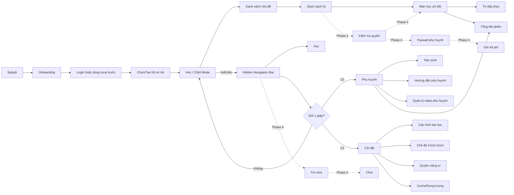
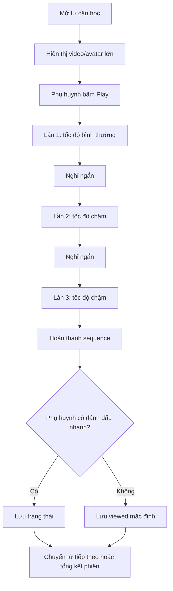
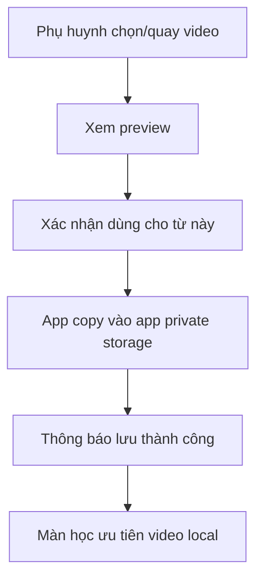
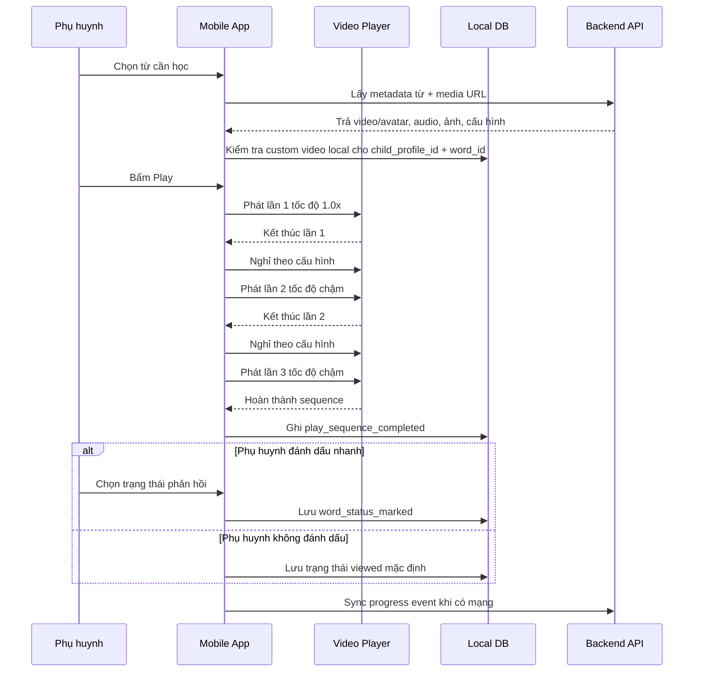
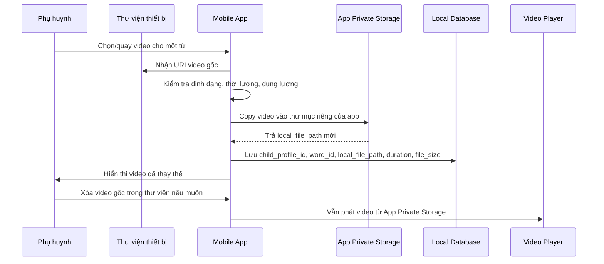
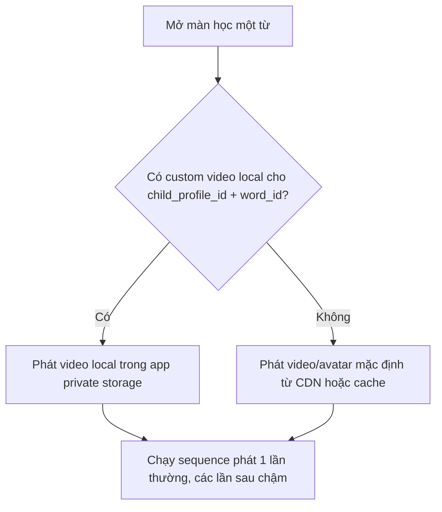
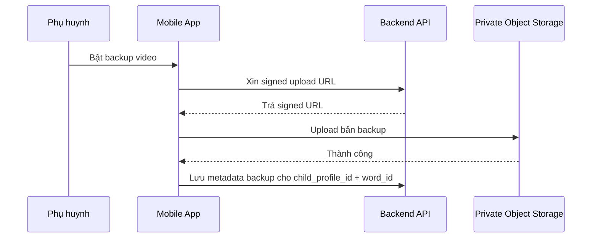
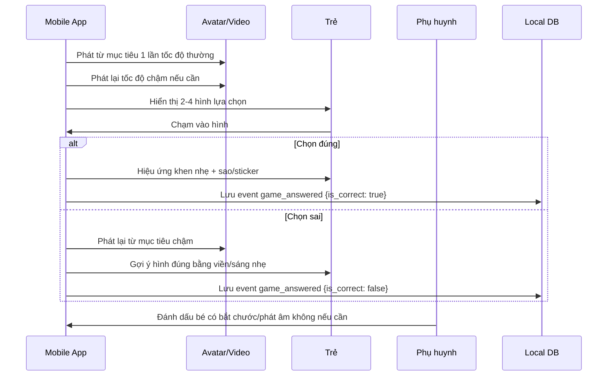
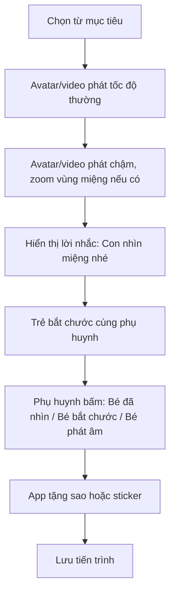
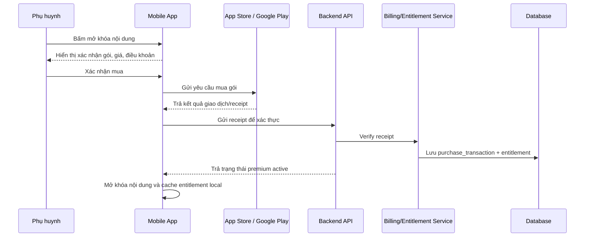

# KidEDU - Tài liệu UI/UX & Product Flow

> Tách từ tài liệu nguồn `Tong_quat_he_thong_Kidedu.md` phiên bản 1.7, ngày 2026-06-24.  
> Mục tiêu tách file: giảm độ dài tài liệu, giúp product/design review và dev implementation đọc đúng phần cần thiết.

## Phạm vi file này

File này tập trung vào trải nghiệm người dùng và luồng sản phẩm:

- Child Mode, Parent Mode, Settings.
- Hidden Navigation Bar, parent gate giữ 1 giây.
- Màn học chi tiết, responsive layout, sensory-friendly UX.
- Luồng phát một từ, đánh dấu kết quả, Session Summary.
- Nội dung tiếng Việt dưới góc nhìn học tập.
- Game/reward và paywall UX ở Phase 4.
- QA UI/UX cho màn học.

Các phần backend, database, API, object storage, authorization chi tiết được chuyển sang file kỹ thuật riêng.

## 1. Mục tiêu sản phẩm

KidEDU là ứng dụng mobile hỗ trợ trẻ chậm nói tiếng Việt luyện nghe, nhìn khẩu hình và bắt chước phát âm thông qua các bài học từ vựng ngắn, trực quan, có lặp lại theo tốc độ phù hợp.

Sản phẩm tập trung vào các giá trị chính theo giai đoạn: Phase 0/1/2 ưu tiên chứng minh lõi học khẩu hình và trải nghiệm sử dụng ổn định; Phase 3 nâng cấp avatar/viseme và cá nhân hóa; Phase 4 mới mở game và thương mại hóa khi app đã có dữ liệu sử dụng thật.

1. **Khẩu hình rõ ràng**: trẻ nhìn thấy avatar/người mẫu phát âm với khẩu hình miệng rõ, đồng bộ với âm thanh.
2. **Lặp lại có kiểm soát**: mỗi từ được phát nhiều lần, lần đầu tốc độ bình thường, các lần sau chậm hơn để trẻ quan sát và bắt chước.
3. **Nội dung tiếng Việt có cấu trúc**: từ đơn, từ kép, số đếm, từ theo chủ đề, có thể mở rộng theo âm đầu, vần, thanh điệu và mức độ khó.
4. **Cá nhân hóa bởi phụ huynh**: phụ huynh có thể thay video mặc định bằng video tự quay, giúp trẻ tương tác với khuôn mặt quen thuộc.
5. **Trò chơi kích thích tương tác ở Phase 4**: mini-game, sticker và phần thưởng chỉ nên thêm sau khi luồng học khẩu hình đã ổn định, tránh làm trẻ lệch khỏi mục tiêu học chính ở giai đoạn đầu.
6. **Thương mại hóa ở Phase 4**: freemium/trả phí chỉ nên triển khai sau khi app hoạt động ổn định, nội dung đủ tốt, có dữ liệu sử dụng thật và có lượng user nhất định.

> Lưu ý định vị: KidEDU là công cụ hỗ trợ luyện tập tại nhà, không thay thế chẩn đoán hoặc can thiệp chuyên môn của bác sĩ/chuyên viên âm ngữ trị liệu.

---

## 2. Đối tượng sử dụng

### 2.1. Người dùng chính

| Nhóm người dùng | Nhu cầu chính |
|---|---|
| Trẻ chậm nói / trẻ đang tập nói | Xem, nghe, bắt chước khẩu hình và âm thanh |
| Phụ huynh | Cho trẻ luyện tập, cấu hình bài học, theo dõi tiến trình |
| Chuyên viên âm ngữ trị liệu | Gợi ý lộ trình học, đánh giá tiến độ, đề xuất nhóm từ phù hợp |
| Quản trị nội dung | Tạo/chỉnh sửa danh mục, từ vựng, ảnh, âm thanh, video/avatar |

### 2.2. Độ tuổi mục tiêu

- Nhóm chính: trẻ 2-6 tuổi cần hỗ trợ phát triển lời nói/ngôn ngữ.
- Có thể mở rộng: trẻ lớn hơn cần luyện phát âm tiếng Việt hoặc luyện khẩu hình âm khó.

---

## 3. Phạm vi chức năng theo phase

Tài liệu dùng một mô hình roadmap thống nhất: **Phase 0 → Phase 5**. Không trộn lẫn nhiều cách gọi như MVP/V1/V2/V4 ở cùng một tầng quyết định. Khi cần nói về MVP, tài liệu phân biệt rõ **Prototype**, **Pilot MVP** và **Production MVP**.

| Phase | Tên giai đoạn | Mục tiêu chính | Không làm trong phase này |
|---:|---|---|---|
| Phase 0 | Prototype | Chứng minh concept học bằng khẩu hình với ít từ nhưng chất lượng cao | Backend/CMS đầy đủ, game, paywall, subscription |
| Phase 1 | Pilot MVP | App mobile dùng được với nhóm phụ huynh test nhỏ | Game, monetization, avatar real-time, therapist/B2B |
| Phase 2 | Production MVP | Bản đủ ổn để public beta/pilot rộng | Game/paywall nếu retention chưa đủ; AI chấm phát âm |
| Phase 3 | Avatar & Personalization | Nâng cấp pipeline avatar/viseme và cá nhân hóa ôn tập | Monetization nếu app chưa có user ổn định |
| Phase 4 | Game + Monetization | Phase 4A thêm game/reward; Phase 4B mới thêm freemium, paywall, IAP/subscription | Không để game/paywall chen vào màn trẻ |
| Phase 5 | Therapist/B2B | Tài khoản chuyên viên, trung tâm, trường học, license | Không triển khai nếu chưa có nhu cầu B2B thật |

### 3.1. Phase 0 - Prototype

Phase 0 dùng để chứng minh: trẻ có thể nhìn video/avatar khẩu hình, nghe phát âm và bắt chước theo một luồng học ngắn.

| Mã | Chức năng | Mô tả |
|---|---|---|
| P00-01 | Bộ từ mẫu nhỏ | 1 chủ đề, 7-10 từ đầu tiên, ưu tiên âm môi/nguyên âm dễ quan sát |
| P00-02 | Video khẩu hình thật | Ít nhất 5 video thật, không dùng video placeholder cho phần demo cốt lõi |
| P00-03 | Màn học chi tiết | Video/avatar lớn, ảnh minh họa, chữ lớn, Play/Replay/Next |
| P00-04 | Phát lặp | Thường → chậm → chậm, cho cấu hình số lần phát ở mức prototype |
| P00-05 | Video phụ huynh thử nghiệm | Thay video cho 1-2 từ mẫu, kiểm chứng luồng copy vào app storage |
| P00-06 | Đánh dấu kết quả đơn giản | Bé nhìn / bé bắt chước / cần ôn; có thể dùng local state/mock data |

### 3.2. Phase 1 - Pilot MVP

Phase 1 là bản mobile có thể test với phụ huynh thật. Trọng tâm là học khẩu hình, media ổn định, video phụ huynh local và tracking cơ bản.

| Mã | Chức năng | Mô tả |
|---|---|---|
| F01 | Danh sách chủ đề | 2-3 chủ đề đầu tiên, đủ test thói quen học |
| F02 | Danh sách từ | 20-30 từ mẫu, có ảnh, trạng thái học cơ bản |
| F03 | Màn học child-first | Child Mode là trang chính; chỉ có video, ảnh/từ, Play/Replay/Next |
| F04 | Hidden Navigation Bar | Thanh điều hướng ẩn, vuốt lên để hiện; vào Parent/Settings cần giữ 1 giây |
| F05 | Phát lặp video | Lần 1 tốc độ thường, lần 2+ tốc độ chậm, cấu hình số lần phát |
| F06 | Video phụ huynh lưu local | App copy video vào app private storage, không upload cloud mặc định |
| F07 | Local DB + progress | Lưu child profile, progress, settings, metadata video local |
| F08 | Backend API cơ bản | Content, progress event, hồ sơ trẻ |
| F09 | CMS đơn giản | Thêm/sửa từ, ảnh, audio, video/avatar; chưa cần workflow phức tạp |
| F10 | Consent cơ bản | Màn thông báo phụ huynh và ghi nhận đồng ý tối thiểu |

### 3.3. Phase 2 - Production MVP

Phase 2 là bản đủ ổn để public beta hoặc pilot rộng. Nội dung nhiều hơn, CMS/QA tốt hơn, privacy và authorization rõ hơn.

| Mã | Chức năng | Mô tả |
|---|---|---|
| F11 | Thư viện nội dung mở rộng | Tối thiểu 5 chủ đề, 50+ từ |
| F12 | Video/avatar QA | Ít nhất 20-30 video/avatar khẩu hình thật đã kiểm tra chất lượng |
| F13 | CMS workflow | Draft → Review → QA → Published |
| F14 | Cache/offline ổn định | Metadata/media/progress hoạt động được khi mất mạng với nội dung đã tải |
| F15 | Progress report | Báo cáo tuần, từ cần ôn, trạng thái học theo hồ sơ trẻ |
| F16 | Privacy baseline | Consent, retention, deletion/export request, audit log cho dữ liệu nhạy cảm |
| F17 | Authorization matrix | Per-endpoint ownership check, role check, therapist delegation nếu có |
| F18 | Monitoring | Crash report, lỗi video, API latency, sync failure |

### 3.4. Phase 3 - Avatar/viseme nâng cao và cá nhân hóa

Phase 3 tập trung vào nâng chất lượng khác biệt cốt lõi: avatar/viseme, cấu trúc tiếng Việt và gợi ý ôn tập cá nhân hóa.

| Mã | Chức năng | Mô tả |
|---|---|---|
| A01 | Avatar 3D pre-render pipeline | Tạo video/avatar đồng nhất theo từng từ |
| A02 | Viseme timeline | Lưu timeline khẩu hình, âm đầu/vần/thanh, QA audio-khẩu hình |
| A03 | Avatar real-time nghiên cứu | Chỉ triển khai nếu pipeline pre-render không đủ mở rộng |
| A04 | Cá nhân hóa ôn tập | Gợi ý từ cần ôn dựa trên tiến trình, tần suất, đánh dấu của phụ huynh |
| A05 | Tùy chọn giọng/vùng miền | Bắc/Nam hoặc giọng chuẩn được kiểm duyệt, không làm nếu chưa đủ nội dung |

### 3.5. Phase 4 - Game và Monetization khi app đã ổn định

Không đưa **trò chơi**, **freemium**, **paywall** hoặc **subscription** vào Phase 0/1/2/3. Giai đoạn đầu cần ưu tiên chứng minh giá trị cốt lõi: trẻ có xem khẩu hình không, phụ huynh có quay lại dùng không, nội dung có giúp luyện tập đều đặn không. Chỉ triển khai Phase 4 khi đã có lượng user nhất định và dữ liệu retention đủ tin cậy.

Phase 4 là umbrella phase, nhưng nên triển khai theo hai bước:

- **Phase 4A - Game & Reward**: thêm Game Hub, 3 mini-game đầu tiên, sticker/reward và game analytics.
- **Phase 4B - Monetization**: chỉ thêm freemium, paywall, IAP/subscription, entitlement và business analytics sau khi Phase 4A không làm giảm thời gian học chính hoặc retention.

Điều kiện khuyến nghị trước khi bật Phase 4:

- App đã chạy ổn định trên iOS/Android, ít lỗi video/playback.
- Luồng học chính đã được phụ huynh dùng lặp lại qua nhiều tuần.
- Có thư viện nội dung đủ tốt, ví dụ tối thiểu 5-10 chủ đề và 100+ từ có media chất lượng.
- Có nhóm user dùng thật, có dữ liệu retention, số phiên học/tuần và phản hồi phụ huynh.
- Phụ huynh hiểu rõ giá trị app trước khi gặp game hoặc paywall.
- Đã có chính sách riêng tư, điều khoản dịch vụ và luồng hỗ trợ người dùng.
- Trước Phase 4B, phải kiểm tra Phase 4A không làm trẻ bỏ qua luồng học khẩu hình hoặc làm giảm thời gian học chính.

| Mã | Chức năng Phase 4 | Mô tả |
|---|---|---|
| G01 | Phase 4A - Game Hub | Màn tập hợp trò chơi, dùng lại từ, ảnh, audio, video/avatar hiện có |
| G02 | Phase 4A - Mini-game kích thích tương tác | Chọn đúng hình, bắt chước khẩu hình, mở rương sticker; game ngắn, ít nhiễu |
| G03 | Phase 4A - Phần thưởng/sticker | Sao, sticker, bộ sưu tập, huy hiệu chủ đề; thưởng tích cực, không tạo cảm giác thua cuộc |
| G04 | Phase 4A - Game analytics | Đo game_started, game_completed, game_answered, reward_earned |
| B01 | Phase 4B - Giới hạn dùng thử freemium | Dùng thử 7-10 từ trong 1 chủ đề miễn phí; nội dung còn lại khóa nhẹ cho phụ huynh |
| B02 | Phase 4B - Subscription/IAP | Mở khóa thư viện hoặc gói nội dung thông qua trả phí; backend xác thực giao dịch và cấp entitlement |
| B03 | Phase 4B - Entitlement/cache quyền truy cập | Lưu trạng thái free/premium, hỗ trợ restore purchase và offline entitlement |
| B04 | Phase 4B - Business analytics | Đo trial, locked content tap, paywall view, purchase funnel và conversion |

### 3.6. Phase 5 - Therapist/B2B

Phase 5 chỉ làm khi có nhu cầu thật từ chuyên viên, phòng khám, trung tâm hoặc trường học.

| Mã | Chức năng | Mô tả |
|---|---|---|
| T01 | Tài khoản chuyên viên | Chuyên viên xem tiến trình khi phụ huynh cấp quyền |
| T02 | Giao bài tập | Chuyên viên chọn từ/chủ đề cho từng trẻ |
| T03 | Ghi chú chuyên viên | Ghi chú/báo cáo theo buổi học, có audit log |
| T04 | Gói trung tâm/trường học | License nhiều hồ sơ trẻ, mã kích hoạt, quản lý nhiều lớp/nhóm |

## 4. Mô hình màn hình và navigation

KidEDU dùng mô hình **Child-first navigation**. Sau khi chọn hồ sơ trẻ, app mặc định mở vào **Child Mode**. Thanh navigation được ẩn để trẻ tập trung vào video/avatar khẩu hình. Phụ huynh vuốt lên từ handle nhỏ ở cạnh dưới để hiện thanh navigation.

> Các node `GameHub`, `GamePlay`, `AccessCheck`, `Paywall`, `Subscription` thuộc Phase 4. Phase 0/1/2/3 bỏ qua các nhánh này để tập trung vào học khẩu hình, video local phụ huynh, tracking tiến trình, privacy và avatar/viseme.



## 5. Cấu trúc màn hình

| Màn hình | Thành phần chính | Quy tắc UX |
|---|---|---|
| Splash | Logo, kiểm tra session, preload cấu hình | Không giữ quá lâu |
| Onboarding | Giới thiệu app, cảnh báo không thay thế chuyên gia, xin quyền phụ huynh | Nói với phụ huynh, không nói với trẻ |
| Hồ sơ trẻ | Tên/nickname, tuổi, mục tiêu học, cấu hình mặc định | Không yêu cầu quá nhiều thông tin cá nhân |
| Child Mode / Học | Chủ đề học, bài gợi ý hôm nay, màn học chi tiết | Là trang chính, ít nút, không cấu hình phức tạp |
| Hidden Navigation Bar | Học, Phụ huynh, Cài đặt; Game chỉ ở Phase 4 | Ẩn mặc định, vuốt lên để hiện |
| Parent Gate | Giữ 1 giây tại tab Parent/Settings hoặc handle parent | Tránh trẻ vào nhầm, nhưng không làm phụ huynh khó chịu |
| Danh sách chủ đề | Từ đơn, từ kép, số đếm, gia đình, động vật... | Card lớn, ảnh rõ, ít chữ |
| Danh sách từ | Ảnh, từ, mức độ đã học, nút bắt đầu | Không hiện paywall ở Phase 0/1/2/3 |
| Màn học chi tiết | Avatar/video khẩu hình, ảnh minh họa, chữ lớn, Play/Replay, Next | Không hiển thị parent controls trực tiếp |
| Parent Mode | Đánh dấu nhanh, tiến trình, video phụ huynh, hướng dẫn | Có thể nhiều thông tin hơn nhưng chia nhóm rõ |
| Session Summary | Danh sách từ đã học, chỉnh lại đánh dấu, từ cần ôn | Hiện cuối phiên, không bắt buộc sau từng từ |
| Settings | Số lần lặp, tốc độ chậm, âm lượng, thời gian nghỉ, chế độ ít kích thích, cache/privacy | Cần parent gate |
| Game Hub | Module Phase 4: danh sách mini-game theo chủ đề/từ đã học, phần thưởng, nhiệm vụ hôm nay | Không xuất hiện trong Phase 0/1/2/3 |
| Paywall phụ huynh | Module Phase 4: lợi ích gói trả phí, giá, điều khoản, mua/khôi phục giao dịch | Chỉ hiển thị cho phụ huynh |

## 6. Thiết kế UI/UX tổng quan

UI/UX của KidEDU phải tách rõ hai vùng: **Child Mode** và **Parent Mode/Settings**. Trẻ cần màn hình ít chữ, ít lựa chọn, video/khẩu hình là trung tâm. Phụ huynh cần cấu hình, theo dõi và thay video, nhưng các thao tác này không được đặt trực tiếp trong vùng trẻ học.

#### 5.4.1. Nguyên tắc thiết kế chính

| Nguyên tắc | Áp dụng trong app |
|---|---|
| Child-first | Child Mode là trang chính sau khi chọn hồ sơ trẻ |
| Một màn một mục tiêu | Màn học chỉ tập trung vào xem khẩu hình, nghe từ, Play/Replay/Next |
| Khẩu hình là trung tâm | Video/avatar chiếm vùng nhìn chính, ưu tiên cận mặt/cận miệng |
| Parent controls tách riêng | Cài đặt, upload/xóa video, đánh dấu chi tiết, báo cáo nằm ở Parent Mode/Settings |
| Navigation ẩn mặc định | Vuốt lên từ handle dưới để hiện; khi video phát thì tự ẩn |
| Parent gate nhẹ | Vào Parent Mode/Settings cần giữ 1 giây để tránh trẻ bấm nhầm; đây chưa phải xác nhận hành động nhạy cảm |
| Nút lớn, thao tác ít | Play, Replay, Next đủ lớn để phụ huynh bấm nhanh bằng một tay |
| Ít chữ trên màn trẻ | Chỉ chữ lớn cho từ đang học; hướng dẫn chi tiết để trong Parent Mode |
| Phản hồi tích cực | Không dùng âm thanh báo sai mạnh, không chấm điểm gây áp lực |
| Phiên học ngắn | Mỗi phiên nên gợi ý 3-5 phút, 3-5 từ hoặc một nhóm nhỏ |
| An toàn dữ liệu | Thêm/xóa video, quyền riêng tư và cache luôn nằm sau parent gate; xóa dữ liệu hoặc thanh toán cần xác nhận riêng |

Parent gate giữ 1 giây chỉ dùng để mở khu vực phụ huynh. Các hành động nhạy cảm như xóa video, xóa hồ sơ, export/delete data, mua gói, khôi phục giao dịch hoặc bật cloud backup phải có bước xác nhận riêng trước khi thực thi.

#### 5.4.2. Phân tách Child Mode, Parent Mode và Settings

| Khu vực | Người dùng chính | Nội dung hiển thị | Quy tắc UX |
|---|---|---|---|
| Child Mode / Học | Trẻ + phụ huynh đồng hành | Video/avatar, ảnh minh họa, chữ lớn, Play/Replay, Next | Ít nút, ít chữ, không paywall, không cấu hình phức tạp |
| Parent Mode | Phụ huynh | Tiến trình, đánh dấu nhanh, video phụ huynh, hướng dẫn | Mở qua navigation + giữ 1 giây |
| Settings | Phụ huynh | Số lần phát, tốc độ chậm, nghỉ giữa lượt, chế độ ít kích thích, cache, privacy | Mở qua navigation + giữ 1 giây |
| Admin CMS | Đội nội dung/vận hành | Chủ đề, từ, media, QA nội dung | Không liên quan trực tiếp đến trải nghiệm trẻ |
| Game Mode | Phase 4 | Mini-game, sticker, phần thưởng | Chỉ mở khi app lõi ổn định; game ngắn và gắn với mục tiêu học |
| Paywall Mode | Phase 4 | Giá, quyền lợi, mua/khôi phục giao dịch | Chỉ hiển thị cho phụ huynh, không làm trẻ hụt hẫng |

#### 5.4.3. Hidden Navigation Bar

Mặc định thanh navigation ẩn để màn học sạch. Phụ huynh vuốt lên từ handle nhỏ ở cạnh dưới để hiện thanh navigation.

```text
┌─────────────────────────────┐
│                             │
│          CHILD MODE          │
│                             │
│   Video khẩu hình lớn        │
│   Ảnh minh họa + từ          │
│   Play / Replay / Next       │
│                             │
│             ━━━━━            │  ← handle nhỏ trong app
└─────────────────────────────┘
```

Khi vuốt lên:

```text
┌─────────────────────────────┐
│          CHILD MODE          │
│   Nội dung học hiện tại      │
├─────────────────────────────┤
│     Học   Phụ huynh   Cài đặt│
└─────────────────────────────┘
```

Quy tắc:

- Không vuốt từ sát mép dưới để tránh xung đột gesture hệ điều hành.
- Dùng handle nhỏ nằm trong app, cao hơn mép dưới một chút.
- Navigation tự ẩn khi video bắt đầu phát.
- Chạm `Học` quay lại Child Mode ngay.
- Chạm `Phụ huynh` hoặc `Cài đặt` phải giữ 1 giây mới mở.
- Có thể có icon phụ huynh nhỏ ở góc trên; icon này cũng phải giữ 1 giây mới mở.
- Giữ 1 giây chỉ là parent gate để vào khu vực phụ huynh; các hành động xóa dữ liệu, thanh toán, restore purchase hoặc export/delete data vẫn cần xác nhận lần hai.

#### 5.4.4. Layout Child Mode

```text
┌─────────────────────────────┐
│ ←        “MẸ”          👨‍👩‍👧 │
│                    giữ 1s    │
├─────────────────────────────┤
│                             │
│    VIDEO / AVATAR KHẨU HÌNH  │
│    ưu tiên cận mặt/cận miệng │
│                             │
│        Lần 1/3 · thường      │
├─────────────────────────────┤
│       Ảnh minh họa nhỏ/vừa   │
│             “MẸ”             │
├─────────────────────────────┤
│        [ PLAY / REPLAY ]     │
│        [ TIẾP THEO ]         │
│             ━━━━━            │
└─────────────────────────────┘
```

Màn trẻ **không hiển thị trực tiếp**:

- Upload/thay video.
- Xóa video.
- Cài đặt tốc độ/số lần phát.
- Đánh dấu kết quả chi tiết.
- Paywall.
- Game config.
- Báo cáo tiến trình.

#### 5.4.5. Responsive rules cho màn học

Thứ tự ưu tiên hiển thị không thay đổi theo kích thước màn hình:

1. Video/avatar khẩu hình.
2. Play/Replay.
3. Chữ của từ.
4. Ảnh minh họa.
5. Trạng thái lượt phát.
6. Navigation/Parent controls, chỉ hiện khi phụ huynh chủ động mở.

| Thiết bị | Video/avatar | Ảnh minh họa | Parent controls |
|---|---:|---:|---|
| Small phone | 55-65% chiều cao vùng học | Thumbnail nhỏ | Ẩn trong nav/Parent Mode |
| Normal phone | 50-60% chiều cao vùng học | Nhỏ/vừa | Ẩn trong nav/Parent Mode |
| Tablet | 60-70%, có thể layout 2 cột | Bên cạnh hoặc dưới video | Có thể là side panel nhưng mặc định vẫn đóng |

Trên máy nhỏ, không dùng layout quá dài khiến phụ huynh phải scroll trong lúc trẻ học. Video/miệng luôn là vùng lớn nhất; ảnh minh họa có thể thu nhỏ.

#### 5.4.6. Luồng UX màn học chi tiết



Đánh dấu kết quả không bắt buộc sau từng từ. Nếu phụ huynh không chọn gì, app tự lưu `viewed` và không chặn trẻ chuyển từ. Phụ huynh có thể chỉnh lại kết quả trong **Session Summary** cuối phiên.

#### 5.4.7. Parent Mode

Parent Mode là tab riêng, mở qua hidden navigation và parent gate giữ 1 giây.

```text
┌─────────────────────────────┐
│        PHỤ HUYNH             │
├─────────────────────────────┤
│ Hồ sơ: Bé An                 │
│ Hôm nay: 5 từ · 2 từ cần ôn  │
├─────────────────────────────┤
│ Đánh dấu nhanh gần đây       │
│ Ba: [Nhìn] [Bắt chước] [Ôn]  │
│ Mẹ: [Nhìn] [Bắt chước] [Ôn]  │
├─────────────────────────────┤
│ Video cá nhân hóa            │
│ 3 từ đang dùng video bố/mẹ   │
├─────────────────────────────┤
│ Hướng dẫn hôm nay            │
│ “Cho bé nhìn miệng trước...” │
└─────────────────────────────┘
```

Parent Mode gồm:

- Tiến trình hôm nay/tuần này.
- Danh sách từ cần ôn.
- Đánh dấu nhanh cho các từ vừa học.
- Quản lý video phụ huynh đã thêm.
- Hướng dẫn phụ huynh theo từng nhóm từ.
- Ghi chú ngắn của phụ huynh nếu cần.

#### 5.4.8. Settings

Settings là tab riêng, không đặt chung vào màn trẻ.

```text
┌─────────────────────────────┐
│          CÀI ĐẶT             │
├─────────────────────────────┤
│ Số lần phát: 3               │
│ Tốc độ chậm: 0.6x            │
│ Nghỉ giữa lượt: 1.5s         │
│ Tự chuyển từ: Tắt/Bật        │
├─────────────────────────────┤
│ Chế độ ít kích thích: Bật    │
│ Âm thanh UI: Tắt             │
│ Animation: Giảm              │
├─────────────────────────────┤
│ Video local                  │
│ Quản lý dung lượng           │
│ Xóa video đã lưu             │
└─────────────────────────────┘
```

Settings gồm:

- Số lần phát.
- Tốc độ chậm.
- Thời gian nghỉ giữa lượt phát.
- Tự chuyển sang từ tiếp theo.
- Âm lượng.
- Chế độ ít kích thích.
- Quản lý cache/dung lượng.
- Quyền riêng tư, xóa dữ liệu/video local.

#### 5.4.9. UX cho phụ huynh thêm video local

Luồng thêm video phải làm rõ rằng app sẽ **copy video vào bộ nhớ riêng của app**:



Thông điệp UX cần có:

- “Video sẽ được lưu trong ứng dụng để dùng offline.”
- “Xóa video trong thư viện điện thoại sẽ không làm mất video đã lưu trong app.”
- “Nếu gỡ app hoặc xóa dữ liệu app, video có thể bị mất.”
- “Bạn có thể xóa video thay thế bất cứ lúc nào.”

#### 5.4.10. Trạng thái UI của video/player/cache

| Trạng thái | Khi nào xảy ra | UI đề xuất |
|---|---|---|
| `idle` | Mở từ, chưa bấm play | Poster video, nút Play lớn |
| `loading_video` | Đang tải video/cache | Spinner nhỏ hoặc skeleton nhẹ, không che vùng miệng |
| `ready` | Video sẵn sàng | Nút Play rõ, trạng thái “Sẵn sàng” |
| `playing_normal` | Phát lần 1 tốc độ thường | Badge nhỏ: “Lần 1/3 · Bình thường” |
| `pause_between_repeats` | Nghỉ giữa các lần phát | Badge nhỏ: “Nghỉ một chút…” |
| `playing_slow` | Phát lần 2/3 tốc độ chậm | Badge nhỏ: “Lần 2/3 · Chậm” |
| `completed` | Hoàn thành sequence | Hiện Replay / Next; không bắt buộc đánh dấu ngay |
| `cached_available` | Mất mạng nhưng có cache | Thông báo nhẹ: “Đang dùng nội dung đã lưu” |
| `offline_no_cache` | Mất mạng và chưa có cache | Fallback ảnh/audio nếu có; hướng dẫn tải lại khi có mạng |
| `custom_video_missing` | Record local còn nhưng file mất | Fallback video mặc định; nhắc phụ huynh chọn lại |
| `video_error` | Video lỗi phát | Cho thử lại, dùng audio + ảnh tạm thời, ghi log lỗi |
| `backgrounded` | App xuống nền khi đang phát | Dừng video và audio ngay |

Không dùng toast/popup lớn che miệng avatar khi video đang phát.

#### 5.4.11. Sensory-friendly UX

KidEDU cần hạn chế kích thích quá mức để trẻ tập trung vào khẩu hình và âm thanh mục tiêu.

Quy tắc:

- Không nhạc nền trong màn học.
- Không animation nhanh, nhấp nháy hoặc rung lắc mạnh.
- Không âm thanh thưởng quá lớn hoặc bất ngờ.
- Không popup che miệng avatar khi video đang phát.
- Không hiệu ứng “sai rồi”, mặt buồn hoặc tiếng báo lỗi tiêu cực.
- Có setting “Chế độ ít kích thích”.
- Khi bật chế độ ít kích thích: tắt âm thanh UI, giảm animation, tắt hiệu ứng phụ, ưu tiên màn tĩnh và video rõ.
- Màu sắc tươi nhưng không quá chói; tránh quá nhiều màu cạnh tranh trên một màn.

#### 5.4.12. Design system đề xuất

| Thành phần | Đề xuất |
|---|---|
| Màu sắc | Tươi, ấm, ít màu trên cùng một màn; tránh nền quá chói |
| Typography | Chữ lớn, rõ, ưu tiên font sans-serif dễ đọc tiếng Việt |
| Icon | Đơn giản, có nhãn ngắn; icon Parent/Settings cần giữ 1 giây mới mở |
| Button | Cao tối thiểu 48px; nút chính nổi bật hơn nút phụ |
| Card từ vựng | Ảnh rõ, chữ lớn, trạng thái đã học/chưa học dễ hiểu |
| Animation | Nhẹ, ngắn; không che miệng avatar khi đang phát âm |
| Âm thanh UI | Hạn chế; không để nhạc nền lấn âm phát âm |
| Dark mode | Không ưu tiên trong Phase 1; nếu có thì phải giữ độ tương phản cao |

#### 5.4.13. UI/UX cho Phase 4

Khi bước sang Phase 4, game và paywall phải tuân theo nguyên tắc:

- Game không xuất hiện trước khi trẻ hoàn thành hoặc xem đủ lượt học chính.
- Game không có hiệu ứng thua cuộc, không làm trẻ thất vọng.
- Sticker/phần thưởng chỉ là động lực nhẹ, không thay mục tiêu học.
- Paywall chỉ xuất hiện trong Parent Mode/Settings, không chặn đột ngột trong màn trẻ.
- Nội dung free phải đủ tốt để phụ huynh hiểu giá trị trước khi trả phí.

## 7. Luồng học chi tiết

### 6.1. Luồng phát một từ



### 6.2. Quy tắc phát mặc định

| Lần phát | Tốc độ | Mục đích |
|---|---:|---|
| Lần 1 | 1.0x | Trẻ nghe và nhìn cách phát âm tự nhiên |
| Lần 2 | 0.5x - 0.7x | Trẻ quan sát khẩu hình chậm |
| Lần 3 | 0.5x - 0.7x | Trẻ bắt chước theo |

Cấu hình nên cho phép:

- Số lần phát: 1-5.
- Tốc độ chậm: 0.5x, 0.6x, 0.75x.
- Thời gian nghỉ giữa các lần: 0.5s - 3s.
- Cho phép bật/tắt tự động chuyển sang từ tiếp theo.

### 6.3. Đánh dấu kết quả không gây gián đoạn

Đánh dấu kết quả không nên bắt buộc sau từng từ. Cơ chế đề xuất:

1. Sau khi phát xong, app tự ghi `viewed` nếu phụ huynh không chọn gì.
2. Nếu phụ huynh mở Parent Mode hoặc Session Summary, có thể đánh dấu nhanh.
3. Cuối phiên, app hiển thị danh sách từ đã học để phụ huynh chỉnh lại kết quả.
4. Trẻ không thấy giao diện đánh giá chi tiết.

Các trạng thái phụ huynh có thể chọn:

| Trạng thái | Ý nghĩa |
|---|---|
| Bé đã nhìn | Trẻ có chú ý vào màn hình/khẩu hình |
| Bé bắt chước khẩu hình | Trẻ mấp máy môi hoặc làm theo khẩu hình |
| Bé phát âm được một phần | Trẻ tạo được âm gần đúng |
| Bé phát âm rõ | Trẻ phát âm tương đối đúng từ mục tiêu |
| Cần ôn lại | Từ này nên xuất hiện lại trong buổi sau |

### 6.4. Session Summary cuối phiên

Sau 3-5 từ hoặc khi phụ huynh kết thúc phiên, app hiển thị màn tổng kết:

```text
Hôm nay bé đã học:
1. Ba   [Nhìn] [Bắt chước] [Cần ôn]
2. Mẹ   [Nhìn] [Bắt chước] [Cần ôn]
3. Ăn   [Nhìn] [Bắt chước] [Cần ôn]
```

Quy tắc:

- Không chặn trẻ sau từng từ chỉ để phụ huynh đánh dấu.
- Không bắt buộc phụ huynh phải đánh dấu đủ mọi từ.
- Nếu phụ huynh không đánh dấu, trạng thái tối thiểu là `viewed`.
- Session Summary thuộc Parent Mode, không phải màn trẻ.

## 8. Thiết kế nội dung tiếng Việt

### 7.1. Cấu trúc nội dung

Nội dung không nên chỉ là danh sách từ vựng. Nên được tổ chức theo 3 lớp:

1. **Chủ đề sinh hoạt**: gia đình, đồ ăn, động vật, đồ chơi, cơ thể, hành động.
2. **Độ khó phát âm**: âm môi dễ nhìn, âm nguyên âm, âm đầu khó, từ hai âm tiết.
3. **Mục tiêu ngôn ngữ**: gọi tên, yêu cầu, phản hồi, giao tiếp hằng ngày.

### 7.2. Metadata cho mỗi từ

Ví dụ với từ `Ba`:

```json
{
  "id": "ba",
  "text": "Ba",
  "normalized_text": "ba",
  "category_id": "gia-dinh",
  "difficulty_level": 1,
  "syllables": [
    {
      "text": "ba",
      "initial": "b",
      "rhyme": "a",
      "tone": "ngang",
      "phoneme_hint": "/b/ + /a/",
      "mouth_hint": "Môi khép rồi bật ra, sau đó miệng mở rộng."
    }
  ],
  "image_asset_id": "img_ba_001",
  "audio_asset_id": "aud_ba_001",
  "default_avatar_video_id": "vid_ba_avatar_001"
}
```

### 7.3. Nhóm từ gợi ý cho MVP

Nên bắt đầu với ít từ nhưng chất lượng khẩu hình cao.

| Nhóm | Từ mẫu | Lý do chọn |
|---|---|---|
| Âm môi dễ quan sát | ba, bà, mẹ, bé, bú | Môi khép/mở rõ, trẻ dễ nhìn |
| Nguyên âm đơn | a, i, u, ô, e | Khẩu hình khác biệt rõ |
| Gia đình | ba, mẹ, ông, bà, anh, chị | Gần gũi, có động lực giao tiếp |
| Nhu cầu cơ bản | ăn, uống, ngủ, đi, bế | Có giá trị trong sinh hoạt hằng ngày |
| Động vật quen thuộc | chó, mèo, cá, gà | Dễ minh họa bằng hình ảnh |

### 7.4. Lưu ý về thanh điệu tiếng Việt

Khẩu hình chỉ hỗ trợ một phần. Tiếng Việt còn có thanh điệu, cần được thể hiện bằng âm thanh, nhịp, cao độ và hướng dẫn nghe.

| Thanh | Ví dụ | Cần hỗ trợ bằng gì? |
|---|---|---|
| Ngang | ba | Âm đều, tự nhiên |
| Huyền | bà | Âm đi xuống nhẹ |
| Sắc | bá | Âm đi lên, ngắn hơn |
| Hỏi | bả | Âm lượn xuống-lên |
| Ngã | bã | Âm lượn/ngắt tùy vùng miền |
| Nặng | bạ | Âm thấp, ngắn, dứt |

Vì vậy, avatar khẩu hình nên đi kèm audio tiếng Việt chuẩn, có thể tùy chọn giọng Bắc/Nam ở các phiên bản sau.

---

## 9. UX video phụ huynh lưu local

### 9.1. Nguyên tắc thiết kế

Với MVP, video phụ huynh tự chọn/quay **không upload lên cloud mặc định**. App phải copy video vào vùng lưu trữ riêng của ứng dụng, sau đó lưu metadata và đường dẫn file local vào local database.

Nguyên tắc bắt buộc:

- Không chỉ lưu URI/path của video trong thư viện ảnh.
- Phải copy file vào **app private storage** hoặc thư mục document/internal storage do app quản lý.
- Khi phụ huynh xóa video gốc trong thư viện điện thoại, video đã copy trong app vẫn còn và vẫn phát được.
- Khi gỡ app, clear app data hoặc đổi máy, video local có thể mất nếu chưa có tính năng backup/export.
- Không lưu file video trực tiếp vào database; database chỉ lưu metadata và local file path.

### 9.2. Luồng thêm video phụ huynh



### 9.3. Luồng chọn nguồn video khi học



Pseudo-logic:

```ts
const videoSource = customVideo?.localFilePath ?? word.defaultAvatarVideoUrl;
```

### 9.4. Vị trí lưu file đề xuất

Không lưu vào cache tạm. Nên lưu trong vùng dữ liệu lâu dài của app.

Ví dụ cấu trúc thư mục:

```text
app-private-storage/
  custom-videos/
    {childProfileId}/
      {wordId}/
        parent-video.mp4
        thumbnail.jpg
```

Ví dụ metadata local:

```json
{
  "id": "local-custom-video-001",
  "child_profile_id": "child_123",
  "word_id": "me",
  "local_file_path": "file:///app-private-storage/custom-videos/child_123/me/parent-video.mp4",
  "thumbnail_path": "file:///app-private-storage/custom-videos/child_123/me/thumbnail.jpg",
  "duration_ms": 5200,
  "file_size_bytes": 8430000,
  "mime_type": "video/mp4",
  "created_at": "2026-06-24T09:00:00+07:00",
  "is_active": true,
  "sync_status": "local_only"
}
```

### 9.5. Ràng buộc video đề xuất

| Hạng mục | Giá trị đề xuất |
|---|---|
| Định dạng | MP4 ưu tiên; MOV có thể hỗ trợ rồi convert nếu cần |
| Thời lượng | 1-10 giây/từ |
| Dung lượng tối đa | 20-50 MB/video trong MVP |
| Độ phân giải | 480p hoặc 720p là đủ cho khẩu hình |
| Vị trí lưu | App private storage, không phải gallery, không phải cache |
| Database | Chỉ lưu metadata + local_file_path |
| Xóa video | Phụ huynh có thể xóa video thay thế trong app |
| Mạng | Không cần mạng để phát video local |

### 9.6. Hành vi khi xóa file gốc hoặc xóa app

| Tình huống | Video trong app còn không? | Ghi chú |
|---|---:|---|
| Phụ huynh xóa video gốc trong thư viện ảnh | Có | Vì app đã copy sang vùng lưu trữ riêng |
| Tắt/mở lại app | Có | Metadata và file local vẫn tồn tại |
| Mất mạng | Có | Phát từ local file |
| Xóa cache app | Có thể còn | Phụ thuộc nền tảng; không được lưu video trong cache |
| Clear app data | Mất | Dữ liệu riêng của app bị xóa |
| Gỡ app | Thường mất | Cần cảnh báo người dùng trước khi gỡ app |
| Đổi điện thoại | Không tự có | Cần export/import hoặc cloud backup tùy chọn |

### 9.7. Backup cloud tùy chọn ở giai đoạn sau

Sau MVP có thể bổ sung tùy chọn:

```text
Bật sao lưu video phụ huynh lên cloud
```

Khi chưa bật backup, video không rời thiết bị. Khi bật backup, hệ thống mới cần object storage private, signed URL, mã hóa và chính sách xóa dữ liệu rõ ràng.

Luồng backup tùy chọn:



### 9.8. Lưu ý bảo mật trẻ em

- Video phụ huynh có thể chứa mặt trẻ/người thân, cần xem là dữ liệu nhạy cảm.
- Mặc định local-only, không public, không upload server.
- Không dùng video phụ huynh để huấn luyện mô hình nếu chưa có đồng ý rõ ràng.
- Nếu có cloud backup, cần quyền xóa dữ liệu và chính sách xuất dữ liệu.
- Tối thiểu hóa dữ liệu cá nhân của trẻ.

---

## 10. Module trò chơi kích thích trẻ em (Phase 4A)

### 10.1. Mục tiêu của trò chơi

Module trò chơi **không nằm trong Phase 0/1/2/3**. Đây là phần mở rộng ở Phase 4A, chỉ triển khai khi app lõi đã ổn định, trẻ/phụ huynh đã có thói quen học và dữ liệu retention cho thấy game có thể tăng tương tác mà không làm lệch mục tiêu học khẩu hình.

Trò chơi trong KidEDU không nên chỉ để giải trí. Mỗi trò chơi phải phục vụ một hoặc nhiều mục tiêu học tập sau:

1. **Tăng chú ý**: giúp trẻ tập trung vào avatar, khẩu hình, âm thanh hoặc hình ảnh mục tiêu.
2. **Tăng lặp lại tự nhiên**: trẻ luyện lại cùng một từ/âm nhiều lần mà không cảm thấy bị ép.
3. **Kích thích bắt chước**: trẻ được khuyến khích nhìn miệng, mấp máy môi, phát âm hoặc làm cử chỉ đi kèm.
4. **Tạo động lực tích cực**: trẻ nhận sticker, hiệu ứng nhẹ hoặc mở khóa vật phẩm sau khi hoàn thành lượt học.
5. **Gắn kết phụ huynh - trẻ**: phụ huynh có thể cùng chơi, cùng khen, cùng đánh dấu phản hồi của trẻ.

Nguyên tắc quan trọng: game phải **ngắn, đơn giản, ít nhiễu, không gây áp lực**, không biến app thành trò chơi thuần túy làm trẻ quên mục tiêu nhìn khẩu hình và luyện phát âm.

### 10.2. Nguyên tắc UX cho game

| Nguyên tắc | Mô tả |
|---|---|
| Thời lượng ngắn | Mỗi lượt chơi nên kéo dài 30 giây - 2 phút |
| Ít lựa chọn | Mỗi màn chỉ nên có 2-4 lựa chọn để trẻ không bị quá tải |
| Không phạt nặng | Trả lời sai chỉ gợi ý lại, không có âm thanh/hiệu ứng tiêu cực |
| Thưởng nhẹ | Sticker, sao, mở khóa hình vui; tránh hiệu ứng quá kích thích |
| Luật lặp lại | Mỗi game nên lặp cùng một logic để trẻ dễ hiểu |
| Ưu tiên khẩu hình | Trước hoặc trong game luôn có bước nhìn avatar/video phát âm |
| Phụ huynh kiểm soát | Có thể bật/tắt game, giới hạn thời gian chơi, chọn game phù hợp |
| Không quảng cáo | Tuyệt đối không có quảng cáo trong khu vực trẻ dùng |

### 10.3. Danh sách mini-game đề xuất

| Mã | Tên game | Mục tiêu | Luồng chơi |
|---|---|---|---|
| G01 | Chọn đúng hình | Luyện nghe hiểu và nhận diện từ | Avatar nói từ → trẻ chọn đúng hình trong 2-4 ảnh |
| G02 | Bong bóng từ vựng | Tăng chú ý và lặp lại từ | Bong bóng hiện hình/từ → trẻ chạm vào bong bóng đúng sau khi nghe âm |
| G03 | Bắt chước khẩu hình | Tập nhìn miệng và bắt chước | Avatar phát âm chậm → trẻ/phụ huynh bấm “bé đã bắt chước” để nhận thưởng |
| G04 | Cho bạn nhỏ ăn | Gắn từ với hành động/đồ vật | Avatar nói “ăn”, “chuối”, “sữa” → trẻ kéo đúng đồ vật cho nhân vật |
| G05 | Tìm đồ vật | Luyện từ theo chủ đề | Màn hình có nhiều vật → nghe từ → chạm đúng vật |
| G06 | Ghép cặp hình - âm | Liên kết âm thanh với hình ảnh | Trẻ nghe audio/avatar → kéo thẻ âm vào hình đúng |
| G07 | Đoàn tàu số đếm | Học số và thứ tự | Avatar đọc số → trẻ kéo toa tàu số tương ứng |
| G08 | Mở rương sticker | Tạo động lực ôn tập | Hoàn thành 3-5 lượt luyện → mở rương nhận sticker |
| G09 | Chọn khẩu hình đúng | Nhận diện khẩu hình | App phát âm hoặc hiện từ → trẻ chọn avatar/miệng đúng trong vài lựa chọn |
| G10 | Bé gọi tên đồ vật | Luyện phát âm tự nhiên | Hiện hình → avatar mẫu → trẻ thử nói → phụ huynh đánh dấu kết quả |

### 10.4. Game ưu tiên cho Phase 4A đầu tiên

Khi bước vào Phase 4A, chỉ nên làm 3 game đơn giản trước, dùng lại dữ liệu sẵn có để giảm chi phí và giảm rủi ro làm trẻ xao nhãng:

| Ưu tiên | Game | Lý do chọn |
|---:|---|---|
| 1 | Chọn đúng hình | Dễ làm, dùng lại ảnh/audio/video, phù hợp trẻ nhỏ |
| 2 | Bắt chước khẩu hình | Bám sát định vị cốt lõi của app là avatar/khẩu hình |
| 3 | Mở rương sticker | Tạo động lực hoàn thành bài học, chi phí kỹ thuật thấp |

Các game chưa nên làm ngay trong Phase 4A đầu tiên:

- Nhận diện giọng nói tự động.
- Chấm điểm phát âm bằng AI.
- Game quá nhiều animation/nhạc nền.
- Game có tính cạnh tranh/thua cuộc.

Lý do: trẻ chậm nói có thể dễ mất tập trung hoặc bị áp lực nếu app chấm sai/phạt sai. Ở giai đoạn đầu, nên để phụ huynh đánh dấu kết quả thay vì bắt AI đánh giá phát âm.

### 10.5. Luồng game “Chọn đúng hình”



### 10.6. Luồng game “Bắt chước khẩu hình”



Game này không cần AI ở Phase 4A đầu tiên. Phụ huynh là người xác nhận hành vi của trẻ.

### 10.7. Luồng game “Mở rương sticker”

Mục tiêu của game này là tạo động lực hoàn thành bài học, không tách rời khỏi học tập.

```text
Hoàn thành 3 từ hoặc 3 lượt luyện
        ↓
App hiện rương nhỏ
        ↓
Trẻ chạm để mở
        ↓
Nhận sticker: ngôi sao, con mèo, xe, bóng...
        ↓
Sticker lưu vào bộ sưu tập của trẻ
```

Quy tắc:

- Không cần mua vật phẩm.
- Không có quảng cáo.
- Không có vòng quay may rủi phức tạp.
- Không dùng cơ chế gây nghiện như streak quá mạnh, hộp quà vô hạn, âm thanh kích thích quá mức.

### 10.8. Cách game dùng lại dữ liệu bài học

Game không nên tạo một hệ dữ liệu riêng quá phức tạp. Nên tái sử dụng dữ liệu sẵn có:

| Dữ liệu có sẵn | Dùng trong game |
|---|---|
| `words.text` | Hiển thị từ, câu hỏi, đáp án |
| `words.category_id` | Sinh game theo chủ đề |
| `media_assets.image` | Hình lựa chọn, thẻ ghép, vật phẩm kéo thả |
| `media_assets.audio` | Âm thanh câu hỏi |
| `media_assets.avatar_video` | Video/avatar mẫu trước khi trẻ chơi |
| `custom_videos.local_file_path` | Nếu phụ huynh có video riêng, game ưu tiên dùng video local |
| `learning_progress` | Chọn từ cần ôn lại trong game |
| `learning_events` | Lưu sự kiện đúng/sai/bắt chước/hoàn thành game |

### 10.9. Thiết kế phần thưởng

| Loại thưởng | Mô tả | Giai đoạn |
|---|---|---|
| Sao | Mỗi lượt hoàn thành nhận 1 sao | Phase 4.1 |
| Sticker | Nhận sticker sau một số lượt luyện | Phase 4.1 |
| Bộ sưu tập | Trẻ xem lại sticker đã nhận | Phase 4.2 |
| Huy hiệu chủ đề | Hoàn thành một nhóm từ được nhận huy hiệu | Phase 4.2 |
| Nhiệm vụ hôm nay | 3-5 lượt luyện ngắn mỗi ngày | Phase 4.2 |

Phần thưởng nên ghi nhận **nỗ lực** thay vì chỉ ghi nhận đúng/sai. Ví dụ trẻ chỉ cần nhìn avatar hoặc bắt chước khẩu hình cũng có thể được thưởng.

### 10.10. Cấu hình game cho phụ huynh

Phụ huynh có thể cấu hình:

- Bật/tắt trò chơi sau bài học.
- Số phút chơi tối đa mỗi ngày.
- Số lựa chọn trong game: 2, 3 hoặc 4 hình.
- Có phát âm thanh nền hay không.
- Có dùng video phụ huynh local trong game hay không.
- Chỉ chơi với từ đã học hoặc cho phép từ mới.
- Mức thưởng: ít/vừa/nhiều.

### 10.11. Dữ liệu cần lưu cho game

Các event quan trọng:

| Event | Ý nghĩa |
|---|---|
| `game_started` | Trẻ bắt đầu một game |
| `game_completed` | Trẻ hoàn thành game |
| `game_answered` | Trẻ chọn đáp án; payload lưu `is_correct`, `attempt_no`, `selected_word_id` |
| `game_hint_shown` | App đã hiển thị gợi ý |
| `game_avatar_played` | Avatar/video được phát trong game |
| `reward_earned` | Trẻ nhận phần thưởng |
| `word_status_marked` | Phụ huynh đánh dấu trẻ có nhìn/bắt chước/phát âm trong game |

### 10.12. Rủi ro khi thêm game

| Rủi ro | Cách xử lý |
|---|---|
| Trẻ chỉ muốn chơi, không muốn học | Game phải gắn với từ mục tiêu, mở sau lượt học hoặc dùng trong bài học |
| Quá nhiều animation làm trẻ mất tập trung | Giới hạn hiệu ứng, ưu tiên hình rõ và avatar khẩu hình |
| Trẻ bị áp lực khi sai | Không dùng thông báo sai tiêu cực, chỉ gợi ý lại |
| Phụ huynh lạm dụng màn hình | Có giới hạn thời gian, nhắc nghỉ, game ngắn |
| Game làm lệch định vị trị liệu | Luôn bắt buộc có bước nghe/nhìn khẩu hình trước khi chơi |

### 10.13. Tiêu chí hoàn thành module game Phase 4A đầu tiên

- Có ít nhất 3 mini-game: Chọn đúng hình, Bắt chước khẩu hình, Mở rương sticker.
- Game dùng được với dữ liệu từ vựng hiện có.
- Game ưu tiên video phụ huynh local nếu từ đó có video riêng.
- Có lưu event tiến trình khi trẻ chơi.
- Có phần thưởng đơn giản: sao/sticker.
- Phụ huynh có thể bật/tắt game.
- Không có quảng cáo, mua vật phẩm, âm thanh/hiệu ứng gây áp lực.

---

## 11. Mô hình kinh doanh Phase 4B và quyền truy cập nội dung

### 11.1. Mục tiêu mô hình freemium

Mô hình freemium **không triển khai trong Phase 0/1/2/3**. Đây là module Phase 4B, chỉ nên bật sau khi app đã hoạt động ổn định, có lượng user nhất định và Phase 4A cho thấy game/reward không làm giảm thời gian học chính. Khi đến Phase 4B, KidEDU có thể dùng mô hình **freemium có giới hạn nội dung**: phụ huynh được trải nghiệm đủ luồng học thật trước khi trả tiền, nhưng thư viện đầy đủ và các chủ đề nâng cao sẽ bị khóa.

Mục tiêu:

- Cho phụ huynh hiểu giá trị cốt lõi: video/avatar khẩu hình, phát lặp chậm, hình minh họa, game ngắn, theo dõi tiến trình.
- Không cần thu phí ngay khi mở app lần đầu.
- Không tạo áp lực mua trong màn hình của trẻ.
- Có cơ chế mở rộng doanh thu khi thư viện nội dung, game và lộ trình học đã đủ lớn, retention đã được chứng minh và Phase 4A không làm lệch mục tiêu học khẩu hình.

### 11.2. Quy tắc dùng thử đề xuất cho Phase 4B

| Nội dung | Quy tắc dùng thử |
|---|---|
| Chủ đề miễn phí | 1 chủ đề mẫu, nên đặt tên là “Từ đầu tiên”, “Gia đình” hoặc “Bài học đầu tiên” |
| Số từ miễn phí | 7-10 từ trong chủ đề dùng thử |
| Màn học chi tiết | Cho dùng đầy đủ với các từ miễn phí: video/avatar, ảnh, audio, phát 3 lần, tốc độ chậm |
| Video phụ huynh local | Cho phép thêm video phụ huynh cho các từ miễn phí; với từ bị khóa thì yêu cầu mở khóa trước |
| Game miễn phí | Chỉ chơi game với bộ từ miễn phí; game dùng từ bị khóa sẽ hiển thị paywall cho phụ huynh |
| Tiến trình | Lưu tiến trình cho cả tài khoản miễn phí, nhưng báo cáo nâng cao có thể thuộc gói trả phí |
| Nội dung bị khóa | Các chủ đề/từ ngoài gói dùng thử hiển thị biểu tượng khóa và CTA “Mở khóa” |

Bộ từ dùng thử nên chọn các từ dễ quan sát khẩu hình, quen thuộc với trẻ và thể hiện rõ giá trị sản phẩm.

Ví dụ chủ đề miễn phí **“Từ đầu tiên”**:

| STT | Từ | Lý do chọn |
|---:|---|---|
| 1 | Ba | Âm môi dễ quan sát |
| 2 | Mẹ | Âm môi /m/ quan trọng, gần gũi |
| 3 | Bé | Từ quen thuộc, âm ngắn |
| 4 | Bú | Nhu cầu cơ bản |
| 5 | Ăn | Nhu cầu cơ bản |
| 6 | Uống | Nhu cầu cơ bản |
| 7 | Đi | Từ hành động ngắn |
| 8 | Ngủ | Từ sinh hoạt hằng ngày |
| 9 | Bóng | Đồ vật/trò chơi quen thuộc |
| 10 | Mèo | Từ theo chủ đề động vật, dễ minh họa |

### 11.3. Gói trả phí đề xuất cho Phase 4B

Có thể triển khai đơn giản theo 2 hướng:

| Gói | Nội dung mở khóa | Ghi chú |
|---|---|---|
| Free | 1 chủ đề, 7-10 từ, một số game cơ bản | Dùng để trải nghiệm thật |
| Premium Monthly | Mở toàn bộ chủ đề, từ, video/avatar, game, báo cáo tiến trình đầy đủ | Phù hợp phụ huynh muốn thử ngắn hạn |
| Premium Yearly | Như monthly nhưng trả theo năm | Nên là gói khuyến khích chính |
| Lifetime / One-time Unlock | Trả một lần để mở thư viện hiện tại | Chỉ cân nhắc sau khi monthly/yearly có tín hiệu tốt |
| Therapist / School Plan | Nhiều hồ sơ trẻ, giao bài tập, báo cáo chuyên viên | Sau Phase 4 nếu có nhu cầu B2B thật |

Không nên chia quá nhiều gói khi mới thương mại hóa. Khi triển khai Phase 4B, nên bắt đầu đơn giản với:

```text
Free → Premium
```

Sau khi có dữ liệu sử dụng thật và doanh thu ổn định mới mở rộng sang gói chuyên viên/trường học.

### 11.4. Quy tắc khóa/mở nội dung trong app ở Phase 4B

Mỗi nội dung cần có metadata quyền truy cập:

```json
{
  "word_id": "ba",
  "category_id": "first_words",
  "access_level": "free",
  "is_locked": false,
  "required_plan": null
}
```

Ví dụ từ bị khóa:

```json
{
  "word_id": "con_voi",
  "category_id": "animals",
  "access_level": "premium",
  "is_locked": true,
  "required_plan": "premium"
}
```

Quy tắc hiển thị:

| Trạng thái | Cách hiển thị |
|---|---|
| Từ miễn phí | Hiển thị bình thường, cho học đầy đủ |
| Từ premium chưa mua | Hiển thị ảnh/tên từ nhưng có icon khóa, bấm vào mở màn paywall phụ huynh |
| Chủ đề premium chưa mua | Hiển thị chủ đề có icon khóa, có thể xem số lượng từ nhưng không học chi tiết |
| Đã mua premium | Mở toàn bộ nội dung theo entitlement |
| Mất mạng | Dùng entitlement đã cache; nếu chưa từng xác thực thì chỉ mở nội dung free |

### 11.5. Vị trí đặt paywall ở Phase 4B

Không nên hiện paywall trực tiếp trong luồng trẻ đang học. Paywall nên nằm ở khu vực phụ huynh.

Vị trí phù hợp:

- Khi phụ huynh bấm vào chủ đề bị khóa.
- Khi phụ huynh bấm vào từ bị khóa.
- Trong màn “Nâng cấp tài khoản”.
- Sau khi trẻ hoàn thành chủ đề miễn phí, app gợi ý phụ huynh mở thêm nội dung.

Vị trí không nên dùng:

- Giữa lúc video đang phát.
- Trong màn trò chơi của trẻ bằng âm thanh/hiệu ứng gây thất vọng.
- Dạng popup lặp lại quá nhiều lần.

Paywall cần nằm sau parent gate để tránh trẻ tự mở khu vực mua. Parent gate có thể là giữ 1 giây, nhưng hành động mua, khôi phục giao dịch hoặc đổi gói vẫn phải có bước xác nhận riêng trước khi gọi store hoặc backend.

### 11.6. Luồng mua và cấp quyền ở Phase 4B



### 11.7. Entitlement và cache offline ở Phase 4B

**Entitlement** là quyền truy cập của người dùng sau khi mua hoặc đang trong gói dùng thử.

Ví dụ:

```json
{
  "user_id": "u_123",
  "plan": "premium_yearly",
  "status": "active",
  "access_scope": "all_content",
  "expires_at": "2027-06-24T00:00:00Z"
}
```

Quy tắc offline:

- App cache trạng thái entitlement ở local DB.
- Nội dung free luôn mở được offline.
- Nội dung premium đã tải/cache có thể mở offline nếu entitlement local còn hiệu lực.
- Khi hết hạn hoặc không xác thực được quá lâu, app yêu cầu online để kiểm tra lại quyền truy cập.
- Không xóa tiến trình học khi user hết premium; chỉ khóa việc mở nội dung premium mới.

### 11.8. Nội dung trả phí nên mở khóa gì ở Phase 4B?

| Nhóm | Free | Premium |
|---|---|---|
| Chủ đề | 1 chủ đề mẫu | Toàn bộ chủ đề |
| Từ | 7-10 từ | Toàn bộ thư viện |
| Video/avatar khẩu hình | Chỉ từ miễn phí | Toàn bộ từ premium |
| Video phụ huynh local | Chỉ thay thế cho từ miễn phí | Thay thế cho toàn bộ từ đã mở khóa |
| Game | Game dùng bộ từ miễn phí | Game theo tất cả chủ đề/từ đã mở khóa |
| Tiến trình | Cơ bản | Báo cáo đầy đủ, gợi ý ôn tập nâng cao |
| Offline cache | Nội dung free | Nội dung premium đã tải |
| Lộ trình học | Bài học mẫu | Lộ trình đầy đủ theo độ khó/chủ đề |

### 11.9. Cấu hình từ Admin CMS ở Phase 4B

Admin CMS cần cho phép đội vận hành cấu hình:

- Chủ đề nào là free/premium.
- Từ nào thuộc danh sách 7-10 từ dùng thử.
- Thứ tự từ trong trial.
- Gói nào mở khóa nội dung nào.
- Copy/mô tả paywall.
- Banner khuyến mãi nếu có.
- Trạng thái bật/tắt paywall theo môi trường: dev, staging, production.

Ví dụ cấu hình một chủ đề:

```json
{
  "category_id": "first_words",
  "name": "Từ đầu tiên",
  "access_level": "free",
  "trial_word_limit": 10,
  "sort_order": 1
}
```

Ví dụ cấu hình chủ đề premium:

```json
{
  "category_id": "animals",
  "name": "Con vật",
  "access_level": "premium",
  "required_plan": "premium",
  "sort_order": 2
}
```

### 11.10. Event business cần ghi nhận ở Phase 4B

| Event | Khi nào ghi? |
|---|---|
| `trial_content_viewed` | User mở từ/chủ đề miễn phí |
| `locked_content_tapped` | User bấm vào nội dung bị khóa |
| `paywall_viewed` | Paywall được hiển thị |
| `purchase_started` | User bắt đầu mua |
| `purchase_succeeded` | Mua thành công |
| `purchase_failed` | Mua thất bại/hủy |
| `entitlement_restored` | Khôi phục giao dịch thành công |
| `subscription_expired` | Gói hết hạn |
| `premium_content_started` | User bắt đầu học nội dung premium |

Các event này giúp đánh giá:

- Bộ từ dùng thử có đủ hấp dẫn không.
- Người dùng thường bị chặn ở chủ đề/từ nào.
- Paywall có đặt đúng vị trí không.
- Tỷ lệ chuyển đổi từ free sang paid.

### 11.11. Nguyên tắc UX trả phí ở Phase 4B

1. Trẻ không nên thấy thông báo “bạn phải trả tiền”.
2. Paywall phải nói với phụ huynh, không nói với trẻ.
3. Không khóa video phụ huynh đã lưu local cho từ free mà phụ huynh đã tạo.
4. Không xóa dữ liệu tiến trình khi user chưa mua hoặc hết hạn.
5. Không dùng hiệu ứng tiêu cực khi trẻ chọn nội dung bị khóa.
6. Không đặt paywall quá sớm trước khi phụ huynh hiểu giá trị app.
7. Nội dung free phải đủ tốt để chứng minh khác biệt của app: khẩu hình, phát chậm, game, tracking.
8. Parent gate chỉ mở khu vực phụ huynh; mua gói, restore purchase hoặc đổi gói phải có xác nhận riêng.

---

## 12. Rủi ro và hướng xử lý

| Rủi ro | Mức độ | Hướng xử lý |
|---|---|---|
| Avatar khẩu hình không đủ chính xác | Cao | Bắt đầu bằng video pre-render đã QA kỹ, chưa vội real-time |
| Trẻ mất tập trung vì UI quá nhiều chi tiết | Cao | Child Mode tối giản, video/miệng là trung tâm, navigation ẩn mặc định, Parent Mode/Settings mở bằng giữ 1 giây |
| Phụ huynh kỳ vọng app thay thế trị liệu | Cao | Truyền thông rõ: công cụ hỗ trợ tại nhà |
| Video phụ huynh chứa dữ liệu nhạy cảm | Cao | Mặc định lưu local-only trong app private storage; nếu backup cloud thì dùng signed URL, quyền xóa, chính sách dữ liệu rõ |
| Nội dung tiếng Việt thiếu chuẩn | Cao | Có chuyên viên/người có chuyên môn review bộ từ và audio |
| Chi phí lưu trữ video lớn | Trung bình | CDN, nén video, giới hạn dung lượng, cache hợp lý |
| Playback lỗi trên nhiều thiết bị | Trung bình | Test thiết bị iOS/Android, dùng native video player ổn định |
| Game gây xao nhãng mục tiêu học | Trung bình | Rủi ro Phase 4; chỉ triển khai sau khi app lõi ổn định, game phải gắn với từ/khẩu hình, giới hạn thời lượng và không dùng hiệu ứng quá kích thích |
| Paywall làm phụ huynh khó chịu nếu xuất hiện quá sớm | Trung bình | Không làm trong Phase 0/1/2/3; chỉ triển khai ở Phase 4 sau khi app ổn định và có dữ liệu user thật |
| Khóa nội dung sai do lỗi entitlement/offline | Cao | Rủi ro Phase 4; cache entitlement có thời hạn, backend verify giao dịch, test kỹ restore purchase và trạng thái hết hạn |

---

## 13. Tiêu chí hoàn thành theo giai đoạn

### 22.1. Prototype Acceptance - Phase 0

Prototype được xem là đạt nếu:

1. Có 1 chủ đề mẫu, ví dụ “Từ đầu tiên”.
2. Có 7-10 từ mẫu.
3. Có ít nhất 5 video khẩu hình thật, không dùng video placeholder cho phần demo chính.
4. Màn học phát được sequence: thường → chậm → chậm.
5. Có hình minh họa và chữ lớn cho từng từ.
6. Có thao tác thay video phụ huynh cho ít nhất 1-2 từ mẫu.
7. Có đánh dấu kết quả đơn giản: bé nhìn / bé bắt chước / cần ôn.
8. Child Mode không chứa parent controls trực tiếp.
9. Chưa cần CMS hoàn chỉnh; có thể dùng mock data hoặc JSON.
10. Chưa cần login, payment, game, therapist, cloud backup.

### 22.2. Pilot MVP Acceptance - Phase 1

Pilot MVP được xem là đạt nếu:

1. Có 2-3 chủ đề.
2. Có 20-30 từ mẫu.
3. Có ít nhất 10-15 video/avatar khẩu hình thật.
4. Mobile app chạy được trên iOS/Android test build.
5. Hidden Navigation Bar hoạt động: vuốt lên để hiện, vào Parent/Settings cần giữ 1 giây.
6. Child Mode chỉ có video/avatar, ảnh/từ, Play/Replay/Next và trạng thái phát nhẹ.
7. Video phụ huynh được copy vào app private storage.
8. App vẫn phát được video phụ huynh sau khi video gốc bị xóa khỏi thư viện.
9. Có local DB lưu progress, settings và custom video metadata.
10. Có backend API cơ bản cho content/progress/hồ sơ trẻ.
11. Có CMS đơn giản để thêm/sửa từ và media.
12. Có cache media cơ bản.
13. Có chính sách riêng tư bản đầu và màn xin đồng ý phụ huynh.
14. Không có game, freemium, paywall, subscription.

### 22.3. Production MVP Acceptance - Phase 2

Production MVP được xem là đạt nếu:

1. Có ít nhất 5 chủ đề.
2. Có 50+ từ.
3. Có ít nhất 20-30 video/avatar khẩu hình thật đã QA.
4. Có CMS với workflow draft/review/QA/published.
5. Có monitoring lỗi video/API/crash.
6. Có tiến trình học theo `child_profile_id`.
7. Có export/delete account/delete child profile flow.
8. Có consent, retention, deletion SLA và audit log baseline.
9. Có authorization rules rõ cho parent/admin/content editor; therapist delegation nếu có Phase 5 thử nghiệm sớm.
10. Có cache/offline ổn định cho nội dung đã tải.
11. Có Session Summary để phụ huynh đánh dấu/chỉnh kết quả cuối phiên.
12. Chưa yêu cầu game, phần thưởng, freemium, paywall, subscription, entitlement hoặc restore purchase trong Production MVP.

## 14. Checklist QA cho màn học

| Test case | Kết quả mong muốn |
|---|---|
| Bấm Play một từ | Video phát đủ số lần theo cấu hình |
| Lần 1 | Playback rate = 1.0x |
| Lần 2+ | Playback rate = tốc độ chậm đã cấu hình |
| Navigation đang ẩn | Màn trẻ chỉ có video/ảnh/từ/Play/Replay/Next |
| Vuốt lên từ handle dưới | Hidden Navigation Bar hiện ra |
| Bấm tab Học | Quay lại Child Mode ngay |
| Bấm nhanh Parent/Settings | Không mở parent controls |
| Giữ Parent/Settings 1 giây | Mở đúng Parent Mode hoặc Settings |
| Trẻ bấm ngẫu nhiên trên màn học | Không mở được cài đặt, upload, xóa video hoặc paywall |
| Màn nhỏ 360x640 | Video vẫn là vùng lớn nhất, không cần scroll để bấm Play |
| Đang phát video | Navigation tự ẩn, không có popup/toast che miệng avatar |
| Chuyển màn khi đang phát | Video dừng, không crash, state được cleanup |
| Video lỗi URL | App hiển thị lỗi thân thiện và cho thử lại/fallback audio + ảnh |
| `loading_video` | Có trạng thái tải nhẹ, không che vùng miệng |
| Mất mạng có cache | App báo nhẹ và vẫn phát nội dung đã lưu |
| Mất mạng chưa có cache | App không crash, fallback rõ ràng |
| Bật chế độ ít kích thích | Tắt âm thanh UI, giảm animation, không nhấp nháy |
| Phát xong một từ mà phụ huynh không đánh dấu | App tự lưu `viewed`, không chặn chuyển từ |
| Cuối phiên học | Phụ huynh có thể chỉnh lại trạng thái từng từ trong Session Summary |
| Thêm video phụ huynh hợp lệ | App copy video vào private storage và video mới thay video mặc định |
| Xóa video gốc trong thư viện | Video trong app vẫn phát được vì đã copy vào app storage |
| Video phụ huynh quá lớn | App báo lỗi rõ ràng và không copy file |
| Video phụ huynh bị mất file local | App fallback về video mặc định và nhắc phụ huynh chọn lại |
| Ghi progress | Backend nhận event đúng `child_profile_id` và `word_id` |
| Đổi hồ sơ trẻ | Tiến trình và video cá nhân hóa không bị lẫn |
| Phase 4A - Game chọn đúng hình | Game dùng đúng từ/ảnh/audio/video của bài học hiện tại |
| Phase 4A - Game chọn sai | App chỉ gợi ý lại, không có âm thanh/hiệu ứng tiêu cực |
| Phase 4A - Bật/tắt game | Phụ huynh có thể tắt game hoặc giới hạn thời lượng chơi |
| Phase 4A - Nhận sticker | Sticker được lưu vào hồ sơ trẻ và đồng bộ event đúng |
| Phase 4B - Tài khoản free mở chủ đề dùng thử | Học được đủ 7-10 từ miễn phí |
| Phase 4B - Tài khoản free bấm từ premium | App hiện paywall phụ huynh, không vào màn học premium |
| Phase 4B - Tài khoản premium bấm từ premium | App mở màn học bình thường |
| Phase 4B - Mất mạng với premium đã cache | App xử lý theo entitlement local còn hiệu lực |
| Phase 4B - Khôi phục giao dịch | Entitlement được cập nhật và mở lại nội dung đã mua |

## 15. Quy tắc UI/UX quan trọng

1. Child Mode là trang chính sau khi chọn hồ sơ trẻ.
2. Mỗi màn chỉ có một hành động chính.
3. Video/khẩu hình là trung tâm của màn học.
4. Nút Play/Replay/Next phải lớn, dễ bấm.
5. Hidden Navigation Bar ẩn mặc định; phụ huynh vuốt lên từ handle dưới để hiện.
6. Parent Mode và Settings phải mở bằng thao tác giữ 1 giây.
7. Giữ 1 giây chỉ là parent gate; xóa video, xóa hồ sơ, export/delete data, mua gói hoặc restore purchase phải có xác nhận riêng.
8. Không đặt parent controls trực tiếp trong màn học của trẻ.
9. Không dùng quá nhiều chữ trên màn trẻ.
10. Luôn có hình minh họa rõ nghĩa.
11. Chữ của từ cần lớn, tương phản cao.
12. Không dùng âm thanh nền gây nhiễu.
13. Không dùng animation nhanh, nhấp nháy hoặc popup che miệng avatar.
14. Không ép trẻ trả lời đúng/sai trong app.
15. Phụ huynh đánh giá thay vì app chấm điểm quá sớm.
16. Đánh dấu kết quả không bắt buộc sau từng từ; có thể gom ở Session Summary cuối phiên.
17. Nội dung học nên ngắn, mỗi phiên 3-5 phút.
18. Có chế độ ít kích thích để tắt âm thanh UI và giảm animation.
19. Trò chơi thuộc Phase 4A, phải ngắn, ít nhiễu, thưởng tích cực và không làm trẻ quên mục tiêu nhìn khẩu hình.
20. Ở Phase 4B, paywall chỉ nói với phụ huynh, không gây thất vọng hoặc gián đoạn trải nghiệm của trẻ.
21. Game/paywall không được chen vào Child Mode khi video đang phát.

## 16. Kết luận UI/UX

Thiết kế UI/UX KidEDU cần giữ nguyên hướng **child-first**: Child Mode là trang chính, video/khẩu hình là trung tâm, parent controls không nằm trực tiếp trên màn trẻ, Parent Mode/Settings mở bằng hidden navigation và thao tác giữ 1 giây.

Ưu tiên tiếp theo của UI/UX là hoàn thiện màn học chi tiết, hidden navigation, Session Summary, chế độ ít kích thích, UX thêm video phụ huynh local và checklist test trên nhiều kích thước màn hình.
