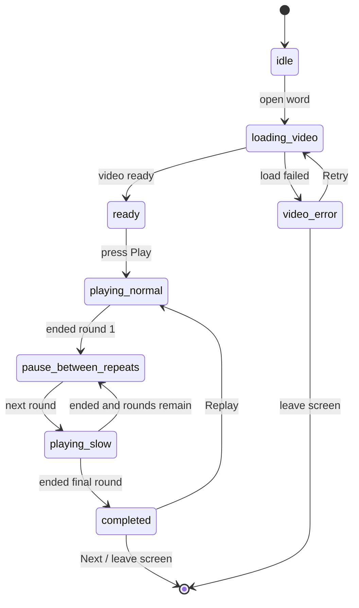

# KidEDU Phase 0 - Learning Screen & Playback

> Phiên bản: 1.0  
> Ngày: 2026-06-24  
> Mục đích: File chi tiết cho Codex khi triển khai màn học và logic phát video khẩu hình.

---

## 1. Goal

Module này xây màn học chi tiết của KidEDU Phase 0. Đây là lõi sản phẩm: trẻ nhìn video/avatar khẩu hình, nghe từ, xem ảnh minh họa và lặp lại theo sequence **thường → chậm → chậm**.

Kết quả cần chứng minh:

- Video khẩu hình là trung tâm màn hình.
- Phát đủ 3 lượt mặc định.
- Lần 1 tốc độ bình thường.
- Lần 2 và 3 tốc độ chậm.
- Không có UI gây nhiễu hoặc che miệng avatar.
- Progress/event được ghi local.

### 1.1. Trạng thái triển khai hiện tại

Prototype web tĩnh đã triển khai màn học trong:

```text
src/app.js
src/styles.css
```

Hiện có màn học theo reference `screenshots/childmode.JPG`: vùng khẩu hình/video là một card lớn bo góc trên nền cream, chip lượt phát nằm ở header, bên dưới là avatar nhỏ, chữ từ lớn, nút `PHÁT` và `TỪ TIẾP THEO`. Event local vẫn là `word_opened`, `play_sequence_started`, `play_sequence_completed` và logic tự lưu `viewed` ngay khi bấm Play nếu từ đang `Chưa học`. UI hiển thị `viewed` là `Đã học`. Khi có video phụ huynh local trong IndexedDB, màn học ưu tiên phát video đó và render `object-fit: cover` trong card khẩu hình. Nếu chưa có file video thật, màn học dùng asset minh họa local `assets/images/mouth-focus.svg` để kiểm thử visual nhưng chưa thay thế yêu cầu media khẩu hình thật.

Lưu ý audio: video trong màn học không được render mặc định ở trạng thái `muted`. Khi phụ huynh bấm Play/Replay, player phải phát cả hình và tiếng để trẻ nghe phát âm.

---

## 2. Phase 0 scope

Làm trong Phase 0:

- Learning Detail Screen.
- Video player phát remote/local source.
- Playback sequence 3 lượt.
- Pause ngắn giữa các lượt.
- Badge trạng thái lượt phát.
- Play/Replay/Next.
- Resolve video source: ưu tiên custom video local nếu có.
- Ghi event local: `word_opened`, `play_sequence_started`, `play_sequence_completed`.
- Khi bấm Play mà phụ huynh chưa đánh dấu, lưu tối thiểu `viewed` và hiển thị `Đã học`.

Không làm trong file này:

- UI chọn/quay video phụ huynh chi tiết. Xem `02-parent-video-local.md`.
- Hidden navigation chi tiết. Xem `03-navigation-parent-gate.md`.
- Backend sync production.
- Game/paywall/subscription.
- AI chấm phát âm.
- Ghi âm trẻ.

---

## 3. UI/UX màn học

### 3.1. Thành phần được phép xuất hiện trong Child Learning Screen

- Header tối giản: back, từ hiện tại, icon parent nhỏ nếu cần.
- Video/avatar khẩu hình lớn.
- Badge trạng thái nhỏ: `Lần 1/3 · thường`, `Lần 2/3 · chậm`.
- Ảnh minh họa.
- Chữ lớn của từ.
- Nút `Play` / `Replay`.
- Nút `Tiếp theo`.
- Hidden nav handle ở dưới.

### 3.2. Thành phần không được xuất hiện trực tiếp

Không đặt các phần sau trong màn trẻ:

- Upload/thay video.
- Xóa video.
- Cài đặt tốc độ/số lần phát.
- Báo cáo tiến trình.
- Đánh dấu chi tiết bắt buộc sau từng từ.
- Paywall.
- Game.
- Popup lớn che video.

### 3.3. Layout đề xuất

```text
┌─────────────────────────────┐
│ ←        “MẸ”          👨‍👩‍👧 │
│                    giữ 1s    │
├─────────────────────────────┤
│                             │
│    VIDEO / AVATAR KHẨU HÌNH  │
│    ưu tiên cận mặt/cận miệng │
│                             │
│        Lần 1/3 · thường      │
├─────────────────────────────┤
│       Ảnh minh họa nhỏ/vừa   │
│             “MẸ”             │
├─────────────────────────────┤
│        [ PLAY / REPLAY ]     │
│        [ TIẾP THEO ]         │
│             ━━━━━            │
└─────────────────────────────┘
```

### 3.4. Responsive priority

Thứ tự ưu tiên hiển thị:

1. Video/avatar khẩu hình.
2. Play/Replay.
3. Chữ của từ.
4. Ảnh minh họa.
5. Badge trạng thái lượt phát.
6. Hidden navigation handle.

| Thiết bị | Video/avatar | Ảnh minh họa | Ghi chú |
|---|---:|---:|---|
| Small phone | 55-65% chiều cao vùng học | Thumbnail nhỏ | Không scroll để bấm Play |
| Normal phone | 50-60% chiều cao vùng học | Nhỏ/vừa | Video vẫn là vùng lớn nhất |
| Tablet | 60-70%, có thể layout 2 cột | Bên cạnh hoặc dưới | Parent controls vẫn mặc định đóng |

---

## 4. Playback sequence

### 4.1. Cấu hình mặc định

```ts
export type PlaybackConfig = {
  repeatCount: number;       // default: 3
  normalSpeed: number;       // default: 1.0
  slowSpeed: number;         // default: 0.6
  pauseDurationMs: number;   // default: 1500
};

export const DEFAULT_PLAYBACK_CONFIG: PlaybackConfig = {
  repeatCount: 3,
  normalSpeed: 1.0,
  slowSpeed: 0.6,
  pauseDurationMs: 1500,
};
```

### 4.2. Quy tắc tốc độ

| Lượt phát | Speed | Badge |
|---:|---:|---|
| 1 | `1.0` | `Lần 1/3 · thường` |
| 2 | `0.6` mặc định | `Lần 2/3 · chậm` |
| 3 | `0.6` mặc định | `Lần 3/3 · chậm` |

Nếu `repeatCount` thay đổi:

- Lượt 1 luôn là `normalSpeed`.
- Lượt 2 trở đi dùng `slowSpeed`.

### 4.3. Sequence state machine



### 4.4. UI states

| State | Khi nào | UI |
|---|---|---|
| `idle` | Chưa chuẩn bị video | Poster + Play disabled nhẹ nếu cần |
| `loading_video` | Đang tải video/cache | Spinner nhỏ, không che miệng nếu đã có poster |
| `ready` | Video sẵn sàng | Nút Play lớn |
| `playing_normal` | Lượt 1 | Badge `Lần 1/3 · thường` |
| `pause_between_repeats` | Nghỉ giữa lượt | Badge `Nghỉ một chút...` |
| `playing_slow` | Lượt 2+ | Badge `Lần n/3 · chậm` |
| `completed` | Hoàn thành sequence | Replay + Next |
| `custom_video_missing` | Có record local nhưng file không còn | Fallback video mặc định, báo nhẹ cho phụ huynh |
| `video_error` | Lỗi phát video | Retry, fallback ảnh + chữ |
| `backgrounded` | App xuống nền | Dừng video/audio |

---

## 5. Resolve video source

Khi mở từ, app phải ưu tiên video phụ huynh local nếu có.

```ts
export type VideoSourceResolution = {
  uri: string;
  sourceType: 'custom_local' | 'default_remote' | 'default_cached';
  usedCustomVideo: boolean;
};

export function resolveVideoSource(params: {
  wordId: string;
  childProfileId: string;
  customVideoLocalPath?: string | null;
  defaultAvatarVideoUrl: string;
  cachedDefaultVideoPath?: string | null;
}): VideoSourceResolution {
  if (params.customVideoLocalPath) {
    return {
      uri: params.customVideoLocalPath,
      sourceType: 'custom_local',
      usedCustomVideo: true,
    };
  }

  if (params.cachedDefaultVideoPath) {
    return {
      uri: params.cachedDefaultVideoPath,
      sourceType: 'default_cached',
      usedCustomVideo: false,
    };
  }

  return {
    uri: params.defaultAvatarVideoUrl,
    sourceType: 'default_remote',
    usedCustomVideo: false,
  };
}
```

Nếu custom file bị mất:

1. Mark custom video as missing/inactive.
2. Fallback sang video mặc định.
3. Không crash.
4. Hiển thị thông báo nhẹ trong Parent Mode hoặc sau khi sequence kết thúc.

---

## 6. Component/hook contract

### 6.1. Components

```text
LearningDetailScreen
  ├── LearningHeader
  ├── VideoLearningPlayer
  ├── PlaybackStatusBadge
  ├── WordIllustration
  ├── WordText
  ├── PlayReplayButton
  ├── NextWordButton
  └── HiddenNavHandle
```

### 6.2. `LearningDetailScreen` props gợi ý

```ts
export type LearningDetailScreenProps = {
  childProfileId: string;
  wordId: string;
  sessionId: string;
  onNextWord: () => void;
  onOpenParentArea?: () => void;
};
```

### 6.3. `usePlaybackSequence` contract

```ts
export type PlaybackState =
  | 'idle'
  | 'loading_video'
  | 'ready'
  | 'playing_normal'
  | 'pause_between_repeats'
  | 'playing_slow'
  | 'completed'
  | 'video_error';

export type PlaybackRound = {
  roundIndex: number; // 1-based
  totalRounds: number;
  speed: number;
};

export type UsePlaybackSequenceResult = {
  state: PlaybackState;
  currentRound?: PlaybackRound;
  isPlaying: boolean;
  canPlay: boolean;
  canReplay: boolean;
  startSequence: () => Promise<void>;
  stopSequence: () => Promise<void>;
  resetSequence: () => void;
};
```

### 6.4. Cleanup bắt buộc

Khi rời màn hoặc đổi từ:

- Dừng video/audio.
- Clear timer pause giữa lượt.
- Không gọi setState sau unmount.
- Không ghi `play_sequence_completed` nếu sequence bị hủy giữa chừng.

---

## 7. Events

### 7.1. `word_opened`

Ghi khi mở màn học.

```json
{
  "event_name": "word_opened",
  "event_version": 1,
  "child_profile_id": "child_profile_123",
  "word_id": "me",
  "session_id": "session_abc",
  "payload": {
    "source": "word_list"
  }
}
```

### 7.2. `play_sequence_started`

Ghi khi người dùng bấm Play/Replay.

```json
{
  "event_name": "play_sequence_started",
  "event_version": 1,
  "child_profile_id": "child_profile_123",
  "word_id": "me",
  "session_id": "session_abc",
  "payload": {
    "repeat_count": 3,
    "normal_speed": 1.0,
    "slow_speed": 0.6,
    "used_custom_video": true
  }
}
```

### 7.3. `play_sequence_completed`

Ghi khi hoàn tất toàn bộ lượt phát.

```json
{
  "event_name": "play_sequence_completed",
  "event_version": 1,
  "child_profile_id": "child_profile_123",
  "word_id": "me",
  "session_id": "session_abc",
  "payload": {
    "repeat_count": 3,
    "speeds": [1.0, 0.6, 0.6],
    "used_custom_video": true,
    "completed": true
  }
}
```

---

## 8. Progress behavior

Sau khi `play_sequence_completed`:

- Tăng `practiceCount`.
- Tăng hoặc giữ `viewCount` tùy logic đã ghi khi `word_opened`.
- Nếu từ chưa có status trong phiên này, set `latestStatus = viewed` khi bắt đầu Play; UI hiển thị `Đã học`.
- Không bắt phụ huynh đánh dấu ngay.

```ts
function onSequenceCompleted(wordId: string) {
  incrementPracticeCount(wordId);
  ensureMinimumStatus(wordId, 'viewed');
  appendEvent('play_sequence_completed', { wordId });
}
```

---

## 9. Sensory-friendly rules trong màn học

Bắt buộc:

- Không nhạc nền.
- Không animation nhanh.
- Không nhấp nháy.
- Không âm thanh báo sai.
- Không popup/toast che miệng avatar khi video đang phát.
- Không tự động bật game/sticker/reward.
- Không tự động mở Parent Mode sau khi phát xong.

Nên làm:

- Nút Play lớn.
- Badge nhỏ, không gây chú ý quá mức.
- Màu rõ nhưng không chói.
- Hiệu ứng chuyển trạng thái nhẹ.

---

## 10. Error handling

| Lỗi | Hành vi bắt buộc |
|---|---|
| Video remote không tải được | Hiện Retry, fallback ảnh + chữ, không crash |
| Video local bị mất file | Fallback video mặc định, đánh dấu custom video inactive/missing |
| App xuống nền khi đang phát | Dừng playback |
| Người dùng bấm Next khi đang phát | Dừng playback trước khi chuyển từ |
| Component unmount | Cleanup timers/listeners |
| Speed không được player hỗ trợ | Fallback 1.0x và log warning local |
| Video có audio nhưng không nghe tiếng | Kiểm tra player không bị `muted`, đặt volume về mức nghe được trước khi phát |

---

## 11. Acceptance criteria

Module đạt nếu:

1. Mở một từ ghi `word_opened`.
2. Bấm Play ghi `play_sequence_started`.
3. Lượt 1 phát tốc độ `1.0`.
4. Lượt 2 và 3 phát tốc độ `0.6` mặc định.
5. Có nghỉ giữa lượt khoảng `pauseDurationMs`.
6. Badge lượt phát đúng trạng thái.
7. Hoàn thành sequence ghi `play_sequence_completed`.
8. Khi bấm Play, nếu không đánh dấu thì status tối thiểu là `viewed` và UI hiển thị `Đã học`.
9. Replay phát lại đủ sequence.
10. Next dừng video và chuyển từ.
11. Có custom video local thì ưu tiên phát custom video.
12. Custom video missing thì fallback video mặc định.
13. Không có popup che miệng avatar khi đang phát.
14. Không có game/paywall/parent controls trực tiếp trong Child Learning Screen.

Trạng thái hiện tại: các tiêu chí logic/UI đã có trong prototype web tĩnh, nhưng tiêu chí phát video khẩu hình thật phụ thuộc việc bổ sung file media thật hoặc video phụ huynh local qua Parent Mode.

---

## 12. Prompt mẫu cho Codex

```text
Read only:
- docs/phase0/00-phase0-overview.md
- docs/phase0/01-learning-screen-playback.md

Task:
Implement LearningDetailScreen and playback sequence.

Constraints:
- Phase 0 only.
- Do not implement game/paywall/backend sync/cloud backup.
- Keep parent controls out of Child Learning Screen.
- Use canonical events: word_opened, play_sequence_started, play_sequence_completed.
- Sequence: 1.0x -> 0.6x -> 0.6x with pause between rounds.
```

---

## 13. Ghi chú responsive layout cho màn học

Child Learning Screen dùng mốc 390px để so visual, nhưng layout thật phải fluid. Vùng khẩu hình/video dùng `width: 100%`, chiều cao `clamp()` theo `dvh`, ảnh/video `object-fit: cover`; chip lượt phát, cụm từ đang học và hai nút chính nằm trong luồng layout một cột.

Chiều cao màn học dùng `min-height: 100dvh` và cho phép cuộn khi viewport thấp, thay vì để video phủ toàn bộ màn hình hoặc hardcode chiều cao export. Layout phải giữ nền cream, card bo góc và không bị cắt nút Play/Next.
