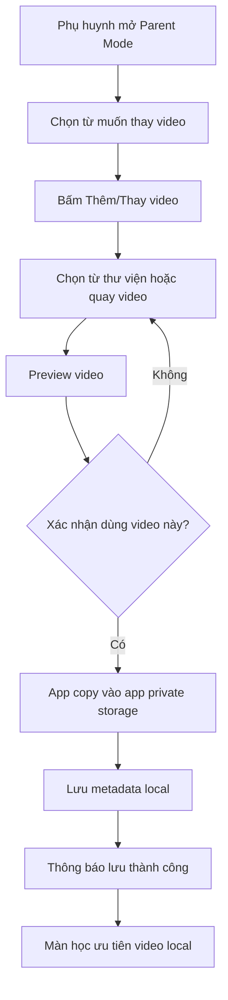
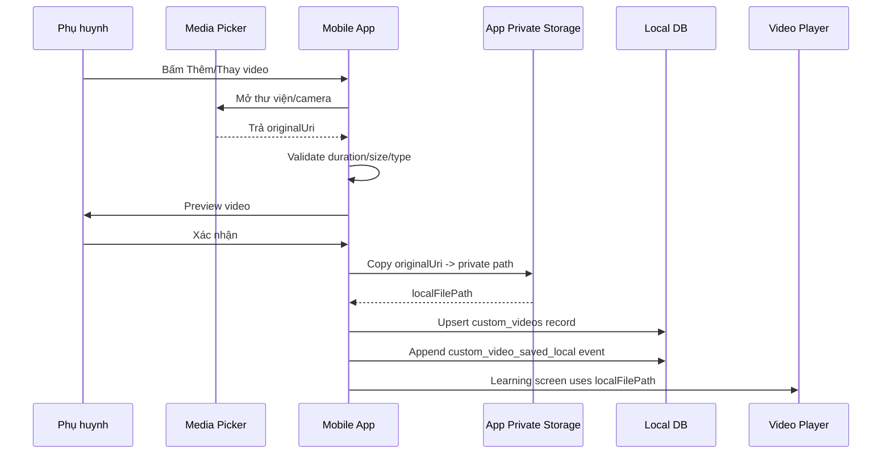
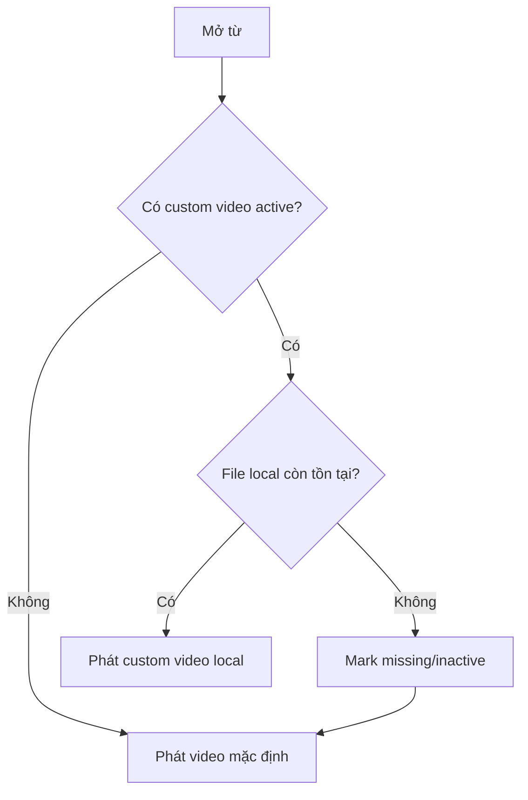

# KidEDU Phase 0 - Parent Video Local Override

> Phiên bản: 1.0  
> Ngày: 2026-06-24  
> Mục đích: File chi tiết cho Codex khi triển khai tính năng phụ huynh chọn/quay video và lưu local trong app.

---

## 1. Goal

Cho phụ huynh thay video/avatar mặc định bằng video tự chọn/quay cho một từ cụ thể. Video phụ huynh **không upload cloud trong Phase 0**. App phải copy file vào **app private storage**, lưu metadata/path local và ưu tiên video này khi trẻ học từ đó.

Điểm cần chứng minh:

- Phụ huynh chọn/quay video.
- App preview video.
- App copy video vào thư mục riêng của app.
- App phát lại video local trong màn học.
- Xóa video gốc trong thư viện điện thoại không làm mất video đã lưu trong app.

---

## 2. Phase 0 scope

Làm trong Phase 0:

- Parent Mode có entry quản lý video cho 1-2 từ mẫu.
- Chọn video từ thư viện hoặc quay video nếu công nghệ hỗ trợ nhanh.
- Preview trước khi lưu.
- Validate cơ bản: định dạng, thời lượng, dung lượng.
- Copy video vào app private storage.
- Lưu local metadata.
- Learning Screen ưu tiên custom video local.
- Cho phép xóa video thay thế trong app.
- Event local: `custom_video_saved_local`, `custom_video_deleted_local`.

Không làm trong Phase 0:

- Cloud backup.
- Signed upload URL.
- Sync nhiều thiết bị.
- Share video giữa tài khoản.
- Upload video lên server.
- Duyệt/moderation video phụ huynh.
- AI kiểm tra chất lượng video.

---

## 3. UX flow

### 3.1. Luồng thêm/thay video



### 3.2. Copy text bắt buộc

Khi xác nhận lưu video, hiển thị ngắn gọn:

```text
Video sẽ được lưu trong ứng dụng để dùng offline.
Xóa video trong thư viện điện thoại sẽ không làm mất video đã lưu trong app.
Nếu gỡ app hoặc xóa dữ liệu app, video có thể bị mất.
```

Khi xóa video trong app:

```text
Xóa video thay thế cho từ này?
Sau khi xóa, app sẽ dùng lại video khẩu hình mặc định.
```

### 3.3. UI trong Parent Mode

```text
┌─────────────────────────────┐
│ Video cá nhân hóa            │
├─────────────────────────────┤
│ Từ: Mẹ                       │
│ Trạng thái: Đang dùng video  │
│ của phụ huynh                │
│                              │
│ [ Xem preview ]              │
│ [ Thay video ]               │
│ [ Xóa video thay thế ]       │
└─────────────────────────────┘
```

Không đặt các nút trên trong Child Learning Screen.

---

## 4. Technical flow

### 4.1. Sequence kỹ thuật



### 4.2. Nguyên tắc bắt buộc

- Không chỉ lưu `originalUri` từ gallery/camera roll.
- Không lưu file video trực tiếp trong database.
- Không lưu video vào cache tạm.
- Phải copy vào thư mục lâu dài do app quản lý.
- Local DB chỉ lưu metadata + `local_file_path`.
- Một `child_profile_id + word_id` chỉ có một video active tại một thời điểm.

---

## 5. File storage

### 5.1. Thư mục đề xuất

```text
app-private-storage/
  custom-videos/
    {childProfileId}/
      {wordId}/
        parent-video.mp4
        thumbnail.jpg
```

Ví dụ:

```text
app-private-storage/custom-videos/child_profile_123/me/parent-video.mp4
```

### 5.2. File naming

Phase 0 có thể dùng tên cố định `parent-video.mp4` cho mỗi từ. Khi thay video mới:

1. Copy file mới sang path tạm.
2. Nếu copy thành công, xóa file cũ.
3. Rename/cập nhật path mới.
4. Update local DB.

Tránh xóa file cũ trước khi copy file mới thành công.

---

## 6. Local DB schema

Có thể dùng SQLite hoặc local storage. Nếu dùng SQLite:

```sql
CREATE TABLE custom_videos (
  id TEXT PRIMARY KEY,
  child_profile_id TEXT NOT NULL,
  word_id TEXT NOT NULL,
  local_file_path TEXT NOT NULL,
  thumbnail_path TEXT,
  duration_ms INTEGER,
  file_size_bytes INTEGER,
  mime_type TEXT,
  is_active INTEGER NOT NULL DEFAULT 1,
  sync_status TEXT NOT NULL DEFAULT 'local_only',
  created_at TEXT NOT NULL,
  updated_at TEXT NOT NULL
);

CREATE UNIQUE INDEX idx_custom_videos_active_word
ON custom_videos(child_profile_id, word_id)
WHERE is_active = 1;
```

Nếu prototype chưa dùng SQLite, dùng type tương đương:

```ts
export type CustomVideo = {
  id: string;
  childProfileId: string;
  wordId: string;
  localFilePath: string;
  thumbnailPath?: string;
  durationMs?: number;
  fileSizeBytes?: number;
  mimeType?: string;
  isActive: boolean;
  syncStatus: 'local_only';
  createdAt: string;
  updatedAt: string;
};
```

---

## 7. Validate video

Phase 0 chỉ cần validate cơ bản.

| Hạng mục | Giá trị đề xuất |
|---|---|
| Định dạng | Ưu tiên MP4; MOV có thể chấp nhận nếu player hỗ trợ |
| Thời lượng | 1-10 giây/từ |
| Dung lượng tối đa | 20-50 MB/video |
| Độ phân giải | 480p hoặc 720p là đủ |
| Âm thanh | Nên có tiếng rõ; Phase 0 chưa cần tự kiểm tra chất lượng |

Nếu video quá dài/quá nặng:

```text
Video hơi dài/nặng. Hãy chọn video ngắn hơn, khoảng 1-10 giây để trẻ dễ tập theo.
```

Không bắt buộc convert/compress trong Phase 0 nếu làm chậm prototype. Có thể thêm TODO.

---

## 8. Video source priority

Khi Learning Screen mở một từ:



Pseudo-code:

```ts
async function getLearningVideoSource(params: {
  childProfileId: string;
  wordId: string;
  defaultAvatarVideoUrl: string;
}) {
  const customVideo = await customVideoStore.findActive(
    params.childProfileId,
    params.wordId,
  );

  if (customVideo) {
    const exists = await fileExists(customVideo.localFilePath);
    if (exists) {
      return {
        uri: customVideo.localFilePath,
        sourceType: 'custom_local' as const,
        usedCustomVideo: true,
      };
    }

    await customVideoStore.markMissing(customVideo.id);
  }

  return {
    uri: params.defaultAvatarVideoUrl,
    sourceType: 'default_remote' as const,
    usedCustomVideo: false,
  };
}
```

---

## 9. Delete behavior

Khi phụ huynh xóa video thay thế:

1. Confirm.
2. Stop playback nếu video đó đang phát.
3. Xóa file vật lý trong app private storage.
4. Mark record inactive hoặc delete record.
5. Append event `custom_video_deleted_local`.
6. Learning Screen fallback về video mặc định.

Pseudo-code:

```ts
async function deleteCustomVideo(customVideoId: string) {
  const video = await customVideoStore.getById(customVideoId);
  if (!video) return;

  await stopPlaybackIfUsing(video.localFilePath);
  await deleteFileIfExists(video.localFilePath);
  if (video.thumbnailPath) await deleteFileIfExists(video.thumbnailPath);

  await customVideoStore.markInactive(customVideoId);
  await appendEvent('custom_video_deleted_local', {
    wordId: video.wordId,
  });
}
```

---

## 10. Events

### 10.1. `custom_video_saved_local`

```json
{
  "event_name": "custom_video_saved_local",
  "event_version": 1,
  "child_profile_id": "child_profile_123",
  "word_id": "me",
  "session_id": "session_abc",
  "payload": {
    "duration_ms": 5200,
    "file_size_bytes": 8430000,
    "mime_type": "video/mp4"
  }
}
```

### 10.2. `custom_video_deleted_local`

```json
{
  "event_name": "custom_video_deleted_local",
  "event_version": 1,
  "child_profile_id": "child_profile_123",
  "word_id": "me",
  "session_id": "session_abc",
  "payload": {
    "reason": "parent_deleted"
  }
}
```

Không đưa raw video, file path nhạy cảm hoặc dữ liệu không cần thiết vào analytics payload nếu sau này sync backend.

---

## 11. Edge cases

| Tình huống | Hành vi mong muốn |
|---|---|
| User hủy chọn video | Quay lại Parent Mode, không tạo record |
| Không có quyền truy cập media | Hiển thị hướng dẫn bật quyền, không crash |
| Video quá dài | Báo chọn video ngắn hơn |
| Copy file thất bại | Không update DB, báo thử lại |
| App bị tắt giữa lúc copy | Không dùng file copy dở; cleanup lần mở sau nếu có temp file |
| Xóa video gốc trong gallery | Video trong app vẫn phát vì đã copy riêng |
| Clear app data/gỡ app | Video local mất; đây là hành vi chấp nhận được Phase 0 |
| File local mất nhưng DB còn | Mark missing/inactive, fallback video mặc định |
| Thay video mới | Copy mới thành công rồi mới thay record active |

---

## 12. Privacy rules Phase 0

- Video phụ huynh có thể chứa mặt trẻ/người thân, coi là dữ liệu nhạy cảm.
- Mặc định video không rời khỏi thiết bị.
- Không upload server.
- Không dùng để huấn luyện AI.
- Không chia sẻ video giữa thiết bị.
- Cần thông báo rõ: gỡ app/clear data có thể mất video.

---

## 13. Acceptance criteria

Module đạt nếu:

1. Parent Mode có nút thêm/thay video cho từ mẫu.
2. Phụ huynh chọn hoặc quay được video.
3. Có preview trước khi lưu.
4. App copy video vào app private storage.
5. Local DB/local store lưu metadata và `local_file_path`.
6. Không chỉ lưu URI gốc từ thư viện ảnh.
7. Learning Screen ưu tiên phát video local khi có.
8. Xóa video gốc trong thư viện vẫn không làm mất video trong app.
9. Có thể xóa video thay thế trong app.
10. Sau khi xóa video thay thế, app fallback video mặc định.
11. Copy fail không tạo record hỏng.
12. File missing không làm app crash.
13. Không có cloud upload hoặc signed URL trong Phase 0.
14. Event `custom_video_saved_local` và `custom_video_deleted_local` dùng đúng canonical name.

---

## 14. Prompt mẫu cho Codex

```text
Read only:
- docs/phase0/00-phase0-overview.md
- docs/phase0/02-parent-video-local.md
- docs/phase0/01-learning-screen-playback.md

Task:
Implement parent video local override for Phase 0.

Constraints:
- Do not upload video to cloud.
- Do not store original gallery URI as playback source.
- Copy video into app private storage.
- Store only metadata + localFilePath.
- Learning screen must prefer custom local video when available.
- Use childProfileId, not childId.
```
