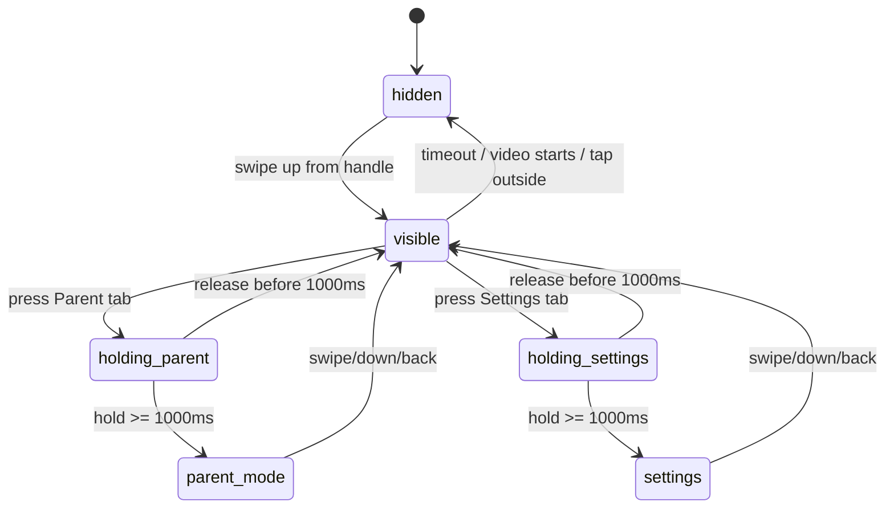

# KidEDU Phase 0 - Hidden Navigation & Parent Gate

> Phiên bản: 1.0  
> Ngày: 2026-06-24  
> Mục đích: File chi tiết cho Codex khi triển khai App Shell, Hidden Navigation Bar, Child Mode, Parent Mode và Settings với parent gate giữ 1 giây.

---

## 1. Goal

Tạo navigation child-first cho Phase 0:

- Child Mode là trang chính mặc định.
- Thanh navigation ẩn mặc định để trẻ tập trung học.
- Phụ huynh vuốt lên từ handle nhỏ để hiện navigation.
- Navigation có 3 tab Phase 0: `Học`, `Phụ huynh`, `Cài đặt`.
- Vào `Phụ huynh` hoặc `Cài đặt` cần giữ 1 giây.

Mục tiêu: trẻ không dễ bấm nhầm vào phần phụ huynh, nhưng phụ huynh vẫn thao tác nhanh.

### 1.1. Trạng thái triển khai hiện tại

Prototype web tĩnh đã triển khai App Shell và hidden navigation trong `src/app.js`:

- Child Mode là màn mặc định.
- Handle nhỏ nằm trong app để mở navigation.
- Navigation có 3 tab: `Học`, `Phụ huynh`, `Cài đặt`.
- `Phụ huynh` và `Cài đặt` dùng hold gate 1 giây.
- Khi bắt đầu playback, navigation tự ẩn.
- Không có Game tab, paywall hoặc subscription.

Hành động xóa video thay thế trong Parent Mode vẫn có confirm riêng; parent gate 1 giây chỉ dùng để vào khu vực phụ huynh.

---

## 2. Phase 0 scope

Làm trong Phase 0:

- App Shell cơ bản.
- Child Mode mặc định.
- Hidden nav handle.
- Vuốt lên để hiện nav.
- Tabs: `Học`, `Phụ huynh`, `Cài đặt`.
- Parent gate giữ 1 giây khi vào Parent Mode/Settings.
- Parent Mode placeholder.
- Settings placeholder.
- Auto-hide nav khi video bắt đầu phát.

Không làm trong Phase 0:

- Game tab.
- Paywall.
- Subscription.
- Auth/role permission production.
- Therapist/B2B navigation.
- Complex animation.
- Biometric/PIN gate.

---

## 3. Navigation model

### 3.1. Mặc định

App mở vào Child Mode sau khi có hồ sơ trẻ local/mặc định.

```text
┌─────────────────────────────┐
│                             │
│          CHILD MODE          │
│                             │
│   Chủ đề / Từ / Màn học      │
│                             │
│             ━━━━━            │  ← handle nhỏ trong app
└─────────────────────────────┘
```

### 3.2. Khi vuốt lên

```text
┌─────────────────────────────┐
│          CHILD MODE          │
│   Nội dung hiện tại          │
├─────────────────────────────┤
│      Học   Phụ huynh   Cài đặt│
└─────────────────────────────┘
```

### 3.3. Tab behavior

| Tab | Hành vi |
|---|---|
| `Học` | Chạm là quay lại Child Mode ngay |
| `Phụ huynh` | Phải giữ 1 giây mới mở Parent Mode |
| `Cài đặt` | Phải giữ 1 giây mới mở Settings |

Không có tab `Game` trong Phase 0.

---

## 4. Parent gate giữ 1 giây

### 4.1. Quy tắc

- Parent gate dùng để mở khu vực phụ huynh.
- Chỉ giữ 1 giây, không quá lâu để phụ huynh khó chịu.
- Chạm nhanh vào `Phụ huynh` hoặc `Cài đặt` không mở.
- Trong lúc giữ, có thể hiện progress ring/bar nhỏ.
- Nếu thả trước 1 giây, hủy.
- Parent gate không thay thế xác nhận hành động nhạy cảm. Sau này xóa dữ liệu/mua gói vẫn phải confirm riêng.

### 4.2. State machine



### 4.3. Touch/gesture notes

- Không bắt đầu vuốt từ sát mép dưới để tránh xung đột gesture iOS/Android.
- Dùng handle nằm trong app, cao hơn mép dưới một chút.
- Handle đủ rộng để phụ huynh dễ vuốt, nhưng không quá nổi bật làm trẻ tò mò.
- Trên Android/iOS gesture navigation, tránh intercept toàn bộ bottom edge.

---

## 5. App Shell structure

```text
AppShell
  ├── ChildModeScreen
  │   ├── CategoryList
  │   ├── WordList
  │   └── LearningDetailScreen
  ├── HiddenNavigationBar
  │   ├── LearnTab
  │   ├── ParentTabWithHoldGate
  │   └── SettingsTabWithHoldGate
  ├── ParentModeScreen
  └── SettingsScreen
```

Phase 0 có thể dùng simple state thay vì router phức tạp nếu prototype nhỏ.

---

## 6. State contract

```ts
export type MainArea = 'child' | 'parent' | 'settings';

export type HiddenNavState = {
  isVisible: boolean;
  activeArea: MainArea;
  holdTarget: 'parent' | 'settings' | null;
  holdProgress: number; // 0..1
  isUnlockedForCurrentInteraction: boolean;
};
```

Events nội bộ UI:

```ts
type NavAction =
  | { type: 'SHOW_NAV' }
  | { type: 'HIDE_NAV' }
  | { type: 'OPEN_CHILD' }
  | { type: 'START_HOLD'; target: 'parent' | 'settings' }
  | { type: 'UPDATE_HOLD_PROGRESS'; progress: number }
  | { type: 'CANCEL_HOLD' }
  | { type: 'COMPLETE_HOLD'; target: 'parent' | 'settings' };
```

---

## 7. Parent Mode placeholder

Phase 0 Parent Mode không cần báo cáo đầy đủ. Chỉ cần những thứ phục vụ prototype.

```text
┌─────────────────────────────┐
│        PHỤ HUYNH             │
├─────────────────────────────┤
│ Phiên hiện tại               │
│ 3 từ đã học                  │
│ 1 từ cần ôn                  │
├─────────────────────────────┤
│ Đánh dấu nhanh               │
│ Từ đã học: [Mẹ ▾]             │
│ Đánh giá: [Bắt chước ▾]       │
│ [ Lưu đánh giá ]              │
├─────────────────────────────┤
│ Video cá nhân hóa            │
│ [ Chọn video ] [ Lưu video ] │
├─────────────────────────────┤
│ Gợi ý                        │
│ Cho bé nhìn miệng trước,     │
│ chưa cần ép bé nói ngay.     │
└─────────────────────────────┘
```

Parent Mode Phase 0 có thể chứa:

- Session Summary.
- Đánh dấu nhanh cho các từ đã học bằng combo box chọn từ + combo box chọn đánh giá.
- Link hoặc cụm nút rõ ràng để chọn/lưu/xóa video local.
- Hướng dẫn phụ huynh ngắn.

Không chứa:

- Paywall.
- Game config.
- Cloud backup.
- Therapist access.
- Báo cáo nâng cao.

---

## 8. Settings placeholder

```text
┌─────────────────────────────┐
│          CÀI ĐẶT             │
├─────────────────────────────┤
│ Số lần phát: 3               │
│ Tốc độ chậm: 0.6x            │
│ Nghỉ giữa lượt: 1.5s          │
├─────────────────────────────┤
│ Chế độ ít kích thích: Bật    │
│ Âm thanh UI: Tắt             │
│ Animation: Giảm              │
└─────────────────────────────┘
```

Settings Phase 0 cần:

- `repeatCount`: default 3.
- `slowSpeed`: default 0.6.
- `pauseDurationMs`: default 1500.
- `sensoryFriendlyMode`: default true.

UI Settings hiển thị nghỉ giữa lượt theo giây, ví dụ `0.8s`, `1.5s`, `2.5s`, dù giá trị nội bộ vẫn lưu bằng millisecond. Có thể cho chỉnh thật hoặc hard-code + UI disabled tùy tốc độ prototype.

---

## 9. Auto-hide rules

Navigation nên tự ẩn khi:

- Video bắt đầu phát.
- Người dùng bấm vào Child Mode.
- Không tương tác trong vài giây.
- Người dùng tap ngoài nav.
- Chuyển sang Learning Detail playback.

Không tự hiện nav khi:

- Sequence phát xong.
- Có lỗi video.
- Trẻ bấm lung tung.

Phụ huynh luôn có thể vuốt lên từ handle để hiện lại nav.

---

## 10. Sensory-friendly rules cho navigation

- Handle nhỏ, không nhấp nháy.
- Navigation animation nhẹ, ngắn.
- Không có âm thanh khi mở nav.
- Hold progress không dùng hiệu ứng quá nổi.
- Không làm rung mạnh thiết bị.
- Không che miệng avatar khi video đang phát; tốt nhất auto-hide trước khi phát.

---

## 11. Component contract

### 11.1. `HiddenNavigationBar`

```ts
export type HiddenNavigationBarProps = {
  visible: boolean;
  activeArea: 'child' | 'parent' | 'settings';
  holdDurationMs?: number; // default 1000
  onShow: () => void;
  onHide: () => void;
  onOpenChild: () => void;
  onOpenParent: () => void;
  onOpenSettings: () => void;
};
```

### 11.2. `HoldToOpenButton`

```ts
export type HoldToOpenButtonProps = {
  label: string;
  holdDurationMs?: number;
  onComplete: () => void;
  onCancel?: () => void;
};
```

Behavior:

- `onPressIn`: start timer.
- Update progress until 1.0.
- `onPressOut` before complete: cancel.
- When complete: call `onComplete` once.
- Avoid multiple completions from repeated timers.

---

## 12. Accessibility/fallback

Gesture-only UI có thể khó phát hiện. Phase 0 nên có thêm một icon nhỏ ở góc trên, nhưng vẫn cần giữ 1 giây.

```text
👨‍👩‍👧 giữ 1s
```

Quy tắc:

- Icon không mở bằng tap nhanh.
- Icon không quá nổi bật.
- Có thể hiện tooltip cho phụ huynh trong lần đầu: `Vuốt lên hoặc giữ biểu tượng phụ huynh để mở cài đặt`.
- Tooltip không hiện lặp lại trong màn trẻ.

---

## 13. QA checklist

| Test case | Kết quả mong muốn |
|---|---|
| Mở app sau chọn hồ sơ | Vào Child Mode |
| Thanh nav mặc định | Ẩn, chỉ thấy handle nhỏ |
| Vuốt lên từ handle | Hiện nav |
| Chạm Học | Quay lại Child Mode ngay |
| Chạm nhanh Phụ huynh | Không mở Parent Mode |
| Giữ Phụ huynh >= 1 giây | Mở Parent Mode |
| Thả Phụ huynh trước 1 giây | Hủy, vẫn ở nav/Child Mode |
| Chạm nhanh Cài đặt | Không mở Settings |
| Giữ Cài đặt >= 1 giây | Mở Settings |
| Video bắt đầu phát | Nav tự ẩn |
| Parent Mode hiển thị | Có đánh dấu nhanh, video local, hướng dẫn ngắn |
| Settings hiển thị | Có repeatCount, slowSpeed, pauseDuration, sensory mode |
| Trẻ bấm lung tung | Không mở được parent controls nhạy cảm |
| Không có game/paywall | Không xuất hiện tab hoặc UI game/paywall |

---

## 14. Acceptance criteria

Module đạt nếu:

1. Child Mode là màn chính mặc định.
2. Hidden nav ẩn mặc định.
3. Vuốt lên từ handle trong app để hiện nav.
4. Navigation có đúng 3 tab Phase 0: Học, Phụ huynh, Cài đặt.
5. `Học` mở ngay Child Mode.
6. `Phụ huynh` cần giữ 1 giây.
7. `Cài đặt` cần giữ 1 giây.
8. Thả trước 1 giây không mở.
9. Video playback bắt đầu thì nav tự ẩn.
10. Parent Mode không mở bằng tap nhanh.
11. Settings không mở bằng tap nhanh.
12. Không có Game tab, paywall, subscription.
13. Parent Mode/Settings không nằm trực tiếp trong Child Learning Screen.
14. Hành vi giữ 1 giây ổn định, không gọi callback nhiều lần.

---

## 15. Prompt mẫu cho Codex

```text
Read only:
- docs/phase0/00-phase0-overview.md
- docs/phase0/03-navigation-parent-gate.md

Task:
Implement Phase 0 AppShell with hidden navigation and parent gate.

Constraints:
- Child Mode is default.
- Hidden nav appears only when swiping up from handle.
- Tabs: Học, Phụ huynh, Cài đặt.
- Parent and Settings require hold for 1 second.
- Do not add Game tab, paywall, subscription, backend auth, therapist access.
- Auto-hide nav when video starts playing.
```
